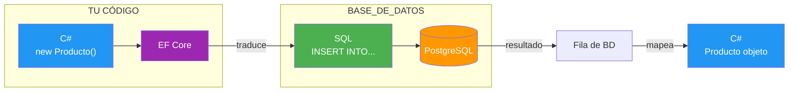
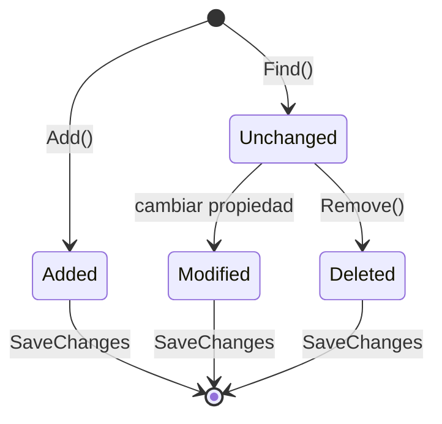
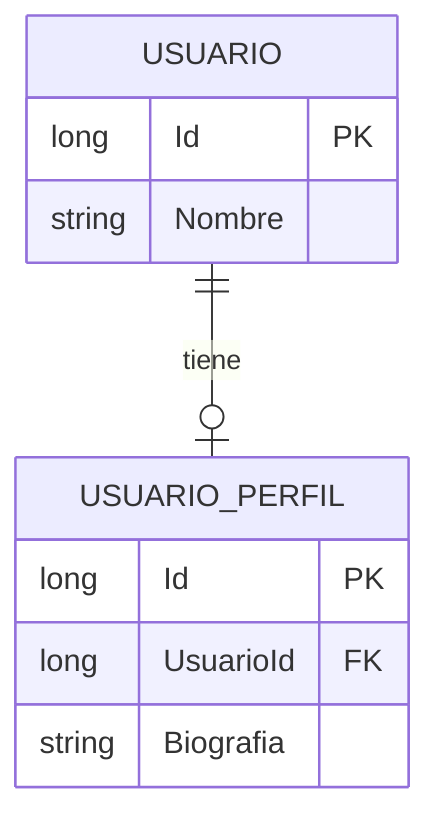
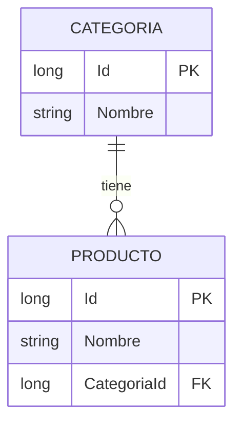
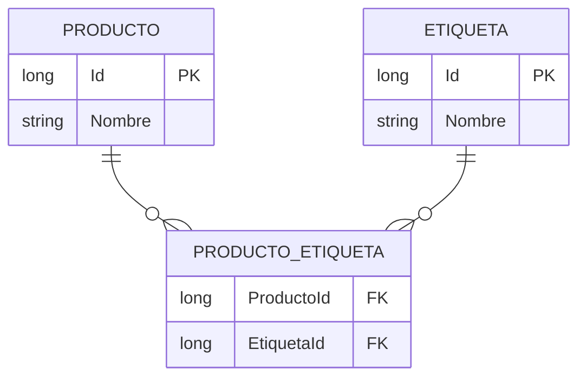
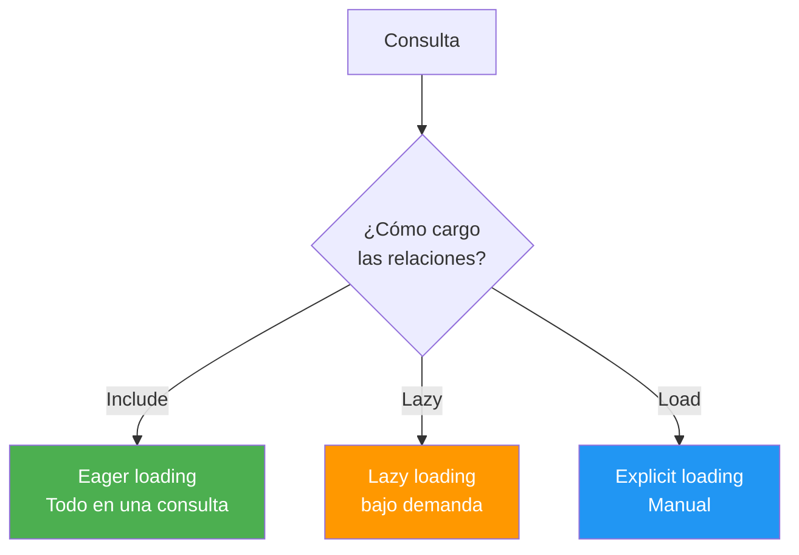
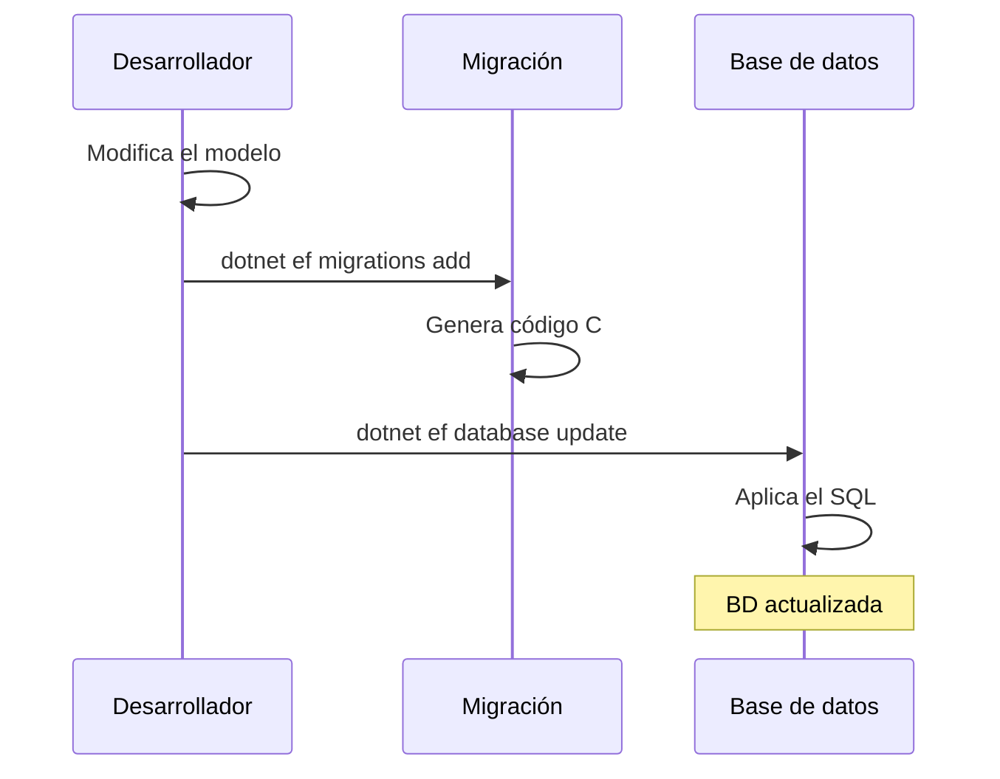

- [12. Entity Framework Core](#12-entity-framework-core)
  - [12.1. Fundamentos](#121-fundamentos)
    - [12.1.1. ¿Qué es un ORM?](#1211-qué-es-un-orm)
    - [12.1.2. DbContext](#1212-dbcontext)
    - [12.1.3. Change tracker](#1213-change-tracker)
    - [12.1.4. Ventajas de EF Core](#1214-ventajas-de-ef-core)
  - [12.2. Configuración inicial](#122-configuración-inicial)
    - [12.2.1. Paquetes NuGet](#1221-paquetes-nuget)
    - [12.2.2. Conexión y registro del DbContext](#1222-conexión-y-registro-del-dbcontext)
    - [12.2.3. EnsureCreated vs migraciones](#1223-ensurecreated-vs-migraciones)
  - [12.3. Configuración del modelo con data annotations](#123-configuración-del-modelo-con-data-annotations)
    - [12.3.1. Columnas y tipos](#1231-columnas-y-tipos)
    - [12.3.2. Claves y generación](#1232-claves-y-generación)
    - [12.3.3. Restricción única (UNIQUE)](#1233-restricción-única-unique)
    - [12.3.4. Atributos de validación: no los ejecuta EF Core](#1234-atributos-de-validación-no-los-ejecuta-ef-core)
    - [12.3.5. Tabla resumen](#1235-tabla-resumen)
  - [12.4. Configuración del modelo con fluent API](#124-configuración-del-modelo-con-fluent-api)
    - [12.4.1. Propiedades y columnas](#1241-propiedades-y-columnas)
    - [12.4.2. Claves y generación](#1242-claves-y-generación)
    - [12.4.3. Restricción única (UNIQUE)](#1243-restricción-única-unique)
    - [12.4.4. Restricciones de valor (CHECK)](#1244-restricciones-de-valor-check)
    - [12.4.5. Tablas y vistas](#1245-tablas-y-vistas)
    - [12.4.6. IEntityTypeConfiguration](#1246-ientitytypeconfiguration)
    - [12.4.7. Data annotations vs fluent API](#1247-data-annotations-vs-fluent-api)
    - [12.4.8. ¿Dónde especifico las cosas?](#1248-dónde-especifico-las-cosas)
  - [12.5. Relaciones entre entidades](#125-relaciones-entre-entidades)
    - [12.5.1. Uno a uno](#1251-uno-a-uno)
    - [12.5.2. Uno a muchos](#1252-uno-a-muchos)
    - [12.5.3. Muchos a muchos](#1253-muchos-a-muchos)
    - [12.5.4. Navegabilidad](#1254-navegabilidad)
    - [12.5.5. Comportamiento de borrado](#1255-comportamiento-de-borrado)
  - [12.6. Carga de datos](#126-carga-de-datos)
    - [12.6.1. Eager loading](#1261-eager-loading)
    - [12.6.2. Lazy loading](#1262-lazy-loading)
    - [12.6.3. Explicit loading](#1263-explicit-loading)
    - [12.6.4. AsSplitQuery](#1264-assplitquery)
  - [12.7. Consultas con LINQ](#127-consultas-con-linq)
    - [12.7.1. Básicas y condicionales](#1271-básicas-y-condicionales)
    - [12.7.2. Elemento único y agregación](#1272-elemento-único-y-agregación)
    - [12.7.3. Joins y subconsultas](#1273-joins-y-subconsultas)
    - [12.7.4. SQL nativo y ToQueryString](#1274-sql-nativo-y-toquerystring)
    - [12.7.5. AsNoTracking](#1275-asnotracking)
  - [12.8. Operaciones en lote](#128-operaciones-en-lote)
  - [12.9. Propiedades avanzadas](#129-propiedades-avanzadas)
    - [12.9.1. Owned types](#1291-owned-types)
    - [12.9.2. Value converters](#1292-value-converters)
    - [12.9.3. Shadow properties](#1293-shadow-properties)
    - [12.9.4. NotMapped y propiedades calculadas](#1294-notmapped-y-propiedades-calculadas)
  - [12.10. Repositorio CRUD](#1210-repositorio-crud)
    - [12.10.1. Entidad y configuración](#12101-entidad-y-configuración)
    - [12.10.2. Interfaz del repositorio](#12102-interfaz-del-repositorio)
    - [12.10.3. Operaciones CRUD](#12103-operaciones-crud)
    - [12.10.4. Borrado lógico](#12104-borrado-lógico)
  - [12.11. Migraciones](#1211-migraciones)
    - [12.11.1. Comandos básicos](#12111-comandos-básicos)
    - [12.11.2. Flujo de una migración](#12112-flujo-de-una-migración)
    - [12.11.3. Migración sobre BD existente](#12113-migración-sobre-bd-existente)
  - [12.12. Seed data y logging](#1212-seed-data-y-logging)
  - [12.13. Control de concurrencia](#1213-control-de-concurrencia)
  - [12.14. Testing con EF Core](#1214-testing-con-ef-core)
  - [12.15. Buenas prácticas](#1215-buenas-prácticas)
  - [12.16. Reto: repositorio CRUD con Entity Framework Core](#1216-reto-repositorio-crud-con-entity-framework-core)


# 12. Entity Framework Core

> 💡 **Punto de partida:** Cuando creas una tienda online, necesitas guardar productos, categorías y pedidos. ¿Los guardas en ficheros JSON? ¿En una base de datos SQL? Entity Framework Core es el ORM que hace que trabajar con bases de datos sea tan fácil como trabajar con objetos C#. Hablas en C# y él traduce a SQL por ti.

En este punto aprenderás qué es un ORM, cómo configurar EF Core con Data Annotations y Fluent API, cómo modelar relaciones, cargar datos, hacer consultas LINQ, gestionar migraciones y testear con bases de datos reales.

**Objetivos de aprendizaje:**

- Entender qué es un ORM y cómo EF Core traduce C# a SQL
- Configurar un DbContext con conexiones por entorno
- Usar Data Annotations y Fluent API para configurar el modelo
- Modelar relaciones (1-1, 1-N, N-M) con navegabilidad
- Cargar datos con Include, ThenInclude y lazy loading
- Crear migraciones y seed data
- Testear con TestContainers

## 12.1. Fundamentos

### 12.1.1. ¿Qué es un ORM?

Un **ORM** (Object-Relational Mapping) es un programita que traduce entre objetos C# y tablas de base de datos. En vez de escribir SQL a mano, trabajas con clases y el ORM genera las consultas SQL por ti.

📌 **Ejemplo real:** Netflix usa EF Core en sus microservicios para gestionar catálogos de contenido. Los desarrolladores trabajan con objetos C# y EF Core se encarga de generar el SQL optimizado.



**Sin ORM** (SQL puro): escribes SQL, lees el reader, mapeas a objetos manualmente. Con EF Core, todo eso lo hace el ORM por ti.

### 12.1.2. DbContext

El **DbContext** es la puerta de entrada a la base de datos. Es una sesión que rastrea entidades, genera SQL y gestiona el Change Tracker. Cada vez que necesitas acceder a la BD, usas un DbContext.

```csharp
public class AppDbContext(DbContextOptions<AppDbContext> options)
    : DbContext(options)
{
    // Tablas de la base de datos
    public DbSet<Producto> Productos => Set<Producto>();
    public DbSet<Categoria> Categorias => Set<Categoria>();

    // Configuración del modelo (Fluent API)
    protected override void OnModelCreating(ModelBuilder modelBuilder)
    {
        modelBuilder.Entity<Producto>(entity =>
        {
            entity.Property(p => p.Nombre).HasMaxLength(100).IsRequired();
            entity.Property(p => p.Precio).HasPrecision(18, 2);
        });
    }
}
```

> 📝 **Nota:** El DbContext se registra en la inyección de dependencias como **transitorio** o **scoped**: cada petición HTTP recibe una instancia nueva. Nunca lo registres como singleton.

### 12.1.3. Change tracker y metadatos

El **Change Tracker** monitoriza todas las entidades cargadas en el contexto. Cuando cambias una propiedad y llamas a `SaveChangesAsync()`, EF Core compara el estado actual con el original y genera el SQL correspondiente.



**Metadatos automáticos:** EF Core puede calcular campos como `CreatedAt` y `UpdatedAt` sin que tú los asignes a mano. Se configuran con `HasDefaultValueSql()` en fluent API o asignándolos en el constructor de la entidad.

```csharp
// El Change Tracker detecta el cambio automáticamente
var producto = await db.Productos.FindAsync(1);
producto!.Precio = 89.99m;  // Marcado como Modified
await db.SaveChangesAsync();  // Genera UPDATE
```

### 12.1.4. Ventajas de EF Core

| Ventaja | Descripción |
|---------|-------------|
| **Productividad** | No escribes SQL a mano |
| **LINQ** | Consultas en C# con tipado estático |
| **Migraciones** | Cambios de esquema versionados |
| **Change Tracker** | Detección automática de cambios |
| **Proveedores** | SQLite, PostgreSQL, SQL Server, MySQL |

## 12.2. Configuración inicial

### 12.2.1. Paquetes NuGet

Necesitas dos paquetes: el proveedor de base de datos y las herramientas de EF Core.

```bash
dotnet add package Microsoft.EntityFrameworkCore.Sqlite      # Para SQLite
dotnet add package Microsoft.EntityFrameworkCore.PostgreSQL   # Para PostgreSQL
dotnet add package Microsoft.EntityFrameworkCore.Tools        # Herramientas CLI
```

> 💡 **Consejo:** En desarrollo usa SQLite (rápido, sin servidor). En producción usa PostgreSQL o SQL Server. El código es el mismo; solo cambia el proveedor.

### 12.2.2. Conexión y registro del DbContext

La conexión se configura en `appsettings.json` y se registra en `Program.cs`:

```json
{
  "ConnectionStrings": {
    "Default": "Data Source=productos.db"
  }
}
```

```csharp
// Program.cs
builder.Services.AddDbContext<AppDbContext>(options =>
    options.UseSqlite(builder.Configuration.GetConnectionString("Default")));
```

### 12.2.3. EnsureCreated vs migraciones

Hay dos formas de crear la base de datos:

| Método | Cuándo usarlo | Limitación |
|--------|---------------|------------|
| `EnsureCreated()` | Prototipos y tests | No soporta migraciones |
| `Database.Migrate()` | Producción | Requiere migraciones |

```csharp
// Solo en desarrollo
if (app.Environment.IsDevelopment())
{
    using var scope = app.Services.CreateScope();
    var db = scope.ServiceProvider.GetRequiredService<AppDbContext>();
    db.Database.EnsureCreated();  // O Migrate()
}
```

> ⚠️ **Advertencia:** `EnsureCreated()` solo crea la BD si no existe. Si ya existe, **no la actualiza**: no añade columnas ni tablas nuevas. En producción, usa migraciones siempre.

## 12.3. Configuración del modelo con data annotations

Las **Data Annotations** son atributos C# que configuran el modelo directamente en las entidades. Son la forma más simple, pero tienen limitaciones.

### 12.3.1. Columnas y tipos

Los atributos de columna controlan cómo se mapea una propiedad C# a una columna de la BD. Puedes cambiar el nombre, la longitud y si admite null.

```csharp
public class Producto
{
    [Column("precio_producto")]   // Nombre de columna diferente
    [Required]                    // No permite null
    [StringLength(100)]           // Longitud máxima con validación
    public decimal Precio { get; set; }
}
```

> 📝 **Nota:** `[StringLength]` valida en el servidor; `[MaxLength]` solo configura el esquema. Si quieres validación, usa `[StringLength]`.

### 12.3.2. Claves y generación

La clave primaria identifica cada fila única de la tabla. `[Key]` la declara, y `[DatabaseGenerated]` controla cómo se genera el valor (auto-increment, calculado por BD, o manual).

```csharp
public class Producto
{
    [Key]                                              // Clave primaria
    [DatabaseGenerated(DatabaseGeneratedOption.Identity)]  // Auto-increment
    public long Id { get; set; }
}
```

> 💡 **Consejo:** Si la propiedad se llama `Id`, EF Core la detecta como clave primaria por convención. Solo necesitas `[Key]` si la propiedad tiene otro nombre.

### 12.3.3. Restricción única (UNIQUE)

Una restricción **UNIQUE** impide que dos filas tengan el mismo valor en una columna.

```csharp
using Microsoft.EntityFrameworkCore;

[Index(nameof(Nombre), IsUnique = true)]  // No puede haber dos con el mismo nombre
public class Producto
{
    public long Id { get; set; }
    public string Nombre { get; set; } = string.Empty;
}
```

> 📝 **Nota:** `[Index]` requiere `using Microsoft.EntityFrameworkCore;`. Para índices compuestos, usa `[Index(nameof(Nombre), nameof(CategoriaId), IsUnique = true)]`.

### 12.3.4. Atributos de validación: no los ejecuta EF Core

Las validaciones que aprendiste con los DTOs en el punto 08 (`[Range]`, `[EmailAddress]`, `[Phone]`, `[RegularExpression]`...) no sirven en EF Core. Si las copias a una entidad, el proyecto compila, pero `SaveChangesAsync` no las mira.

```csharp
// ❌ MALO: atributos de validación de DTO copiados en la entidad
public class Producto
{
    [Key]
    [StringLength(100)]           // Sí sirve: la columna será nvarchar(100)
    public string Nombre { get; set; } = string.Empty;

    [Range(0.01, 9999.99)]        // No sirve: EF Core no lo comprueba
    public decimal Precio { get; set; }

    [EmailAddress]                // No sirve: EF Core no lo comprueba
    public string? EmailContacto { get; set; }
}
```

Si guardas `EmailContacto = "no-es-un-email"` o `Precio = -5`, el `INSERT` se hace sin ninguna excepción y la fila se queda en la base de datos tal cual. Quién ejecuta esos atributos es la validación de modelos de ASP.NET Core (`ModelState`), y solo cuando el dato entra por una petición. Por eso se quedan en el DTO:

```csharp
// ✅ BUENO: la validación vive en el DTO, como en el punto 08
public class CreateProductoDto
{
    [Range(0.01, 9999.99, ErrorMessage = "El precio debe estar entre 0,01 y 9999,99")]
    public decimal Precio { get; set; }

    [EmailAddress(ErrorMessage = "El email no tiene un formato válido")]
    public string? EmailContacto { get; set; }
}
```

En la entidad solo tienen cabida los atributos de mapeo, que son los únicos que EF Core traduce a la base de datos:

| Atributos en la entidad | Qué hace EF Core con ellos |
|-------------------------|----------------------------|
| `[Key]`, `[Column]`, `[Table]`, `[ForeignKey]`, `[NotMapped]`, `[Index]` | Los traduce a esquema |
| `[Required]`, `[StringLength]`, `[MaxLength]` | Crea la columna `NOT NULL` y le da longitud |
| `[Range]`, `[EmailAddress]`, `[Phone]`, `[Url]`, `[RegularExpression]` | No hace nada por sí solo (sección 12.4.4) |

> ⚠️ **Advertencia:** un `[EmailAddress]` en la entidad no protege la base de datos: el email sin arroba entra igual. Si la base de datos tiene que rechazar el valor ella misma, eso no es una data annotation, es una restricción CHECK (sección 12.4.4).

### 12.3.5. Tabla resumen

| Atributo | Uso | Ejemplo |
|----------|-----|---------|
| `[Key]` | Clave primaria | `public long Id` |
| `[DatabaseGenerated(Identity)]` | Auto-increment | `public long Id` |
| `[Required]` | No permite null | `[Required] string Nombre` |
| `[StringLength(100)]` | Longitud máxima + validación | `[StringLength(80)]` |
| `[Column("nombre")]` | Nombre de columna | `[Column("precio_prod")]` |
| `[Table("tbl_prod")]` | Nombre de tabla | `[Table("tbl_productos")]` |
| `[Index(IsUnique = true)]` | Índice único | `[Index(nameof(Nombre), IsUnique = true)]` |
| `[ForeignKey("CatId")]` | Clave foránea | `[ForeignKey("Categoria")]` |
| `[NotMapped]` | No mapear a BD | `[NotMapped] string Temporal` |

> 📝 **Nota:** `[Range]`, `[EmailAddress]`, `[Phone]` o `[RegularExpression]` no aparecen en la tabla a propósito: son atributos de validación de los DTOs y EF Core no los ejecuta (sección 12.3.4).

## 12.4. Configuración del modelo con fluent API

La **Fluent API** configura el modelo mediante código en `OnModelCreating`. Es más potente que Data Annotations y separa la configuración de la entidad.

### 12.4.1. Propiedades y columnas

Los métodos de fluent API controlan las mismas propiedades que data annotations, pero con más opciones. `HasPrecision` es exclusivo de fluent API: define la precisión decimal exacta.

```csharp
protected override void OnModelCreating(ModelBuilder modelBuilder)
{
    modelBuilder.Entity<Producto>(entity =>
    {
        entity.Property(p => p.Nombre).HasMaxLength(100).IsRequired();
        entity.Property(p => p.Precio).HasPrecision(18, 2);
        entity.Property(p => p.Stock).HasDefaultValue(0);
        entity.Property(p => p.Precio).HasColumnName("precio_producto");
    });
}
```

> 📝 **Nota:** `HasPrecision(18, 2)` define 18 dígitos totales y 2 decimales. Sin esto, `decimal` puede fallar en algunas bases de datos.

### 12.4.2. Claves y generación

Fluent API permite declarar claves primarias, alternativas y controlar cómo se generan los valores. `HasAlternateKey` crea una restricción UNIQUE a nivel de BD.

```csharp
entity.HasKey(p => p.Id);                              // Clave primaria
entity.Property(p => p.Id).ValueGeneratedOnAdd();      // Auto-increment
entity.HasAlternateKey(p => p.Codigo);                 // Clave alternativa (UNIQUE)
```

### 12.4.3. Restricción única (UNIQUE)

Fluent API crea índices únicos con `HasIndex().IsUnique()`. Es más flexible que data annotations porque permite índices compuestos y nombres personalizados.

```csharp
entity.HasIndex(p => p.Nombre).IsUnique();                          // UNIQUE en una columna
entity.HasIndex(p => new { p.Nombre, p.CategoriaId }).IsUnique();   // UNIQUE compuesto
entity.HasIndex(p => p.Codigo).HasDatabaseName("IX_Codigo");       // Nombre personalizado
```

> 📝 **Nota:** `HasIndex` crea un índice; `IsUnique` lo hace único. Son métodos distintos: `HasAlternateKey` crea una clave alternativa (UNIQUE a nivel de BD), `HasIndex(...).IsUnique()` crea un índice único (más flexible).

### 12.4.4. Restricciones de valor (CHECK)

La única forma de que la base de datos rechace ella misma un valor inválido es la restricción CHECK: una expresión SQL que debe cumplirse en todas las filas de la tabla. Se define con fluent API, dentro de `ToTable`.

```csharp
protected override void OnModelCreating(ModelBuilder modelBuilder)
{
    modelBuilder.Entity<Producto>(entity =>
    {
        entity.ToTable(t =>
        {
            t.HasCheckConstraint("CK_Producto_Precio", "[Precio] >= 0.01");
            t.HasCheckConstraint("CK_Producto_Stock", "[Stock] >= 0");
        });
    });
}
```

Con este check en vigor, un `INSERT` con precio negativo falla en la propia base de datos, incluso si el SQL llega escrito a mano y se salta toda la aplicación. Es la garantía fuerte que el `[Range]` de data annotations no te daba.

El límite del CHECK es que la condición se escribe en SQL del proveedor: sirve para rangos y comparaciones, pero no para comprobar formatos como email o teléfono, porque no todas las bases de datos saben expresar regex. Como norma general, esos formatos se validan en la capa de entrada, en los DTOs del punto 08.

El CHECK que trae EF Core de serie solo sale de la fluent API: `[Range]` por sí mismo no genera nada en la base de datos. El paquete de la comunidad `EFCore.CheckConstraints` viene a cerrar ese hueco: permite que la regla viva al lado de la propiedad, en la entidad, y él se encarga de convertirla en CHECK de verdad. No hace magia: cuando el modelo se cierra, recorre los atributos de cada propiedad y añade un CHECK por cada regla que entiende, con nombre previsible del tipo `CK_Producto_Nombre_MinLength`. Se instala con `dotnet add package EFCore.CheckConstraints` y se activa una sola vez, justo detrás del proveedor:

```csharp
// Program.cs: primero el proveedor, después la traducción
options.UseSqlite(connectionString)
       .UseValidationCheckConstraints();
```

Los atributos que sabe traducir son estos:

| Atributo en la entidad | CHECK generado |
|------------------------|----------------|
| `[Range]` con valores del mismo tipo que la propiedad | `col BETWEEN mínimo AND máximo` |
| `[MinLength]`, `[StringLength(MinimumLength)]`, `[Required]` | `LENGTH(col) >= n` |
| `[AllowedValues]`, `[DeniedValues]` | `col IN (...)` y `col NOT IN (...)` |
| `[EmailAddress]`, `[Phone]`, `[Url]`, `[RegularExpression]` | regex, solo en cuatro motores |

La traducción tiene sus reglas, y conviene conocerlas antes de confiarse. `[Range]` solo genera CHECK cuando los valores del atributo y la propiedad son del mismo tipo exacto: sobre `int` o `double` va bien, sobre `decimal` no, porque el atributo admite `double` o `string` y el paquete no hace conversiones. Por eso el precio de arriba se quedó con su CHECK escrito a mano en la fluent API. Y el CHECK de formato no es gratis: se evalúa en cada escritura, por eso la activación permite desactivarlos con `UseValidationCheckConstraints(options => options.UseRegex(false))` si una regex complicada frena las inserciones.

La longitud y la regex también dependen del motor, y el paquete conoce a los cuatro más usados:

| Motor | Longitud | Regex |
|-------|----------|-------|
| **PostgreSQL** | `LENGTH` | `~` |
| **SQL Server** | `LEN` | `REGEXP_LIKE` con compatibilidad ≥ 170; si no, `dbo.RegexMatch` instalada a mano |
| **MySQL** | `LENGTH` | `REGEXP` |
| **SQLite** | `LENGTH` | `REGEXP` |
| **Otros** (Oracle, DB2...) | no genera el CHECK | no genera el CHECK |

En el resto de motores el paquete omite ese CHECK en silencio: no falla nada, pero la regla tampoco existe en la base de datos. El nombre de cada restricción sale por convención, con el patrón `CK_Tabla_Columna_MinLength`, y ese mismo nombre es la fuente del único error que el paquete puede provocar:

> ⚠️ **Advertencia:** No combines `[Required]` y `[StringLength]` sobre la misma propiedad. Los dos producen un CHECK con el mismo nombre, `CK_Tabla_Columna_MinLength`, y el paquete revienta al construir el modelo con un `InvalidOperationException`. En un string no nullable `[Required]` no aporta nada, la columna ya sale `NOT NULL`: quítalo y déjate solo `[StringLength(MinimumLength = 1)]`.

Antes de soltarlo hay un último detalle de la traducción: `[StringLength]` solo mira su `MinimumLength`, así que si no lleva mínimo genera un `LENGTH(col) >= 0` siempre verdadero. Si solo te interesa la longitud máxima, déjala en la fluent API con `HasMaxLength` y no la dupliques en la entidad.

> 📝 **Nota:** El paquete no sustituye a la fluent API: solo añade CHECK a partir de los atributos. Si una anotación y la fluent API se contradicen, sigue mandando la fluent API (sección 12.4.8).

> 💡 **Consejo:** Los tres niveles defienden el mismo dato en capas distintas: el DTO valida el formato al entrar, la entidad define el esquema de la columna y el CHECK garantiza el valor dentro de la base de datos.

### 12.4.5. Tablas y vistas

Fluent API permite mapear entidades a tablas y vistas de la BD. `ToView` es útil para leer datos de vistas sin modificarlas.

```csharp
entity.ToTable("tbl_productos");    // Nombre de tabla
entity.HasNoKey();                  // Para vistas (sin clave)
entity.ToView("vw_productos");      // Mapear a vista
```

### 12.4.6. IEntityTypeConfiguration

Para separar la configuración en clases dedicadas:

```csharp
public class ProductoConfiguration : IEntityTypeConfiguration<Producto>
{
    public void Configure(EntityTypeBuilder<Producto> builder)
    {
        builder.HasKey(p => p.Id);
        builder.Property(p => p.Nombre).HasMaxLength(100).IsRequired();
        builder.HasIndex(p => p.Nombre).IsUnique();
    }
}

// En el DbContext:
protected override void OnModelCreating(ModelBuilder modelBuilder)
{
    modelBuilder.ApplyConfigurationsFromAssembly(typeof(AppDbContext).Assembly);
}
```

> 💡 **Consejo:** Cuando tengas muchas entidades, usa `IEntityTypeConfiguration` para mantener `OnModelCreating` limpio.

### 12.4.7. Data annotations vs fluent API

| Criterio | Data Annotations | Fluent API |
|----------|-----------------|------------|
| **Sintaxis** | Atributos en la entidad | Código en OnModelCreating |
| **Potencia** | Limitada (lo básico) | Completa (todo) |
| **Separación** | Mezclado con la entidad | Separado en configuración |
| **UNIQUE** | `[Index(IsUnique = true)]` | `HasIndex(...).IsUnique()` |
| **CHECK (valor en BD)** | No existe | `ToTable(t => t.HasCheckConstraint(...))` |
| **Validación de formato** | No: va en el DTO (sección 12.3.4) | No: va en el DTO |
| **Relaciones** | `[ForeignKey]` | `HasOne().WithMany()` |
| **Recomendación** | Para lo simple | Para lo complejo |

### 12.4.8. ¿Dónde especifico las cosas?

La misma regla se puede escribir de las dos formas y en un proyecto real acaban conviviendo. Estas son las cuatro situaciones que se pueden plantear.

**Caso 1: solo data annotations.** Se aplican ellas.

```csharp
public class Producto
{
    [StringLength(60)]            // única fuente de la regla: columna de 60
    public string Origen { get; set; } = string.Empty;
}
```

**Caso 2: solo fluent API.** Se aplica ella.

```csharp
// En OnModelCreating
entity.Property(p => p.Web).HasMaxLength(40);   // única fuente: columna de 40
```

**Caso 3: las dos y se complementan.** Cada una configura una cosa distinta y las dos se aplican.

```csharp
public class Producto
{
    [Column("nombre_prod")]        // anotación: nombre de columna
    public string Nombre { get; set; } = string.Empty;
}

// En OnModelCreating
entity.Property(p => p.Nombre).HasMaxLength(80);   // fluent: longitud
```

El modelo final se queda con las dos cosas: la columna se llama `nombre_prod` y admite 80 caracteres.

**Caso 4: se contradicen.** Gana la fluent API, siempre. EF Core es la fuente de verdad del modelo y lo que se configure en `OnModelCreating` tiene precedencia absoluta sobre lo que digan los atributos; la anotación en conflicto queda ignorada.

```csharp
public class Producto
{
    [StringLength(100)]           // dice 100
    [Table("TablaAnotacion")]     // dice TablaAnotacion
    public string? Descripcion { get; set; }
}

// En OnModelCreating
entity.ToTable("TablaFluent");
entity.Property(p => p.Descripcion).HasMaxLength(50);   // dice 50
```

La tabla se llama `TablaFluent` y la columna admite 50. La anotación no se aplica, y de paso no se entera ni el que la escribió.

| Situación | Qué manda |
|-----------|-----------|
| **Solo data annotations** | Las anotaciones |
| **Solo fluent API** | La fluent API |
| **Las dos, sin pisarse** | Las dos: cada una configura lo suyo |
| **Las dos, contradiciéndose** | La fluent API |

> ⚠️ **Advertencia:** la contradicción no produce ningún error ni aviso: el modelo funciona igual y el valor de la anotación simplemente no se usa. Si cambias un `[StringLength]` pensando que se nota, y encima hay otra configuración en `OnModelCreating`, no cambia nada.

> 💡 **Consejo:** Un estilo mixto y ordenado: anotaciones para lo básico en la entidad (`[Key]`, `[Required]`, `[StringLength]`) y fluent API en `IEntityTypeConfiguration` para todo lo demás. Y si quieres mirar qué decide el modelo final de verdad, en cualquier sitio tienes `db.Model.FindEntityType(typeof(Producto)).FindProperty(nameof(Producto.Descripcion)).GetMaxLength()`, que devuelve `50`.

## 12.5. Relaciones entre entidades

Una relación describe cómo se conectan dos tablas. EF Core las detecta por convención (propiedad de navegación + clave foránea), pero puedes configurarlas con Data Annotations o Fluent API.

### 12.5.1. Uno a uno

Un registro de la tabla A se asocia con exactamente un registro de la tabla B. Ejemplo: un usuario tiene un perfil.



**Modelo:**

```csharp
public class Usuario
{
    public long Id { get; set; }
    public string Nombre { get; set; } = string.Empty;
    public UsuarioPerfil? Perfil { get; set; }
}

public class UsuarioPerfil
{
    public long Id { get; set; }
    public string Biografia { get; set; } = string.Empty;
    public long UsuarioId { get; set; }
    public Usuario Usuario { get; set; } = null!;
}
```

**Data Annotations:**

```csharp
public class UsuarioPerfil
{
    public long Id { get; set; }
    public string Biografia { get; set; } = string.Empty;
    public long UsuarioId { get; set; }

    [ForeignKey(nameof(UsuarioId))]
    public Usuario Usuario { get; set; } = null!;
}
```

**Fluent API:**

```csharp
builder.Entity<UsuarioPerfil>()
    .HasOne(p => p.Usuario)
    .WithOne(u => u.Perfil)
    .HasForeignKey<UsuarioPerfil>(p => p.UsuarioId);
```

> 📝 **Nota:** La clave foránea vive en `UsuarioPerfil`, no en `Usuario`. Así, la relación es "cada perfil apunta a un usuario".

### 12.5.2. Uno a muchos

Un registro de la tabla A se asocia con muchos registros de la tabla B. Ejemplo: una categoría tiene muchos productos.



**Modelo:**

```csharp
public class Categoria
{
    public long Id { get; set; }
    public string Nombre { get; set; } = string.Empty;
    public ICollection<Producto> Productos { get; set; } = [];
}

public class Producto
{
    public long Id { get; set; }
    public string Nombre { get; set; } = string.Empty;
    public long CategoriaId { get; set; }
    public Categoria Categoria { get; set; } = null!;
}
```

**Data Annotations:**

```csharp
public class Producto
{
    public long Id { get; set; }
    public string Nombre { get; set; } = string.Empty;
    public long CategoriaId { get; set; }

    [ForeignKey(nameof(CategoriaId))]
    public Categoria Categoria { get; set; } = null!;
}
```

**Fluent API:**

```csharp
builder.Entity<Producto>()
    .HasOne(p => p.Categoria)
    .WithMany(c => c.Productos)
    .HasForeignKey(p => p.CategoriaId);
```

**Cómo se usa:**

```csharp
var categoria = await db.Categorias
    .Include(c => c.Productos)
    .FirstOrDefaultAsync(c => c.Id == 1);
```

### 12.5.3. Muchos a muchos

Muchos registros de A se asocian con muchos de B. Ejemplo: un producto tiene muchas etiquetas.



**Modelo con tabla intermedia:**

```csharp
public class Producto
{
    public long Id { get; set; }
    public string Nombre { get; set; } = string.Empty;
    public ICollection<ProductoEtiqueta> ProductoEtiquetas { get; set; } = [];
}

public class Etiqueta
{
    public long Id { get; set; }
    public string Nombre { get; set; } = string.Empty;
    public ICollection<ProductoEtiqueta> ProductoEtiquetas { get; set; } = [];
}

public class ProductoEtiqueta
{
    public long ProductoId { get; set; }
    public Producto Producto { get; set; } = null!;
    public long EtiquetaId { get; set; }
    public Etiqueta Etiqueta { get; set; } = null!;
}
```

**Data Annotations:**

```csharp
public class ProductoEtiqueta
{
    [Key]
    public long ProductoId { get; set; }

    [Key]
    public long EtiquetaId { get; set; }

    public Producto Producto { get; set; } = null!;
    public Etiqueta Etiqueta { get; set; } = null!;
}
```

**Fluent API:**

```csharp
builder.Entity<ProductoEtiqueta>()
    .HasOne(pe => pe.Producto)
    .WithMany(p => p.ProductoEtiquetas)
    .HasForeignKey(pe => pe.ProductoId);

builder.Entity<ProductoEtiqueta>()
    .HasOne(pe => pe.Etiqueta)
    .WithMany(e => e.ProductoEtiquetas)
    .HasForeignKey(pe => pe.EtiquetaId);
```

**Cómo se usa:**

```csharp
var producto = await db.Productos
    .Include(p => p.ProductoEtiquetas)
        .ThenInclude(pe => pe.Etiqueta)
    .FirstOrDefaultAsync(p => p.Id == 1);
```

> 📝 **Nota:** `ThenInclude` carga la relación segundo nivel: primero los `ProductoEtiquetas`, y después cada `Etiqueta`.

### 12.5.4. Navegabilidad

La **navegabilidad** es la capacidad de ir de una entidad a sus relaciones sin SQL. Funciona en ambas direcciones:

| Dirección | Ejemplo | Carga |
|-----------|---------|-------|
| Hacia adelante | `producto.Categoria` | `Include(p => p.Categoria)` |
| Hacia atrás | `categoria.Productos` | `Include(c => c.Productos)` |

### 12.5.5. Comportamiento de borrado

Cuando borras una entidad padre, ¿qué pasa con las hijas?

| Comportamiento | Qué hace | Ejemplo |
|----------------|----------|---------|
| `Cascade` | Borra las hijas automáticamente | Borrar categoría → se borran sus productos |
| `Restrict` | Impide borrar si hay hijas | No puedes borrar categoría con productos |
| `SetNull` | Pone la FK a null | Borrar categoría → productos sin categoría |
| `SetDefault` | Pone la FK a su valor por defecto | Borrar categoría → productos con FK=0 |

**Fluent API:**

```csharp
builder.Entity<Producto>()
    .HasOne(p => p.Categoria)
    .WithMany(c => c.Productos)
    .HasForeignKey(p => p.CategoriaId)
    .OnDelete(DeleteBehavior.Restrict);  // No borrar si hay productos
```

> ⚠️ **Advertencia:** `Cascade` es el comportamiento **por defecto**. Si no lo configuras, borrar una categoría borra todos sus productos. En producción, casi siempre quieres `Restrict` o `SetNull`.

## 12.6. Carga de datos

Cuando tienes relaciones, necesitas decidir cómo cargarlas.



### 12.6.1. Eager loading

**Carga todo en una sola consulta** con `Include` y `ThenInclude`.

```csharp
// Una consulta: productos + categorías
var productos = await db.Productos
    .Include(p => p.Categoria)
    .AsNoTracking()
    .ToListAsync();

// Con relación segundo nivel
var productos = await db.Productos
    .Include(p => p.Categoria)
        .ThenInclude(c => c.Subcategoria)
    .ToListAsync();
```

> 📝 **Nota:** `ThenInclude` carga la relación **siguiente** en la cadena. Sin él, `producto.Categoria.Subcategoria` sería null.

### 12.6.2. Lazy loading

**Carga las relaciones bajo demanda** cuando accedes a la propiedad. Requiere proxies:

```csharp
// Instalación: dotnet add package Microsoft.EntityFrameworkCore.Proxies
// En el DbContext: options.UseLazyLoadingProxies();

var producto = await db.Productos.FirstOrDefaultAsync(p => p.Id == 1);
Console.WriteLine(producto!.Categoria.Nombre);  // ← Carga aquí
```

> ⚠️ **Advertencia:** Lazy loading puede causar el problema N+1: una consulta por cada relación. En producción, usa eager loading con `Include`.

### 12.6.3. Explicit loading

**Carga manual** cuando ya tienes la entidad:

```csharp
var producto = await db.Productos.FirstOrDefaultAsync(p => p.Id == 1);

await db.Entry(producto!)
    .Reference(p => p.Categoria)
    .LoadAsync();
```

### 12.6.4. AsSplitQuery

Con muchos `Include`, EF Core genera un JOIN enorme. `AsSplitQuery` divide la consulta:

```csharp
var productos = await db.Productos
    .Include(p => p.Categoria)
    .Include(p => p.ProductoEtiquetas)
        .ThenInclude(pe => pe.Etiqueta)
    .AsSplitQuery()  // Divide en varias consultas
    .ToListAsync();
```

## 12.7. Consultas con LINQ

EF Core convierte consultas LINQ a SQL. Siempre son asíncronas (`await`).

### 12.7.1. Básicas y condicionales

Las consultas básicas filtran, ordenan y devuelven listas. LINQ genera el SQL equivalente automáticamente.

```csharp
// Todos los productos
var todos = await db.Productos.ToListAsync();

// Filtrar con Where
var caros = await db.Productos
    .Where(p => p.Precio > 100)
    .OrderByDescending(p => p.Precio)
    .ToListAsync();

// Condición compuesta
var filtrados = await db.Productos
    .Where(p => p.Stock > 0 && p.CategoriaId == 1)
    .ToListAsync();
```

### 12.7.2. Elemento único y agregación

Estos métodos devuelven un solo valor o agregado en vez de una lista. Son más eficientes porque el SQL hace el cálculo.

```csharp
// Primer elemento que cumple la condición
var producto = await db.Productos.FirstOrDefaultAsync(p => p.Id == 1);

// Contar
var total = await db.Productos.CountAsync();

// Suma
var suma = await db.Productos.SumAsync(p => p.Precio);

// Agrupar
var porCategoria = await db.Productos
    .GroupBy(p => p.CategoriaId)
    .Select(g => new { CategoriaId = g.Key, Total = g.Count() })
    .ToListAsync();
```

### 12.7.3. Joins y subconsultas

LINQ hace joins implícitos cuando usas propiedades de navegación. Para subconsultas, usas la propiedad `DbSet` dentro de `Where`.

```csharp
// Join implícito (por navegación)
var productos = await db.Productos
    .Include(p => p.Categoria)
    .Where(p => p.Categoria!.Nombre == "Periféricos")
    .ToListAsync();

// Subconsulta
var caros = await db.Productos
    .Where(p => p.Precio > db.Productos.Average(x => x.Precio))
    .ToListAsync();
```

### 12.7.4. SQL nativo y ToQueryString

Cuando LINQ no llega, puedes escribir SQL nativo con `FromSqlRaw`. Y `ToQueryString` te permite ver qué SQL genera LINQ.

```csharp
// Ver el SQL generado
var query = db.Productos.Where(p => p.Precio > 100);
Console.WriteLine(query.ToQueryString());
// SELECT p.Id, p.Nombre FROM Productos WHERE p.Precio > 100

// SQL nativo
var productos = await db.Productos
    .FromSqlRaw("SELECT * FROM Productos WHERE Precio > {0}", 100)
    .ToListAsync();
```

### 12.7.5. AsNoTracking

Para consultas de solo lectura, `AsNoTracking` mejora el rendimiento porque EF Core no rastrea las entidades.

```csharp
// Con tracking (por defecto): EF Core monitoriza los cambios
var conTracking = await db.Productos.ToListAsync();

// Sin tracking: más rápido, no detecta cambios
var sinTracking = await db.Productos.AsNoTracking().ToListAsync();
```

> 💡 **Consejo:** Usa `AsNoTracking` siempre que solo vayas a leer datos y no vayas a modificarlos.

## 12.8. Operaciones en lote

`ExecuteUpdate` y `ExecuteDelete` ejecutan SQL directo sin cargar entidades:

```csharp
// Actualizar precios en lote
await db.Productos
    .Where(p => p.CategoriaId == 1)
    .ExecuteUpdateAsync(s => s.SetProperty(p => p.Precio, p => p.Precio * 0.9m));

// Borrar en lote
await db.Productos
    .Where(p => p.Stock == 0)
    .ExecuteDeleteAsync();
```

> 📝 **Nota:** Estas operaciones ejecutan SQL directo. No pasan por el Change Tracker ni disparan eventos de guardado.

## 12.9. Propiedades avanzadas

### 12.9.1. Owned types

Permiten embeber un tipo dentro de otro (composición real):

```csharp
public class Direccion
{
    public string Calle { get; set; } = string.Empty;
    public string Ciudad { get; set; } = string.Empty;
}

public class Usuario
{
    public long Id { get; set; }
    public string Nombre { get; set; } = string.Empty;
    public Direccion Direccion { get; set; } = null!;
}

// Configuración
modelBuilder.Entity<Usuario>()
    .OwnsOne(u => u.Direccion);
```

### 12.9.2. Value converters

Convierten tipos de CLR a tipos de BD:

```csharp
modelBuilder.Entity<Producto>()
    .Property(p => p.Estado)
    .HasConversion<string>();  // Enum → string en la BD
```

### 12.9.3. Shadow properties

Propiedades que existen en el modelo pero no en la clase:

```csharp
modelBuilder.Entity<Producto>()
    .Property<string>("CodigoInterno");  // Existe en BD, no en la clase
```

### 12.9.4. NotMapped y propiedades calculadas

`[NotMapped]` indica que una propiedad no se mapea a la BD. Las propiedades calculadas (sin setter) tampoco se mapean automáticamente.

```csharp
public class Producto
{
    public long Id { get; set; }
    public decimal Precio { get; set; }
    public decimal Iva { get; set; }

    [NotMapped]           // No se mapea a la BD
    public string Temporal { get; set; } = "";

    // Calculada: EF Core la ignora porque no tiene setter
    public decimal PrecioConIva => Precio * (1 + Iva);
}
```

## 12.10. Repositorio CRUD

### 12.10.1. Entidad y configuración

La entidad `Producto` solo lleva atributos de mapeo; los de validación se quedan en el DTO (sección 12.3.4). Los metadatos (`CreatedAt`, `UpdatedAt`) se asignan automáticamente en el constructor.

```csharp
public class Producto
{
    [Key]
    [DatabaseGenerated(DatabaseGeneratedOption.Identity)]
    public long Id { get; set; }

    [Required]
    [StringLength(100)]
    public string Nombre { get; set; } = string.Empty;

    [Required]
    public decimal Precio { get; set; }

    public long CategoriaId { get; set; }
    public Categoria Categoria { get; set; } = null!;

    public bool IsDeleted { get; set; }
    public DateTime CreatedAt { get; set; }
    public DateTime? UpdatedAt { get; set; }
}
```

### 12.10.2. Interfaz del repositorio

La interfaz define las operaciones que el repositorio ofrece. Todos los métodos son asíncronos porque la BD es una operación de E/S.

```csharp
public interface IProductoRepository
{
    Task<IReadOnlyList<Producto>> GetAllAsync();
    Task<Producto?> GetByIdAsync(long id);
    Task<Producto> AddAsync(Producto producto);
    Task<Producto?> UpdateAsync(Producto producto);
    Task<bool> DeleteAsync(long id);
    Task<bool> SoftDeleteAsync(long id);
}
```

### 12.10.3. Operaciones CRUD

Todos los métodos son **asíncronos**: la BD es una operación de E/S que no debe bloquear el hilo.

```csharp
public class ProductoRepository(AppDbContext db) : IProductoRepository
{
    public async Task<IReadOnlyList<Producto>> GetAllAsync() =>
        await db.Productos.AsNoTracking().Include(p => p.Categoria).ToListAsync();

    public async Task<Producto?> GetByIdAsync(long id) =>
        await db.Productos.AsNoTracking().Include(p => p.Categoria)
            .FirstOrDefaultAsync(p => p.Id == id);

    public async Task<Producto> AddAsync(Producto producto)
    {
        producto.CreatedAt = DateTime.UtcNow;
        await db.Productos.AddAsync(producto);
        await db.SaveChangesAsync();
        return producto;
    }

    public async Task<Producto?> UpdateAsync(Producto producto)
    {
        var existente = await db.Productos.FindAsync(producto.Id);
        if (existente is null) return null;

        existente.Nombre = producto.Nombre;
        existente.Precio = producto.Precio;
        existente.UpdatedAt = DateTime.UtcNow;

        await db.SaveChangesAsync();
        return existente;
    }

    public async Task<bool> DeleteAsync(long id)
    {
        var producto = await db.Productos.FindAsync(id);
        if (producto is null) return false;

        db.Productos.Remove(producto);
        await db.SaveChangesAsync();
        return true;
    }
}
```

> ⚠️ **Advertencia:** Nunca uses `.Result` ni `.Wait()` para esperar un método asíncrono: bloquea el hilo y puede causar deadlocks. Usa siempre `await`.

### 12.10.4. Borrado lógico

El borrado lógico no borra el registro: marca un flag y lo oculta con un Query Filter.

```csharp
public async Task<bool> SoftDeleteAsync(long id)
{
    var producto = await db.Productos.FindAsync(id);
    if (producto is null) return false;

    producto.IsDeleted = true;
    await db.SaveChangesAsync();
    return true;
}

// Query Filter: todas las consultas excluyen los borrados
protected override void OnModelCreating(ModelBuilder modelBuilder)
{
    modelBuilder.Entity<Producto>().HasQueryFilter(p => !p.IsDeleted);
}
```

> 💡 **Consejo:** Para ver los registros borrados lógicamente, usa `IgnoreQueryFilters()`.

## 12.11. Migraciones

Las migraciones versionan el esquema de la base de datos.

### 12.11.1. Comandos básicos

Estos son los comandos que usarás habitualmente con `dotnet ef`. El más importante es `add` (crea la migración) y `update` (la aplica).

```bash
dotnet ef migrations add AddProductoTable   # Crear migración
dotnet ef database update                    # Aplicar migraciones
dotnet ef migrations list                    # Ver migraciones aplicadas
dotnet ef database update Previous           # Rollback
dotnet ef migrations remove                  # Eliminar última migración
dotnet ef migrations script                  # Generar SQL sin ejecutar
```

### 12.11.2. Flujo de una migración

El flujo completo es: modificar el modelo, generar la migración, aplicarla a la BD.



### 12.11.3. Migración sobre BD existente

Si la BD ya existe y usabas `EnsureCreated()`, necesitas una migración baseline:

```bash
dotnet ef migrations add InitialCreate
dotnet ef database update
```

O en `Program.cs`:

```csharp
if (app.Environment.IsDevelopment())
{
    using var scope = app.Services.CreateScope();
    var db = scope.ServiceProvider.GetRequiredService<AppDbContext>();
    db.Database.Migrate();  // Aplica migraciones pendientes
}
```

## 12.12. Seed data y logging

**Seed data** inserta datos iniciales:

```csharp
if (!db.Productos.Any())
{
    db.Productos.AddRange(
        new Producto { Nombre = "Teclado", Precio = 79.90m },
        new Producto { Nombre = "Ratón", Precio = 39.50m }
    );
    await db.SaveChangesAsync();
}
```

**Logging** muestra las consultas SQL en consola:

```csharp
builder.Logging.AddFilter("Microsoft.EntityFrameworkCore", LogLevel.Information);
```

## 12.13. Control de concurrencia

La concurrencia optimista detecta si otro usuario modificó el registro antes de guardarlo:

```csharp
// PostgreSQL: usar xmin
modelBuilder.Entity<Producto>()
    .Property<uint>("Xmin").HasColumnName("xmin").HasColumnType("xid").IsRowVersion();

// SQL Server: usar RowVersion
modelBuilder.Entity<Producto>()
    .Property(p => p.RowVersion).IsRowVersion();
```

## 12.14. Testing con EF Core

### 12.14.1. InMemory database

Para tests rápidos sin Docker:

```csharp
var options = new DbContextOptionsBuilder<AppDbContext>()
    .UseInMemoryDatabase("test")
    .Options;
```

### 12.14.2. TestContainers

Para tests con base de datos real en Docker:

```csharp
var container = new PostgreSqlBuilder("postgres:17-alpine")
    .WithDatabase("test")
    .Build();
await container.StartAsync();
```

## 12.15. Buenas prácticas

- **Siempre async**: `await db.SaveChangesAsync()`, nunca `.Result`
- **Valida en el DTO**: no pongas `[EmailAddress]`, `[Range]` ni `[Phone]` en la entidad; EF Core no los ejecuta
- **CHECK para la garantía final**: `HasCheckConstraint` cuando la base de datos tiene que rechazar el valor ella misma
- **AsNoTracking en lecturas**: más rendimiento cuando no modificas
- **Migraciones en desarrollo, no EnsureCreated en producción**
- **IEntityTypeConfiguration** para separar configuración de entidades
- **Query Filters** para borrado lógico, no filtrar a mano en cada consulta
- **TestContainers** para tests con BD real en CI

## 12.16. Reto: repositorio CRUD con Entity Framework Core

> Monta un repositorio CRUD completo para FunkoApp, con borrado lógico, migraciones y tests de integración con Docker.

### 12.16.1. Contexto

**Paso 0:** parte de la API de FunkoApp que ya funcione con funkos en memoria (punto 07 o 08). Ahora toca persistir en una base de datos real con EF Core y SQLite (desarrollo) o PostgreSQL (producción).

### 12.16.2. Modelo de datos

**Modelo Funko:**

| Propiedad | Tipo | Obligatorio |
|-----------|------|:-----------:|
| `id` | int | Sí (autogenerado) |
| `nombre` | string | Sí |
| `precio` | decimal | Sí |
| `stock` | int | Sí |
| `categoriaId` | int | Sí (FK) |
| `isDeleted` | bool | Sí (default false) |
| `createdAt` | DateTime | Sí (autogenerado) |
| `updatedAt` | DateTime? | No |

**Modelo Categoria:**

| Propiedad | Tipo | Obligatorio |
|-----------|------|:-----------:|
| `id` | int | Sí (autogenerado) |
| `nombre` | string | Sí |
| `descripcion` | string? | No |

### 12.16.3. Almacenamiento

- **Base de datos:** SQLite en desarrollo, PostgreSQL en producción
- **Migraciones:** aplicar automáticamente en desarrollo
- **Seed Data:** 5 Funkos y 3 Categorías de ejemplo
- **Query Filter:** filtrado automático de `isDeleted`

### 12.16.4. Retos

1. **Modelo:** crear `Funko` y `Categoria` con relación Uno a Muchos
2. **DbContext:** configurar con Fluent API, Query Filter para borrado lógico
3. **Repositorio:** Create, GetAll, GetById, Update, Delete (lógico), Restore
4. **Migraciones:** generar y aplicar, comprobar que la BD se crea
5. **Seed Data:** insertar 5 Funkos y 3 Categorías al arrancar
6. **Tests:** con TestContainers, probar Create, GetById, GetAll, Delete lógico

**Puntos extra:**

- Value Converters para enumeraciones
- Concurrencia optimista con `xmin` (PostgreSQL)
- ExecuteUpdate para actualizar precios en lote


**Resumen del punto:**

| Concepto | Descripción |
|----------|-------------|
| **ORM** | Mapeo objeto-relacional que traduce C# a SQL |
| **DbContext** | Sesión con la base de datos |
| **DbSet\<T\>** | Colección de entidades |
| **Data Annotations** | Atributos para configurar el modelo |
| **Fluent API** | Configuración potente en OnModelCreating |
| **CHECK** | Restricción de valor que garantiza la base de datos |
| **Validación de valores** | Va en el DTO; EF Core no ejecuta `[EmailAddress]` ni `[Range]` |
| **Relaciones** | Uno a Uno, Uno a Muchos, Muchos a Muchos |
| **Eager Loading** | Carga relaciones con Include/ThenInclude |
| **AsNoTracking** | Mejor rendimiento en solo lectura |
| **Migraciones** | Cambios de esquema controlados |
| **Query Filters** | Filtros automáticos (borrado lógico) |
| **TestContainers** | Tests con BD real en Docker |

**¿Qué viene después?**

En el siguiente punto veremos **MongoDB**: una base de datos NoSQL orientada a documentos que no usa tablas ni SQL. Verás cómo trabajar con colecciones de documentos JSON y cómo muchos conceptos de EF Core tienen su equivalente en el mundo NoSQL.