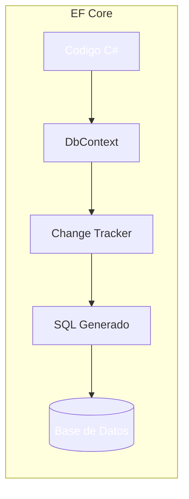
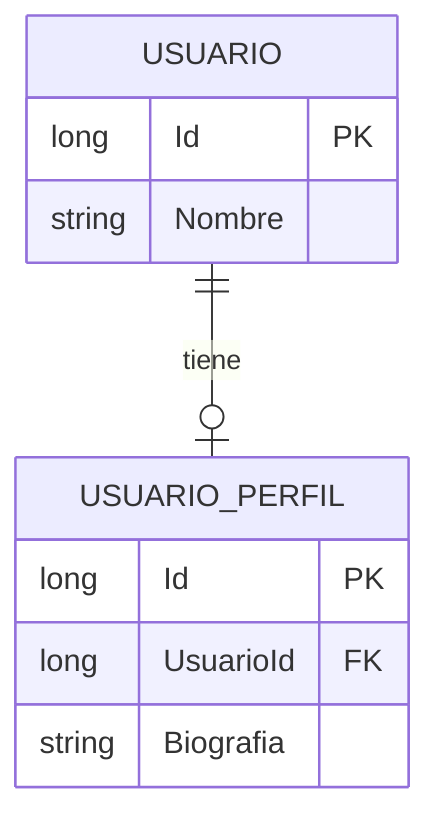
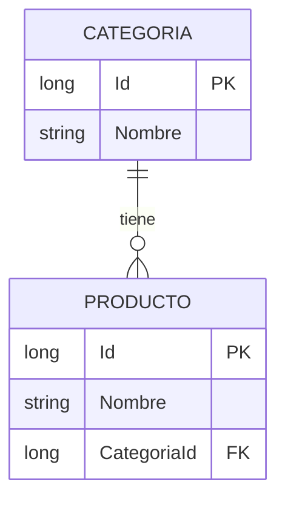
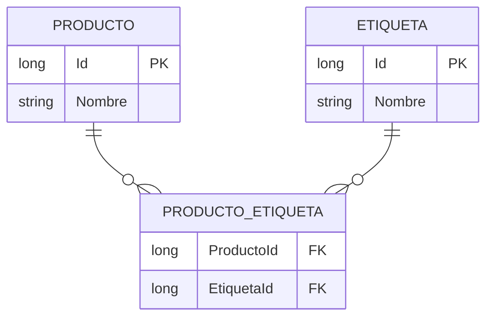
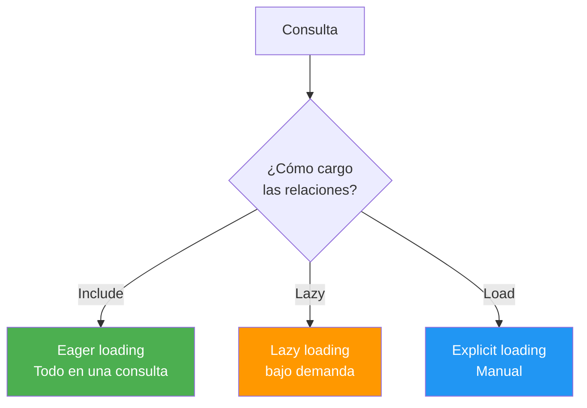
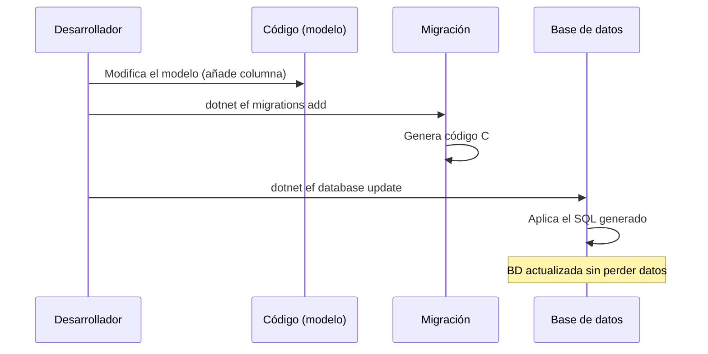

- [12. Entity Framework Core](#12-entity-framework-core)
  - [12.1. Fundamentos](#121-fundamentos)
    - [12.1.1. ¿Qué es un ORM?](#1211-qué-es-un-orm)
    - [12.1.2. DbContext](#1212-dbcontext)
    - [12.1.3. Componentes del DbContext](#1213-componentes-del-dbcontext)
    - [12.1.4. Ventajas de EF Core](#1214-ventajas-de-ef-core)
    - [12.1.5. Change tracker](#1215-change-tracker)
  - [12.2. Configuración inicial](#122-configuración-inicial)
    - [12.2.1. Paquetes NuGet](#1221-paquetes-nuget)
    - [12.2.2. Conexión](#1222-conexión)
    - [12.2.3. Registro del DbContext](#1223-registro-del-dbcontext)
    - [12.2.4. EnsureCreated vs migrate](#1224-ensurecreated-vs-migrate)
  - [12.3. Data annotations](#123-data-annotations)
    - [12.3.1. Atributos de columna](#1231-atributos-de-columna)
    - [12.3.2. Atributos de clave](#1232-atributos-de-clave)
    - [12.3.3. Atributos de tabla](#1233-atributos-de-tabla)
    - [12.3.4. Atributos de concurrencia](#1234-atributos-de-concurrencia)
    - [12.3.5. Atributos de generación](#1235-atributos-de-generación)
    - [12.3.6. Tabla resumen](#1236-tabla-resumen)
  - [12.4. Fluent API](#124-fluent-api)
    - [12.4.1. Propiedades](#1241-propiedades)
    - [12.4.2. Claves](#1242-claves)
    - [12.4.3. Tablas y vistas](#1243-tablas-y-vistas)
    - [12.4.4. Relaciones](#1244-relaciones)
    - [12.4.5. IEntityTypeConfiguration](#1245-ientitytypeconfiguration)
    - [12.4.6. Data annotations vs fluent API](#1246-data-annotations-vs-fluent-api)
  - [12.5. Relaciones](#125-relaciones)
    - [12.5.1. Uno a uno](#1251-uno-a-uno)
    - [12.5.2. Uno a muchos](#1252-uno-a-muchos)
    - [12.5.3. Muchos a muchos](#1253-muchos-a-muchos)
    - [12.5.4. Navegabilidad](#1254-navegabilidad)
    - [12.5.5. Cascada (DeleteBehavior)](#1255-cascada-deletebehavior)
  - [12.6. Owned types](#126-owned-types)
  - [12.7. Value converters](#127-value-converters)
  - [12.8. Shadow properties](#128-shadow-properties)
  - [12.9. NotMapped y propiedades calculadas](#129-notmapped-y-propiedades-calculadas)
  - [12.10. Carga de datos](#1210-carga-de-datos)
    - [12.10.1. Eager loading](#12101-eager-loading)
    - [12.10.2. Lazy loading](#12102-lazy-loading)
    - [12.10.3. Explicit loading](#12103-explicit-loading)
    - [12.10.4. AsSplitQuery](#12104-assplitquery)
  - [12.11. Consultas con LINQ](#1211-consultas-con-linq)
    - [12.11.1. Básicas](#12111-básicas)
    - [12.11.2. Elemento único](#12112-elemento-único)
    - [12.11.3. Condicionales](#12113-condicionales)
    - [12.11.4. Joins explícitos](#12114-joins-explícitos)
    - [12.11.5. GroupBy y agregación](#12115-groupby-y-agregación)
    - [12.11.6. Subconsultas](#12116-subconsultas)
    - [12.11.7. ToQueryString](#12117-toquerystring)
    - [12.11.8. AsNoTracking](#12118-asnotracking)
    - [12.11.9. SQL nativo](#12119-sql-nativo)
  - [12.12. ExecuteUpdate y ExecuteDelete](#1212-executeupdate-y-executedelete)
  - [12.13. Repositorio CRUD](#1213-repositorio-crud)
    - [12.13.1. Entidad y configuración](#12131-entidad-y-configuración)
    - [12.13.2. Interfaz del repositorio](#12132-interfaz-del-repositorio)
    - [12.13.3. Create, GetById, GetAll, update](#12133-create-getbyid-getall-update)
    - [12.13.4. Borrado físico](#12134-borrado-físico)
    - [12.13.5. Borrado lógico](#12135-borrado-lógico)
    - [12.13.6. Consultas típicas](#12136-consultas-típicas)
  - [12.14. Migraciones](#1214-migraciones)
    - [12.14.1. Migraciones sobre una BD existente (baseline)](#12141-migraciones-sobre-una-bd-existente-baseline)
  - [12.15. Seed data](#1215-seed-data)
  - [12.16. Logging](#1216-logging)
  - [12.17. Control de concurrencia](#1217-control-de-concurrencia)
  - [12.18. Testing con EF Core](#1218-testing-con-ef-core)
    - [12.18.1. InMemory database](#12181-inmemory-database)
    - [12.18.2. TestContainers](#12182-testcontainers)
    - [12.18.3. Buenas prácticas con TestContainers](#12183-buenas-prácticas-con-testcontainers)
    - [12.18.4. Patrón AAA](#12184-patrón-aaa)
  - [12.19. Buenas prácticas](#1219-buenas-prácticas)
  - [12.20. Reto](#1220-reto)


# 12. Entity Framework Core

> 💡 **Punto de partida:** Cuando creas una tienda online, necesitas guardar productos, categorías y pedidos. ¿Los guardas en ficheros JSON? ¿En una base de datos SQL? Entity Framework Core es el ORM que hace que trabajar con bases de datos sea tan fácil como trabajar con objetos C#. Hablas en C# y él traduce a SQL por ti.

En este punto aprenderás qué es un ORM, cómo configurar EF Core, Data Annotations, Fluent API, relaciones, migraciones y testing.

**Objetivos de aprendizaje:**
- Entender qué es un ORM y por qué se usa EF Core
- Configurar un DbContext con PostgreSQL
- Usar Data Annotations y Fluent API para configurar el modelo
- Crear relaciones entre entidades
- Gestionar migraciones
- Testear con TestContainers

## 12.1. Fundamentos

### 12.1.1. ¿Qué es un ORM?

Un **ORM** (Object-Relational Mapping) es una técnica que mapea objetos C# a tablas de base de datos. En vez de escribir SQL a mano, trabajas con clases y el ORM traduce automáticamente. Piensa en él como un **traductor automático** entre tu código y la BD.

📌 Ejemplo real: **Netflix** usa EF Core en sus microservicios internos para gestionar catálogos de contenido. Los desarrolladores trabajan con objetos C# y EF Core se encarga de generar las consultas SQL optimizadas.

**Sin ORM** (SQL puro):

```csharp
// Sin ORM: debes escribir SQL, mapear resultados manualmente
var command = new SqlCommand("SELECT Id, Nombre, Precio FROM Productos WHERE Precio > @precio", connection);
command.Parameters.AddWithValue("@precio", 30);
var reader = command.ExecuteReader();
while (reader.Read())
{
    var producto = new Producto
    {
        Id = reader.GetInt32(0),
        Nombre = reader.GetString(1),
        Precio = reader.GetDecimal(2)
    };
}
```

**Con ORM** (EF Core):

```csharp
// Con ORM: trabajas con objetos, EF Core genera el SQL
var productos = await context.Productos
    .Where(p => p.Precio > 30)
    .ToListAsync();
```



### 12.1.2. DbContext

El **DbContext** es la clase central de EF Core. Representa una sesión con la base de datos y permite consultar, guardar y manipular datos.

```csharp
using Microsoft.EntityFrameworkCore;

public class AppDbContext : DbContext
{
    public DbSet<Producto> Productos => Set<Producto>();
    public DbSet<Categoria> Categorias => Set<Categoria>();

    protected override void OnModelCreating(ModelBuilder modelBuilder)
    {
        // Configuración del modelo
    }
}
```

📌 Ejemplo real: **Amazon** usa un patrón similar. Cada microservicio tiene su propio DbContext que representa exactamente los datos que necesita consultar.

### 12.1.3. Componentes del DbContext

| Componente | Función | Ejemplo |
|------------|---------|---------|
| **DbSet<T>** | Colección de entidades | `DbSet<Producto>` |
| **OnModelCreating** | Configuración del modelo | Fluent API, seeds |
| **SaveChanges** | Guardar cambios en BD | Insert/Update/Delete |
| **ChangeTracker** | Rastrear cambios | Detectar modificaciones |

### 12.1.4. Ventajas de EF Core

| Ventaja | Descripción |
|---------|-------------|
| **Productividad** | Menos código, más abstracción |
| **LINQ** | Consultas tipadas en C# |
| **Migraciones** | Cambios de esquema controlados |
| **Change Tracking** | Detecta automáticamente qué cambió |
| **Provider** | PostgreSQL, SQL Server, SQLite, MongoDB... |

### 12.1.5. Change tracker

El **Change Tracker** monitoriza todas las entidades cargadas en el contexto. Cuando llamas a `SaveChanges()`, EF Core compara el estado actual con el original y genera las sentencias SQL correspondientes.

```csharp
// EF Core detecta automáticamente el cambio
var producto = await context.Productos.FindAsync(1);
producto.Precio = 99.99m; // Change Tracker detecta la modificación
await context.SaveChangesAsync(); // Genera: UPDATE Productos SET Precio = 99.99 WHERE Id = 1
```

❌ **MALO**: Cargar entidades que no necesitas para que el Change Tracker las rastree:

```csharp
var todos = await context.Productos.ToListAsync(); // Carga TODO
var producto = todos.First(p => p.Id == 1); // Solo necesitas uno
```

✅ **BUENO**: Usar `AsNoTracking()` para consultas de solo lectura:

```csharp
var producto = await context.Productos.AsNoTracking().FirstAsync(p => p.Id == 1);
```

## 12.2. Configuración inicial

### 12.2.1. Paquetes NuGet

```bash
dotnet add package Microsoft.EntityFrameworkCore
dotnet add package Npgsql.EntityFrameworkCore.PostgreSQL
dotnet add package Microsoft.EntityFrameworkCore.Design
```

📌 Ejemplo real: **Spotify** usa EF Core con PostgreSQL para gestionar millones de canciones y playlists. Los paquetes NuGet les permiten mantener el código limpio y actualizado.

### 12.2.2. Conexión

**appsettings.json:**

```json
{
  "ConnectionStrings": {
    "DefaultConnection": "Host=localhost;Port=5432;Database=productos;Username=postgres;Password=postgres"
  }
}
```

```csharp
// Program.cs
builder.Services.AddDbContext<AppDbContext>(options =>
    options.UseNpgsql(builder.Configuration.GetConnectionString("DefaultConnection")));
```

### 12.2.3. Registro del DbContext

```csharp
// Opción 1: AddDbContext (Scoped)
builder.Services.AddDbContext<AppDbContext>();

// Opción 2: AddDbContextFactory (para DataLoaders)
builder.Services.AddDbContextFactory<AppDbContext>(ServiceLifetime.Scoped);
```

### 12.2.4. EnsureCreated vs migrate

| Método | Uso | Cuándo usar |
|--------|-----|-------------|
| `EnsureCreated()` | Crea BD si no existe, sin migraciones | Desarrollo, tests |
| `Migrate()` | Aplica migraciones pendientes | Producción |

❌ **MALO**: Usar `EnsureCreated()` en producción:

```csharp
await context.Database.EnsureCreated(); // No aplica migraciones, solo crea si no existe
```

✅ **BUENO**: Usar `Migrate()` en producción:

```csharp
await context.Database.MigrateAsync(); // Aplica todas las migraciones pendientes
```

## 12.3. Data annotations

Las **Data Annotations** son atributos C# que configuran el modelo directamente en las entidades. Son la forma más simple de configurar EF Core, pero tienen limitaciones: para configuraciones avanzadas necesitas Fluent API.

### 12.3.1. Atributos de columna

```csharp
public class Producto
{
    [Column("precio_producto")]  // Cambia el nombre de la columna en la BD
    [Required]                   // No permite null
    [StringLength(100)]          // Longitud máxima
    [Range(0.01, 9999.99)]      // Rango de valores
    public decimal Precio { get; set; }
}
```

| Atributo | Qué hace | Ejemplo |
|----------|----------|---------|
| `[Column("nombre")]` | Cambia el nombre de la columna | `[Column("precio_prod")]` |
| `[Required]` | No permite null | `[Required] public string Nombre` |
| `[StringLength(100)]` | Longitud máxima | `[StringLength(80)]` |
| `[Range(0, 100)]` | Rango de valores | `[Range(1, 10)]` |
| `[MaxLength(50)]` | Longitud máxima (no valida en runtime) | `[MaxLength(50)]` |

> 📝 **Nota:** `[StringLength]` valida en el servidor; `[MaxLength]` solo configura el esquema. Si quieres validación, usa `[StringLength]`.

### 12.3.2. Atributos de clave

```csharp
public class Producto
{
    [Key]  // Clave primaria (por convención, la propiedad "Id" ya lo es)
    [DatabaseGenerated(DatabaseGeneratedOption.Identity)]  // Auto-increment
    public long Id { get; set; }
}
```

### 12.3.3. Atributos de tabla

```csharp
[Table("tbl_productos")]  // Nombre de la tabla en la BD
public class Producto { ... }
```

### 12.3.4. Atributos de restricciones únicas (UNIQUE)

Una restricción **UNIQUE** impide que dos filas tengan el mismo valor en una columna. Ejemplo: no puede haber dos productos con el mismo nombre.

**Con Data Annotations** (usando `[Index]` de EF Core 5+):

```csharp
using Microsoft.EntityFrameworkCore;

public class Producto
{
    public long Id { get; set; }

    [Required]
    [StringLength(100)]
    public string Nombre { get; set; } = string.Empty;

    // Índice único: no puede haber dos productos con el mismo nombre
    [Index(nameof(Nombre), IsUnique = true)]
    public string? Codigo { get; set; }
}
```

O con el atributo `[Index]` en la clase:

```csharp
[Index(nameof(Nombre), IsUnique = true)]
public class Producto
{
    public long Id { get; set; }
    public string Nombre { get; set; } = string.Empty;
}
```

**Con Fluent API** (más potente):

```csharp
protected override void OnModelCreating(ModelBuilder modelBuilder)
{
    modelBuilder.Entity<Producto>(entity =>
    {
        // Índice único en una columna
        entity.HasIndex(p => p.Nombre).IsUnique();

        // Índice único compuesto (dos columnas juntas)
        entity.HasIndex(p => new { p.Nombre, p.CategoriaId }).IsUnique();
    });
}
```

> 💡 **Consejo:** Usa UNIQUE cuando el negocio lo exige: email de usuario, código de producto, NIF. No lo uses solo por "limpieza": cada índice ralentiza las escrituras.

### 12.3.5. Atributos de concurrencia

```csharp
// SOLO SQL Server:
[Timestamp]
public byte[] RowVersion { get; set; }
```

> ⚠️ **Advertencia:** `[Timestamp]` con `byte[] RowVersion` genera una columna `rowversion` exclusiva de SQL Server. En PostgreSQL, usa la columna de sistema `xmin` (ver Fluent API en 12.4).

### 12.3.6. Atributos de generación

```csharp
[DatabaseGenerated(DatabaseGeneratedOption.Identity)]  // Auto-increment
[DatabaseGenerated(DatabaseGeneratedOption.Computed)]  // Calculado por BD (ej: GETDATE())
[DatabaseGenerated(DatabaseGeneratedOption.None)]      // Sin generación
```

### 12.3.7. Tabla resumen

| Atributo | Uso | Ejemplo |
|----------|-----|---------|
| `[Key]` | Clave primaria | `public long Id { get; set; }` |
| `[Required]` | Campo obligatorio | `[Required] public string Nombre` |
| `[StringLength(100)]` | Longitud máxima con validación | `[StringLength(80)]` |
| `[Column("nombre")]` | Nombre de columna | `[Column("precio_prod")]` |
| `[Table("tbl_prod")]` | Nombre de tabla | `[Table("tbl_productos")]` |
| `[Index(nameof(Nombre), IsUnique = true)]` | Índice único | No duplicar valores |
| `[ForeignKey("CategoriaId")]` | Clave foránea | `[ForeignKey("Categoria")]` |
| `[NotMapped]` | No mapear a BD | `[NotMapped] public string Temporal` |
| `[Timestamp]` | Concurrencia (solo SQL Server) | `public byte[] RowVersion` |

## 12.4. Fluent API

La **Fluent API** permite configurar el modelo mediante código en `OnModelCreating`. Es más potente que Data Annotations y separa la configuración de la entidad.

### 12.4.1. Propiedades

```csharp
protected override void OnModelCreating(ModelBuilder modelBuilder)
{
    modelBuilder.Entity<Producto>(entity =>
    {
        // Longitud máxima y obligatorio
        entity.Property(p => p.Nombre)
            .HasMaxLength(100)
            .IsRequired();

        // Precisión decimal (18 dígitos, 2 decimales)
        entity.Property(p => p.Precio)
            .HasPrecision(18, 2);

        // Valor por defecto
        entity.Property(p => p.Stock)
            .HasDefaultValue(0);

        // Nombre de columna diferente
        entity.Property(p => p.Precio)
            .HasColumnName("precio_producto");
    });
}
```

### 12.4.2. Claves

```csharp
entity.HasKey(p => p.Id);                    // Clave primaria
entity.HasAlternateKey(p => p.Codigo);       // Clave alternativa (UNIQUE)
```

### 12.4.3. Restricciones únicas (UNIQUE)

```csharp
protected override void OnModelCreating(ModelBuilder modelBuilder)
{
    modelBuilder.Entity<Producto>(entity =>
    {
        // Índice único en una columna
        entity.HasIndex(p => p.Nombre).IsUnique();

        // Índice único compuesto (dos columnas juntas)
        entity.HasIndex(p => new { p.Nombre, p.CategoriaId }).IsUnique();

        // Índice con nombre personalizado
        entity.HasIndex(p => p.Codigo)
            .HasDatabaseName("IX_Productos_Codigo")
            .IsUnique();
    });
}
```

> 📝 **Nota:** `HasIndex` crea un índice; `IsUnique` lo hace único. Son métodos distintos: `HasAlternateKey` crea una clave alternativa (restricción UNIQUE a nivel de BD), `HasIndex(...).IsUnique()` crea un índice único (más flexible).

### 12.4.4. Tablas y vistas

```csharp
entity.ToTable("tbl_productos");    // Nombre de tabla
entity.HasNoKey();                  // Para vistas (sin clave)
entity.ToView("vw_productos");      // Mapear a vista
```

### 12.4.5. Relaciones

```csharp
entity.HasOne(p => p.Categoria)     // Propiedad de navegación
      .WithMany(c => c.Productos)   // Colección en la otra entidad
      .HasForeignKey(p => p.CategoriaId)  // Clave foránea
      .OnDelete(DeleteBehavior.Restrict); // Comportamiento de borrado
```

### 12.4.6. IEntityTypeConfiguration

Para separar la configuración en clases dedicadas:

```csharp
public class ProductoConfiguration : IEntityTypeConfiguration<Producto>
{
    public void Configure(EntityTypeBuilder<Producto> builder)
    {
        builder.HasKey(p => p.Id);
        builder.Property(p => p.Nombre).HasMaxLength(100).IsRequired();
        builder.Property(p => p.Precio).HasPrecision(18, 2);
        builder.HasIndex(p => p.Nombre).IsUnique();
        builder.HasOne(p => p.Categoria)
               .WithMany(c => c.Productos)
               .HasForeignKey(p => p.CategoriaId);
    }
}

// En el DbContext:
protected override void OnModelCreating(ModelBuilder modelBuilder)
{
    modelBuilder.ApplyConfigurationsFromAssembly(typeof(AppDbContext).Assembly);
}
```

> 💡 **Consejo:** Cuando tengas muchas entidades, usa `IEntityTypeConfiguration` para mantener `OnModelCreating` limpio.

### 12.4.7. Data annotations vs fluent API

| Criterio | Data Annotations | Fluent API |
|----------|-----------------|------------|
| **Sintaxis** | Atributos en la entidad | Código en OnModelCreating |
| **Potencia** | Limitada (lo básico) | Completa (todo) |
| **Separación** | Mezclado con la entidad | Separado en configuración |
| **UNIQUE** | `[Index(IsUnique = true)]` | `HasIndex(...).IsUnique()` |
| **Relaciones** | `[ForeignKey]` | `HasOne().WithMany()` |
| **Recomendación** | Para lo simple | Para lo complejo |

## 12.5. Relaciones
## 12.5. Relaciones entre entidades

Una relación describe cómo se conectan dos tablas entre sí. EF Core las detecta automáticamente por convención (propiedad de navegación + clave foránea), pero puedes configurarlas con Data Annotations o con Fluent API.

### 12.5.1. Uno a uno

Un registro de la tabla A se asocia con exactamente un registro de la tabla B. Ejemplo: un usuario tiene un perfil.



**Modelo:**

```csharp
public class Usuario
{
    public long Id { get; set; }
    public string Nombre { get; set; } = string.Empty;

    // Navegación: un usuario tiene un perfil (puede ser null)
    public UsuarioPerfil? Perfil { get; set; }
}

public class UsuarioPerfil
{
    public long Id { get; set; }
    public string Biografia { get; set; } = string.Empty;

    // Clave foránea al usuario
    public long UsuarioId { get; set; }
    public Usuario Usuario { get; set; } = null!;
}
```

**Configuración con Fluent API** (en `OnModelCreating`):

```csharp
builder.Entity<UsuarioPerfil>()
    .HasOne(p => p.Usuario)
    .WithOne(u => u.Perfil)
    .HasForeignKey<UsuarioPerfil>(p => p.UsuarioId);
```

> 📝 **Nota:** La clave foránea vive en la tabla `UsuarioPerfil`, no en `Usuario`. Así, la relación es "cada perfil apunta a un usuario".

### 12.5.2. Uno a muchos

Un registro de la tabla A se asocia con muchos registros de la tabla B. Ejemplo: una categoría tiene muchos productos.



**Modelo:**

```csharp
public class Categoria
{
    public long Id { get; set; }
    public string Nombre { get; set; } = string.Empty;

    // Colección de productos de esta categoría
    public ICollection<Producto> Productos { get; set; } = [];
}

public class Producto
{
    public long Id { get; set; }
    public string Nombre { get; set; } = string.Empty;

    // Clave foránea a la categoría
    public long CategoriaId { get; set; }
    public Categoria Categoria { get; set; } = null!;
}
```

**Configuración con Fluent API:**

```csharp
builder.Entity<Producto>()
    .HasOne(p => p.Categoria)
    .WithMany(c => c.Productos)
    .HasForeignKey(p => p.CategoriaId);
```

**Cómo se usa:**

```csharp
// Obtener una categoría con sus productos
var categoria = await db.Categorias
    .Include(c => c.Productos)
    .FirstOrDefaultAsync(c => c.Id == 1);

// Obtener un producto con su categoría
var producto = await db.Productos
    .Include(p => p.Categoria)
    .FirstOrDefaultAsync(p => p.Id == 1);
```

> 💡 **Consejo:** `Include` carga la relación en la misma consulta. Sin él, acceder a `producto.Categoria` lanza una excepción si no hay lazy loading.

### 12.5.3. Muchos a muchos

Muchos registros de A se asocian con muchos registros de B. Ejemplo: un producto tiene muchas etiquetas.



**Modelo con tabla intermedia explícita:**

```csharp
public class Producto
{
    public long Id { get; set; }
    public string Nombre { get; set; } = string.Empty;

    public ICollection<ProductoEtiqueta> ProductoEtiquetas { get; set; } = [];
}

public class Etiqueta
{
    public long Id { get; set; }
    public string Nombre { get; set; } = string.Empty;

    public ICollection<ProductoEtiqueta> ProductoEtiquetas { get; set; } = [];
}

// Tabla intermedia: conecta productos con etiquetas
public class ProductoEtiqueta
{
    public long ProductoId { get; set; }
    public Producto Producto { get; set; } = null!;

    public long EtiquetaId { get; set; }
    public Etiqueta Etiqueta { get; set; } = null!;
}
```

**Configuración con Fluent API:**

```csharp
builder.Entity<ProductoEtiqueta>()
    .HasOne(pe => pe.Producto)
    .WithMany(p => p.ProductoEtiquetas)
    .HasForeignKey(pe => pe.ProductoId);

builder.Entity<ProductoEtiqueta>()
    .HasOne(pe => pe.Etiqueta)
    .WithMany(e => e.ProductoEtiquetas)
    .HasForeignKey(pe => pe.EtiquetaId);
```

**Cómo se usa:**

```csharp
// Obtener un producto con sus etiquetas
var producto = await db.Productos
    .Include(p => p.ProductoEtiquetas)
        .ThenInclude(pe => pe.Etiqueta)
    .FirstOrDefaultAsync(p => p.Id == 1);

foreach (var pe in producto!.ProductoEtiquetas)
{
    Console.WriteLine(pe.Etiqueta.Nombre);
}
```

> 📝 **Nota:** `ThenInclude` carga la relación segundo nivel: primero los `ProductoEtiquetas`, y después cada `Etiqueta`.

### 12.5.4. Navegabilidad

La navegabilidad es la capacidad de ir de una entidad a sus relaciones sin escribir SQL. Funciona en ambas direcciones:

| Dirección | Ejemplo | Carga |
|-----------|---------|-------|
| Hacia adelante | `producto.Categoria` | `Include(p => p.Categoria)` |
| Hacia atrás | `categoria.Productos` | `Include(c => c.Productos)` |

### 12.5.5. Comportamiento de borrado (DeleteBehavior)

Cuando borras una entidad padre, ¿qué pasa con las hijas? EF Core lo controla con `DeleteBehavior`:

| Comportamiento | Qué hace | Ejemplo |
|----------------|----------|---------|
| `Cascade` | Borra las hijas automáticamente | Borrar categoría → se borran sus productos |
| `Restrict` | Impide borrar si hay hijas | No puedes borrar categoría con productos |
| `SetNull` | Pone la FK a null | Borrar categoría → productos quedan sin categoría |
| `SetDefault` | Pone la FK a su valor por defecto | Borrar categoría → productos con categoríaId=0 |

**Configuración con Fluent API:**

```csharp
// Cascade: si borro la categoría, se borran sus productos
builder.Entity<Producto>()
    .HasOne(p => p.Categoria)
    .WithMany(c => c.Productos)
    .HasForeignKey(p => p.CategoriaId)
    .OnDelete(DeleteBehavior.Cascade);

// Restrict: no puedo borrar una categoría con productos
builder.Entity<Producto>()
    .HasOne(p => p.Categoria)
    .WithMany(c => c.Productos)
    .HasForeignKey(p => p.CategoriaId)
    .OnDelete(DeleteBehavior.Restrict);
```

> ⚠️ **Advertencia:** `Cascade` es el comportamiento por defecto en EF Core. Si no lo configuras, borrar una categoría borra todos sus productos. En producción, casi siempre quieres `Restrict` o `SetNull`.


## 12.6. Owned types

Los **Owned Types** permiten embeber un tipo dentro de otro (como documentos embebidos en MongoDB).

```csharp
[Owned]
public class Direccion
{
    public string Calle { get; set; } = string.Empty;
    public string Ciudad { get; set; } = string.Empty;
}

public class Cliente
{
    public long Id { get; set; }
    public string Nombre { get; set; } = string.Empty;
    public Direccion Direccion { get; set; } = null!; // Embebida
}
```

📌 Ejemplo real: **Netflix** usa un patrón similar para almacenar preferencias de usuario. Cada usuario tiene un objeto `Preferencias` embebido dentro de su documento, no como una tabla separada.

## 12.7. Value converters

Los **Value Converters** transforman tipos de datos entre C# y la base de datos.

```csharp
modelBuilder.Entity<Producto>()
    .Property(p => p.Estado)
    .HasConversion<string>(); // Enum → string en la BD
```

## 12.8. Shadow properties

Las **Shadow Properties** son propiedades que existen solo en el modelo de EF Core, no en la entidad C#.

```csharp
// Configurar shadow property
modelBuilder.Entity<Producto>()
    .Property<DateTime>("CreatedAt");

// Acceder a shadow property
var fecha = context.Entry(producto).Property("CreatedAt").CurrentValue;
```

## 12.9. NotMapped y propiedades calculadas

```csharp
public class Producto
{
    public long Id { get; set; }
    public string Nombre { get; set; } = string.Empty;
    public decimal Precio { get; set; }
    public int Stock { get; set; }

    [NotMapped]
    public string PrecioFormateado => $"{Precio:C}";

    public decimal ValorTotal => Precio * Stock; // Propiedad calculada
}
```

## 12.10. Carga de datos

Cuando tienes relaciones entre entidades, necesitas decidir cómo cargarlas. EF Core ofrece tres estrategias:



### 12.10.1. Eager loading (include)

**Carga todo en una sola consulta.** Es la estrategia más usada y la que EF Core recomienda por defecto.

```csharp
// Una sola consulta: productos + categorías
var productos = await db.Productos
    .Include(p => p.Categoria)       // Carga la categoría de cada producto
    .AsNoTracking()                  // Solo lectura: más rápido
    .ToListAsync();
```

**Carga de relaciones encadenadas (ThenInclude):**

```csharp
// Producto → Categoría → Subcategoría (tercer nivel)
var productos = await db.Productos
    .Include(p => p.Categoria)
        .ThenInclude(c => c.Subcategoria)  // Segundo nivel
    .ToListAsync();
```

> 📝 **Nota:** `ThenInclude` carga la relación **siguiente** en la cadena. Sin él, `producto.Categoria.Subcategoria` sería null.

**Carga de muchas a muchas:**

```csharp
// Producto → ProductoEtiquetas → Etiqueta
var producto = await db.Productos
    .Include(p => p.ProductoEtiquetas)
        .ThenInclude(pe => pe.Etiqueta)
    .FirstOrDefaultAsync(p => p.Id == 1);
```

> 💡 **Consejo:** Usa `Include` siempre que necesites las relaciones. Si solo necesitas datos de la tabla principal, no lo uses (las consultas son más rápidas).

### 12.10.2. Lazy loading

**Carga las relaciones bajo demanda**, cuando accedes a la propiedad. EF Core lo hace con proxies:

```csharp
// Instalación previa:
// dotnet add package Microsoft.EntityFrameworkCore.Proxies

// En el DbContext:
options.UseLazyLoadingProxies();
```

```csharp
// Con lazy loading, esto carga la categoría automáticamente
var producto = await db.Productos.FirstOrDefaultAsync(p => p.Id == 1);
Console.WriteLine(producto!.Categoria.Nombre);  // ← Carga la categoría aquí
```

> ⚠️ **Advertencia:** Lazy loading puede causar el "problema N+1": una consulta por cada relación, en vez de una sola. En producción, usa eager loading con `Include`.

### 12.10.3. Explicit loading

**Carga manual** cuando ya tienes la entidad cargada:

```csharp
var producto = await db.Productos.FirstOrDefaultAsync(p => p.Id == 1);

// Cargar la categoría explícitamente
await db.Entry(producto!)
    .Reference(p => p.Categoria)
    .LoadAsync();

// Cargar la colección de etiquetas
await db.Entry(producto!)
    .Collection(p => p.ProductoEtiquetas)
    .LoadAsync();
```

### 12.10.4. AsSplitQuery

Cuando cargas **múltiples Include**, EF Core genera un JOIN enorme. `AsSplitQuery` divide la consulta en varias:

```csharp
// Una sola consulta con JOINs (puede ser lenta con muchas relaciones)
var productos = await db.Productos
    .Include(p => p.Categoria)
    .Include(p => p.ProductoEtiquetas)
        .ThenInclude(pe => pe.Etiqueta)
    .ToListAsync();

// Consultas separadas (más rápido con muchas relaciones)
var productos = await db.Productos
    .Include(p => p.Categoria)
    .Include(p => p.ProductoEtiquetas)
        .ThenInclude(pe => pe.Etiqueta)
    .AsSplitQuery()  // ← Divide en varias consultas
    .ToListAsync();
```

### 12.10.5. Tabla resumen

| Estrategia | Cuándo usarla | Rendimiento |
|------------|---------------|:-----------:|
| `Include` (eager) | Cuando necesitas las relaciones | Bueno |
| `ThenInclude` | Para relaciones segundo nivel | Bueno |
| Lazy loading | Prototipos, no producción | Malo (N+1) |
| Explicit loading | Cuando ya tienes la entidad | Medio |
| `AsSplitQuery` | Con muchos Include | Mejor |

## 12.11. Consultas con LINQ

### 12.11.1. Básicas

```csharp
var productos = await context.Productos
    .Where(p => p.Precio > 50)
    .OrderBy(p => p.Nombre)
    .ToListAsync();
```

### 12.11.2. Elemento único

```csharp
var producto = await context.Productos.FirstAsync(p => p.Id == 1);
var producto = await context.Productos.FirstOrDefaultAsync(p => p.Nombre == "Teclado");
var producto = await context.Productos.SingleAsync(p => p.Id == 1);
```

### 12.11.3. Condicionales

```csharp
var productos = await context.Productos
    .Where(p => p.Nombre.Contains("Teclado") || p.Precio < 50)
    .ToListAsync();
```

### 12.11.4. Joins explícitos

```csharp
var resultado = await context.Productos
    .Join(context.Categorias,
        p => p.CategoriaId,
        c => c.Id,
        (p, c) => new { Producto = p, Categoria = c })
    .ToListAsync();
```

### 12.11.5. GroupBy y agregación

```csharp
var porCategoria = await context.Productos
    .GroupBy(p => p.CategoriaId)
    .Select(g => new { CategoriaId = g.Key, Count = g.Count(), Total = g.Sum(p => p.Precio) })
    .ToListAsync();
```

### 12.11.6. Subconsultas

```csharp
var productos = await context.Productos
    .Where(p => context.Categorias
        .Where(c => c.Nombre.Contains("Electrónica"))
        .Select(c => c.Id)
        .Contains(p.CategoriaId))
    .ToListAsync();
```

### 12.11.7. ToQueryString

```csharp
var sql = context.Productos
    .Where(p => p.Precio > 50)
    .ToQueryString(); // Muestra el SQL generado
```

### 12.11.8. AsNoTracking

```csharp
// Para consultas de solo lectura: mejor rendimiento
var productos = await context.Productos
    .AsNoTracking()
    .ToListAsync();
```

📌 Ejemplo real: **GitHub** usa consultas optimizadas en su base de datos de millones de repositorios. `AsNoTracking()` reduce el uso de memoria un 30-40% en consultas de solo lectura.

### 12.11.9. SQL nativo

```csharp
var productos = await context.Productos
    .FromSqlRaw("SELECT * FROM Productos WHERE Precio > {0}", 50)
    .ToListAsync();
```

## 12.12. ExecuteUpdate y ExecuteDelete

```csharp
// ExecuteUpdate: actualiza sin cargar entidades
await context.Productos
    .Where(p => p.Precio < 10)
    .ExecuteUpdateAsync(s => s.SetProperty(p => p.Precio, p => p.Precio * 1.1m));

// ExecuteDelete: elimina sin cargar entidades
await context.Productos
    .Where(p => p.IsDeleted)
    .ExecuteDeleteAsync();
```

📌 Ejemplo real: **Amazon** usa operaciones batch para actualizar precios de miles de productos de golpe. `ExecuteUpdate` es mucho más rápido que cargar-modificar-guardar.

## 12.13. Repositorio CRUD

### 12.13.1. Entidad y configuración

```csharp
public class Producto
{
    [Key]
    public long Id { get; set; }

    [Required]
    [StringLength(100)]
    public string Nombre { get; set; } = string.Empty;

    [Required]
    public decimal Precio { get; set; }

    public long CategoriaId { get; set; }
    public Categoria Categoria { get; set; } = null!;

    public bool IsDeleted { get; set; }
    public DateTime CreatedAt { get; set; }
    public DateTime? UpdatedAt { get; set; }
}
```

### 12.13.2. Interfaz del repositorio

```csharp
public interface IProductoRepository
{
    IEnumerable<Producto> GetAll();
    IEnumerable<Producto> GetDeleted();
    Producto? GetById(long id);
    Producto Add(Producto producto);
    Producto? Update(Producto producto);
    bool Delete(long id);
    bool Restore(long id);
    bool IsDuplicated(string nombre, long excludeId = 0);
}
```

### 12.13.3. Create, GetById, GetAll, update

```csharp
public class ProductoRepository(AppDbContext db) : IProductoRepository
{
    public IEnumerable<Producto> GetAll() =>
        db.Productos.AsNoTracking().Include(p => p.Categoria).ToList();

    public Producto? GetById(long id) =>
        db.Productos.AsNoTracking().Include(p => p.Categoria)
            .FirstOrDefault(p => p.Id == id);

    public Producto Add(Producto producto)
    {
        producto.CreatedAt = DateTime.UtcNow;
        db.Productos.Add(producto);
        db.SaveChanges();
        return producto;
    }

    public Producto? Update(Producto producto)
    {
        var existente = db.Productos.Find(producto.Id);
        if (existente is null) return null;

        existente.Nombre = producto.Nombre;
        existente.Precio = producto.Precio;
        existente.Imagen = producto.Imagen;
        existente.CategoriaId = producto.CategoriaId;
        existente.UpdatedAt = DateTime.UtcNow;

        db.SaveChanges();
        return existente;
    }
}
```

### 12.13.4. Borrado físico

```csharp
public bool Delete(long id)
{
    var producto = db.Productos.Find(id);
    if (producto is null) return false;

    db.Productos.Remove(producto);
    db.SaveChanges();
    return true;
}
```

### 12.13.5. Borrado lógico

```csharp
public bool Delete(long id)
{
    var producto = db.Productos.Find(id);
    if (producto is null) return false;

    producto.IsDeleted = true;
    db.SaveChanges();
    return true;
}

// Query Filter automático
protected override void OnModelCreating(ModelBuilder modelBuilder)
{
    modelBuilder.Entity<Producto>().HasQueryFilter(p => !p.IsDeleted);
}
```

### 12.13.6. Consultas típicas

```csharp
// Paginado (siempre con OrderBy antes de Skip/Take, y async)
var query = db.Productos.AsQueryable();
var total = await query.CountAsync();
var items = await query
    .OrderBy(p => p.Id)
    .Skip((page - 1) * pageSize)
    .Take(pageSize)
    .ToListAsync();

// Busqueda
var resultados = await db.Productos
    .Where(p => p.Nombre.Contains(termino))
    .ToListAsync();

// Conteo
var totalProductos = await db.Productos.CountAsync();
```

> ⚠️ **Advertencia:** Sin un `OrderBy` explícito, el `Skip/Take` no tiene un orden garantizado y la paginación puede devolver filas repetidas o saltadas entre páginas.

## 12.14. Migraciones

Las migraciones son la forma de versionar el esquema de la base de datos. Cuando cambias un modelo (añades una columna, creas una tabla), generas una migración que EF Core aplica a la BD sin perder datos.

📌 **Ejemplo real:** Netflix usa migraciones para gestionar cambios de esquema en sus microservicios. Cada cambio de BD es una migración versionada que se aplica automáticamente en despliegue.

### 12.14.1. Comandos básicos

```bash
# Crear una migración (genera el código que describe el cambio)
dotnet ef migrations add AddProductoTable

# Aplicar migraciones pendientes a la BD
dotnet ef database update

# Ver qué migraciones hay aplicadas
dotnet ef migrations list

# Volver atrás (deshacer la última migración)
dotnet ef database update PreviousMigration

# Eliminar la última migración (si no se ha aplicado)
dotnet ef migrations remove

# Generar script SQL sin ejecutarlo
dotnet ef migrations script
```

### 12.14.2. Flujo completo de una migración



**Ejemplo paso a paso:**

1. Añades una propiedad al modelo:
```csharp
public class Producto
{
    public long Id { get; set; }
    public string Nombre { get; set; } = string.Empty;
    public string? Descripcion { get; set; }  // ← Nueva columna
}
```

2. Generas la migración:
```bash
dotnet ef migrations add AddDescripcion
```

3. EF Core crea un fichero en `Migrations/` con el código que describe el cambio (crear columna, índice, etc.)

4. Aplicas la migración:
```bash
dotnet ef database update
```

5. La BD tiene la nueva columna `Descripcion`

### 12.14.3. Migraciones sobre una BD existente (baseline)

El caso real: tu API ya está en producción con datos y llevas meses usando `Database.EnsureCreated()`. Aquí hay una trampa clásica:

> ⚠️ **Advertencia:** `EnsureCreated` solo crea la BD si no existe. Si ya existe, no toca nada: no añade tablas nuevas, no añade columnas, no modifica el esquema. Tus "mejoras de rendimiento" (índices, columnas) nunca llegarán a una BD ya creada.

**La solución: crear una migración baseline**

```bash
# 1. Crear una migración inicial que represente el esquema actual
dotnet ef migrations add InitialCreate

# 2. Marcarla como aplicada SIN ejecutar el SQL (la BD ya tiene esos datos)
dotnet ef database update --connection "tu_connection_string"
```

O mejor, en el `Program.cs`:

```csharp
// Solo en desarrollo: aplicar migraciones automáticamente
if (app.Environment.IsDevelopment())
{
    using var scope = app.Services.CreateScope();
    var db = scope.ServiceProvider.GetRequiredService<AppDbContext>();
    db.Database.Migrate();  // Aplica migraciones pendientes
}
```

> 💡 **Consejo:** Usa `EnsureCreated` solo en prototipos y tests. En producción, usa migraciones siempre.

## 12.15. Seed data

```csharp
// En OnModelCreating
modelBuilder.Entity<Categoria>().HasData(
    new Categoria { Id = 1, Nombre = "Electrónica" },
    new Categoria { Id = 2, Nombre = "Mobiliario" }
);

modelBuilder.Entity<Producto>().HasData(
    new Producto { Id = 1, Nombre = "Teclado", Precio = 89.99m, CategoriaId = 1 }
);
```

## 12.16. Logging

```csharp
// Configurar logging de consultas SQL
options.UseNpgsql(connectionString)
    .LogTo(Console.WriteLine, LogLevel.Information);

// ⚠️ EnableSensitiveDataLogging solo en desarrollo: en producción
// los logs filtrarían parámetros SQL y datos personales (PII)
if (env.IsDevelopment())
{
    options.EnableSensitiveDataLogging();
}
```

## 12.17. Control de concurrencia

La **concurrencia optimista** no bloquea filas: cada actualización comprueba que nadie ha modificado el registro entre que lo leíste y lo guardas.

En **PostgreSQL** (nuestro proveedor en el curso) se usa la columna de sistema `xmin` mapeada con `IsRowVersion()` — ver detalles en [12.3.4. Atributos de concurrencia](#1234-atributos-de-concurrencia):

```csharp
// PostgreSQL: propiedad Xmin mapeada como token de concurrencia (Fluent API)
// entity.Property(e => e.Xmin).HasColumnName("xmin").HasColumnType("xid").IsRowVersion();

// Manejar conflicto: otro usuario modificó los datos entre lectura y escritura
try
{
    await context.SaveChangesAsync();
}
catch (DbUpdateConcurrencyException)
{
    // El registro ha cambiado: recargar y decidir cómo resolver el conflicto
}
```

> 📝 **Nota:** En SQL Server se usaría `[Timestamp]` + `byte[] RowVersion`. Como el curso usa PostgreSQL, preferimos `xmin` (ver 12.3.4).

## 12.18. Testing con EF Core

### 12.18.1. InMemory database

```csharp
var options = new DbContextOptionsBuilder<AppDbContext>()
    .UseInMemoryDatabase("TestDb")
    .Options;

var context = new AppDbContext(options);
```

### 12.18.2. TestContainers

```csharp
private readonly PostgreSqlContainer _postgres = new PostgreSqlBuilder()
    .WithImage("postgres:17-alpine")
    .Build();

[OneTimeSetUp]
public async Task ClassSetUp()
{
    await _postgres.StartAsync();
}

[OneTimeTearDown]
public async Task ClassTearDown()
{
    // Dispose una sola vez al final de todos los tests del fixture;
    // sin esto, el contenedor queda huérfano y contamina el siguiente run
    await _postgres.DisposeAsync();
}

[SetUp]
public async Task SetUp()
{
    var options = new DbContextOptionsBuilder<AppDbContext>()
        .UseNpgsql(_postgres.GetConnectionString())
        .Options;

    Db = new AppDbContext(options);
    await Db.Database.EnsureCreatedAsync();
}
```

### 12.18.3. Buenas prácticas con TestContainers

> ⚠️ **Advertencia — Cada test debe ser aislado**

1. **Container instance, nunca `static`** — cada fixture su propio contenedor
2. **`[OneTimeTearDown]`** — dispose una sola vez al final
3. **`TRUNCATE ... RESTART IDENTITY CASCADE`** — limpiar antes de cada test

> 📝 **Nota:** La regla "un contenedor por fixture" es la más sencilla y vale para suites pequeñas. Si tu suite crece y los arranques se acumulan, puedes pasar a **un único contenedor por assembly con base de datos por clase** (misma garantía de aislamiento, menos arranques): ver **28.9.1**.

### 12.18.4. Patrón AAA

```csharp
[Test]
public async Task Create_ProductoValido_RetornaProductoConId()
{
    // Arrange
    var producto = new Producto { Nombre = "Teclado", Precio = 89.99m, CategoriaId = 1 };

    // Act
    Db.Productos.Add(producto);
    await Db.SaveChangesAsync();

    // Assert
    producto.Id.Should().BeGreaterThan(0);
}
```

> 💡 **Consejo:** Si el cuerpo del test usa `await`, la firma debe ser `public async Task ...`. Un `public void` con `await` dentro **no compila**.

## 12.19. Buenas prácticas

- **Usa Fluent API** sobre Data Annotations para configuración avanzada
- **Separa configuraciones** con `IEntityTypeConfiguration<T>`
- **Usa `AsNoTracking()`** en consultas de solo lectura
- **Prefiere `ExecuteUpdate/ExecuteDelete`** sobre cargar-modificar-guardar
- **ApplyQueryFilters** para borrado lógico
- **Índices en columnas de filtro** frecuentes
- **TestContainers** para tests de integración con BD real

## 12.20. Reto: repositorio CRUD con Entity Framework Core

> Monta un repositorio CRUD completo para una tienda de productos, con borrado lógico, migraciones y tests de integración con Docker.

### 12.20.1. Contexto

**Paso 0:** parte de una API Minimal o MVC que ya funcione con productos en memoria (punto 07 o 08). Ahora toca persistir en una base de datos real con EF Core y SQLite (desarrollo) o PostgreSQL (producción).

### 12.20.2. Modelo de datos

| Propiedad | Tipo | Obligatorio |
|-----------|------|:-----------:|
| `id` | int | Sí (autogenerado) |
| `nombre` | string | Sí |
| `precio` | decimal | Sí |
| `stock` | int | Sí |
| `categoriaId` | int | Sí (FK) |
| `isDeleted` | bool | Sí (default false) |
| `createdAt` | DateTime | Sí (autogenerado) |
| `updatedAt` | DateTime? | No |

**Modelo Categoria:**

| Propiedad | Tipo | Obligatorio |
|-----------|------|:-----------:|
| `id` | int | Sí (autogenerado) |
| `nombre` | string | Sí |
| `descripcion` | string? | No |

### 12.20.3. Almacenamiento

- **Base de datos:** SQLite en desarrollo, PostgreSQL en producción (misma configuración por entornos)
- **Migraciones:** `dotnet ef migrations add` + aplicar automáticamente en desarrollo
- **Seed Data:** 5 productos y 3 categorías de ejemplo
- **Query Filter:** filtrado automático de `isDeleted` en el DbContext

### 12.20.4. Retos

1. **Modelo:** crear `Producto` y `Categoria` con la relación Uno a Muchos
2. **DbContext:** configurar con Fluent API, Query Filter para borrado lógico
3. **Repositorio:** Create, GetAll, GetById, Update, Delete (lógico), Restore
4. **Migraciones:** generar y aplicar, comprobar que la BD se crea
5. **Seed Data:** insertar datos iniciales al arrancar
6. **Tests:** con TestContainers, probar Create, GetById, GetAll, Delete lógico

**Puntos extra:**

- Value Converters para enumeraciones
- Concurrencia optimista con `xmin` (PostgreSQL) o `RowVersion` (SQL Server)
- ExecuteUpdate para actualizar precios en lote

---

**Resumen del punto:**

| Concepto | Descripción |
|----------|-------------|
| **ORM** | Mapeo objeto-relacional que traduce C# a SQL |
| **DbContext** | Sesión con la base de datos |
| **DbSet\<T\>** | Colección de entidades |
| **Data Annotations** | Atributos para configurar el modelo |
| **Fluent API** | Configuración potente en OnModelCreating |
| **Relaciones** | Uno a Uno, Uno a Muchos, Muchos a Muchos |
| **Owned Types** | Tipos embebidos dentro de otros |
| **Eager Loading** | Carga relaciones con Include/ThenInclude |
| **AsNoTracking** | Mejor rendimiento en solo lectura |
| **Migraciones** | Cambios de esquema controlados |
| **Query Filters** | Filtros automáticos (borrado lógico) |
| **TestContainers** | Tests con BD real en Docker |
| **ExecuteUpdate/Delete** | Operaciones batch sin cargar entidades |

**¿Qué viene después?**

En el siguiente punto veremos **MongoDB**: una base de datos NoSQL orientada a documentos que no usa tablas ni SQL. Verás cómo trabajar con colecciones de documentos JSON y cómo muchos conceptos de EF Core tienen su equivalente en el mundo NoSQL.