- [15. Transacciones, concurrencia e identificadores](#15-transacciones-concurrencia-e-identificadores)
  - [15.1. El problema de la concurrencia](#151-el-problema-de-la-concurrencia)
  - [15.2. Transacciones](#152-transacciones)
    - [15.2.1. Qué es una transacción](#1521-qué-es-una-transacción)
    - [15.2.2. Propiedades ACID](#1522-propiedades-acid)
    - [15.2.3. Transacciones en EF Core](#1523-transacciones-en-ef-core)
  - [15.3. Control de concurrencia](#153-control-de-concurrencia)
    - [15.3.1. Enfoque optimista](#1531-enfoque-optimista)
    - [15.3.2. Enfoque pesimista](#1532-enfoque-pesimista)
    - [15.3.3. Enfoque mixto](#1533-enfoque-mixto)
    - [15.3.4. Comprobar el conflicto con dos contextos](#1534-comprobar-el-conflicto-con-dos-contextos)
    - [15.3.5. Comparativa de enfoques](#1535-comparativa-de-enfoques)
  - [15.4. Identificadores: claves primarias](#154-identificadores-claves-primarias)
    - [15.4.1. Autoincrementales (INT/BIGINT)](#1541-autoincrementales-intbigint)
    - [15.4.2. UUID/GUID](#1542-uuidguid)
    - [15.4.3. El ID de YouTube: base64 de 11 caracteres](#1543-el-id-de-youtube-base64-de-11-caracteres)
    - [15.4.4. Generador de IDs personalizado con atributo](#1544-generador-de-ids-personalizado-con-atributo)
    - [15.4.5. Comparativa de identificadores](#1545-comparativa-de-identificadores)
  - [15.5. Buenas prácticas](#155-buenas-prácticas)
  - [15.6. Reto: concurrencia e identificadores para FunkoApp](#156-reto-concurrencia-e-identificadores-para-funkoapp)
    - [15.6.1. Contexto](#1561-contexto)
    - [15.6.2. Modelo de datos](#1562-modelo-de-datos)
    - [15.6.3. Retos](#1563-retos)
    - [15.6.4. Ampliaciones (puntos extra)](#1564-ampliaciones-puntos-extra)


# 15. Transacciones, concurrencia e identificadores

> 💡 **Punto de partida:** En Booking, la última plaza de un vuelo puede estar disponible durante los diez segundos antes de que alguien más la compre. Si dos personas pulsan "reservar" en el mismo segundo, ¿qué decide quién se lleva la plaza? La respuesta no está en el servidor web, sino en la base de datos, y en este punto vas a aprender a escribir esa decisión.

**Objetivos de aprendizaje:**
- Comprender el problema de la concurrencia y las race conditions
- Implementar transacciones explícitas con EF Core (BeginTransactionAsync)
- Aplicar control de concurrencia optimista y pesimista
- Conocer diferentes estrategias de generación de identificadores (UUID, ULID, Base64)

## 15.1. El problema de la concurrencia

Cuando múltiples usuarios intentan modificar el mismo dato simultáneamente, surgen problemas de concurrencia que pueden llevar a inconsistencias en los datos.

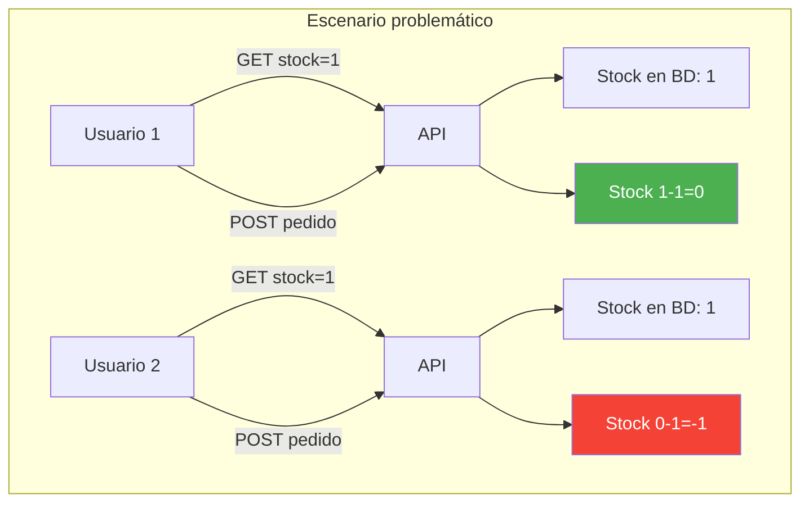

**Timeline del problema:**

| Tiempo | Usuario 1 | Usuario 2 | Stock en BD |
|--------|-----------|-----------|-------------|
| T1 | Lee stock = 1 | - | 1 |
| T2 | - | Lee stock = 1 | 1 |
| T3 | Crea pedido | - | 1 |
| T4 | Decrementa stock | - | 0 |
| T5 | - | Crea pedido | 0 |
| T6 | - | Decrementa stock | **-1** |

Vendemos 2 productos cuando solo teníamos 1 en stock. Esto se llama **race condition** (condición de carrera).

📌 Ejemplo real: **Amazon** gestiona millones de compras simultáneas. Cuando ves "último unidad en stock" y la compras, otro usuario en otro país puede estar haciendo lo mismo. Sin control de concurrencia, venderían el mismo producto dos veces.

## 15.2. Transacciones

### 15.2.1. Qué es una transacción

Una **transacción** es un conjunto de operaciones que se ejecutan como una unidad indivisible. Todas se completan exitosamente o ninguna se aplica.

> 💡 **Analogía:** Piensa en una transferencia bancaria. No puedes sacar dinero de la cuenta A sin asegurarte de que se deposite en la cuenta B. Si algo falla a mitad, todo debe revertirse.

### 15.2.2. Propiedades ACID

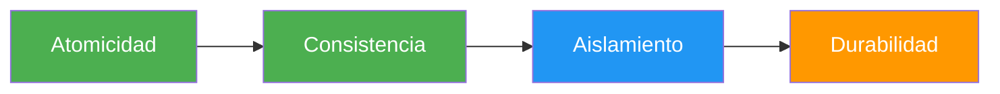

| Propiedad | Descripción | Ejemplo |
|-----------|-------------|---------|
| **Atomicidad** | Todo o nada | Si el pedido falla, el stock no se decrementa |
| **Consistencia** | Se pasa de un estado válido a otro válido | El stock nunca es negativo **si** hay un `CHECK` o un UPDATE condicional |
| **Aislamiento** | Cada transacción no ve estados intermedios de las demás | Un pedido no ve el stock a medio descontar de otro |
| **Durabilidad** | Commits persistentes | Si el servidor cae después del commit, los datos sobreviven |

> 📝 **Nota:** ACID no decide qué es un dato válido: eso lo declaran tus restricciones. Sin un `CHECK (Stock >= 0)` ni un UPDATE condicional, la base de datos acepta el -1 del ejemplo de 15.1 y sigue cumpliendo ACID.

### 15.2.3. Transacciones en EF Core

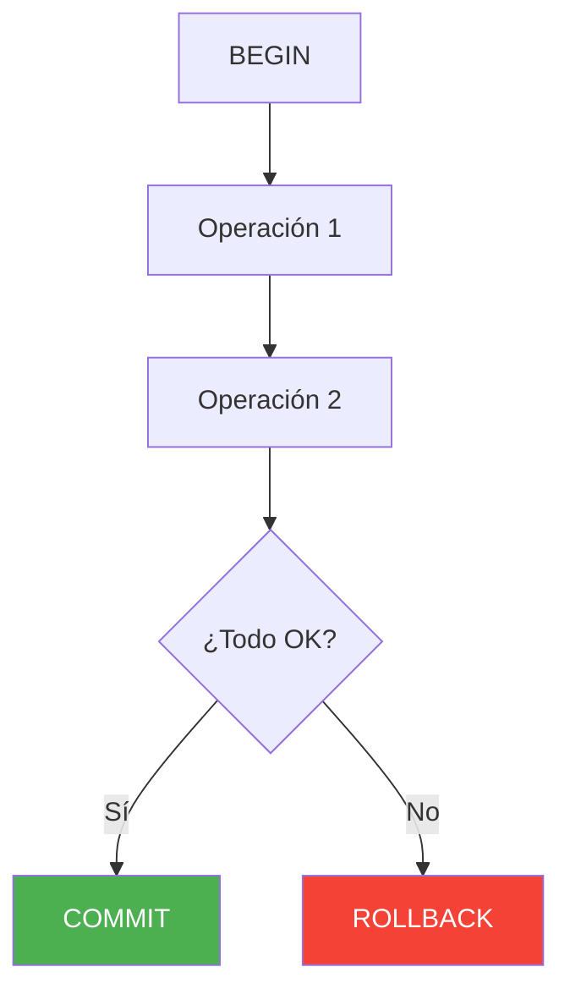

**Transacción implícita:** EF Core envuelve cada `SaveChanges` en una transacción por su cuenta. El problema aparece cuando necesitas más de un `SaveChanges` y ambos tienen que ocurrir o fallar juntos.

```csharp
// ❌ MALO: Crear pedido y stock en SaveChanges separados — riesgo de inconsistencia
context.Productos.Add(producto);
await context.SaveChangesAsync();  // Transacción 1: si falla aquí...

context.Pedidos.Add(pedido);
await context.SaveChangesAsync();  // Transacción 2: ...el producto ya está creado pero no el pedido

// ✅ BUENO: Usar transacción explícita para operaciones que deben ser atómicas
await using var transaction = await context.Database.BeginTransactionAsync();
try
{
    context.Productos.Add(producto);
    context.Pedidos.Add(pedido);
    await context.SaveChangesAsync();
    await transaction.CommitAsync(); // Todo se aplica junto o nada
}
catch
{
    await transaction.RollbackAsync(); // Deshacer todo si algo falla
    throw;
}
```

> 📝 **Nota:** un solo `SaveChangesAsync()` con varias entidades **ya es atómico**: EF Core lo envuelve internamente en una transacción. Abrir una transacción explícita no le añade atomicidad a ese caso, le da control sobre el momento del `Commit` y sobre los bloqueos.

**Cuándo necesitas una transacción explícita:**

| Situación | ¿Transacción explícita? | Por qué |
|-----------|:------------------------:|---------|
| Un solo `SaveChangesAsync()` con varias entidades | No | EF Core ya la envuelve en una transacción |
| Dos o más `SaveChangesAsync()` que deben ir juntos | Sí | Si el segundo falla, el primero ya está confirmado y no puedes deshacerlo |
| Bloquear filas con `SELECT ... FOR UPDATE` | Sí | Sin una transacción abierta el bloqueo se suelta al terminar la sentencia y no protege nada |
| Confirmar por fases (guardar antes de un proceso largo) | Sí | El `Commit` decide qué se aplica y qué se descarta |

> 💡 **Consejo:** piensa en la transacción explícita como una **frontera**: todo lo que quieras que ocurra a la vez va dentro, y el `Commit` es el momento en el que el mundo se entera de que ha pasado.

> ⚠️ **Advertencia:** Siempre haz `RollbackAsync()` en el bloque `catch`, incluso si el error es esperado. Una transacción abandonada puede bloquear recursos en la BD.

## 15.3. Control de concurrencia

La concurrencia no se resuelve con un único candado: hay tres formas de enfrentarse al mismo problema, y las tres parten de la historia de 15.1 (stock = 1, dos clientes a la vez). Elegir una u otra es decidir cuánto confías en que no habrá conflicto y cuánto estás dispuesto a esperar.

| Enfoque | Imagen mental | En la tienda |
|---------|---------------|--------------|
| **Optimista** | Confío en que los conflictos son raros y compruebo al final, justo antes de escribir | Dos editores tocan la ficha del mismo producto |
| **Pesimista** | No confío: cierro la fila con un candado antes de leerla y nadie más entra | Las últimas entradas de un concierto |
| **Mixto** | No cierro nada, pero solo dejo pasar el pedido si aún queda mercancía | El carrito del ejemplo de 15.1 |

### 15.3.1. Enfoque optimista

El enfoque **optimista** asume que los conflictos son raros. Nadie reserva la fila al leerla: se lee sin bloquear y la comprobación ocurre al escribir, dentro del propio `UPDATE`. Si otro proceso modificó los datos, ese `UPDATE` afecta a **0 filas** y EF Core lanza `DbUpdateConcurrencyException` antes de confirmar nada.

**El caso de la tienda:** un marketplace con dos editores de catálogo. Uno pone un producto en oferta por la mañana y otro corrige su descripción por la tarde. El conflicto es raro (solo si coinciden en el mismo producto y el mismo momento), y cuando ocurre la solución natural es enseñar al segundo lo que hay ahora y pedirle que lo relee. El ejemplo de abajo usa `Stock` porque es el campo que más se parece al de 15.1, pero el mecanismo es el mismo para un precio o una descripción.

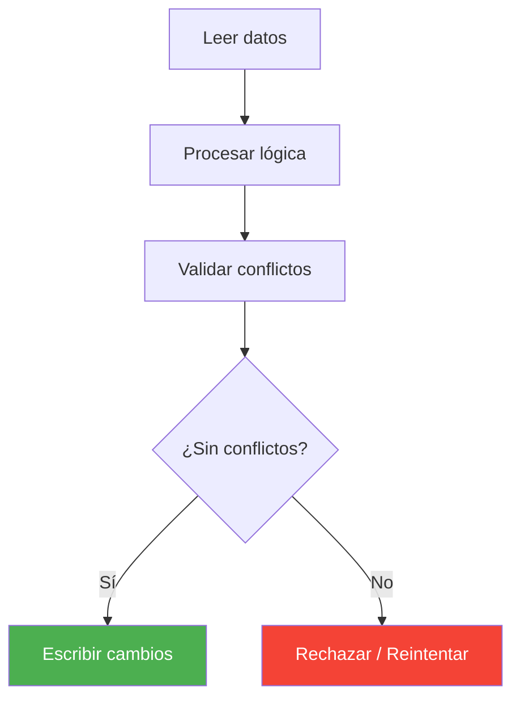

La misma carrera vista en el tiempo, con el token de versión en juego:

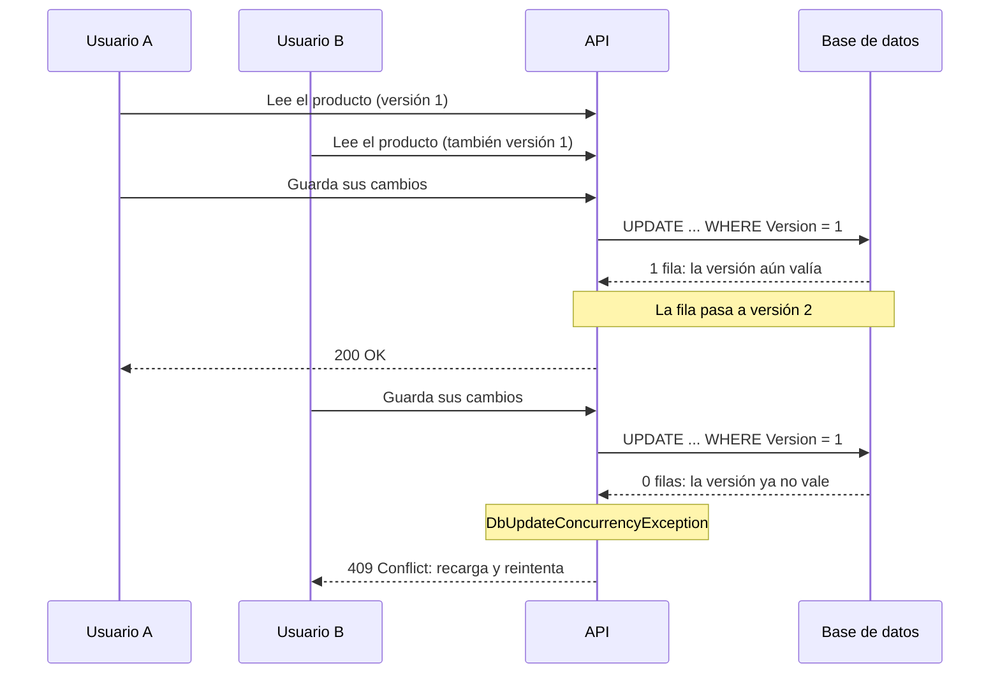

**Implementación en EF Core (token de fila):**

```csharp
// ❌ MALO: No usar control de concurrencia — race conditions garantizadas
public class Producto
{
    public long Id { get; set; }
    public string Nombre { get; set; } = string.Empty;
    public int Stock { get; set; }
    // Sin [Timestamp] → dos usuarios pueden vender el mismo stock
}

// ✅ BUENO: añadir un token de concurrencia (aquí, rowversion de SQL Server)
public class Producto
{
    public long Id { get; set; }
    public string Nombre { get; set; } = string.Empty;
    public int Stock { get; set; }

    [Timestamp]
    public byte[] RowVersion { get; set; } = null!; // Solo el proveedor puede mantenerlo actualizado
}
// Si otro usuario modificó el registro entre tu lectura y tu escritura,
// SaveChanges lanza DbUpdateConcurrencyException
```

> ⚠️ **Advertencia:** `[Timestamp]` solo funciona en SQL Server, donde la columna `rowversion` cambia sola en cada `UPDATE`. En **SQLite y PostgreSQL** nada actualiza ese valor: la comparación siempre coincide, el conflicto no se detecta nunca y el código compila igual. En PostgreSQL se usa la columna de sistema `xmin` (`UseXminAsConcurrencyToken()`) y en SQLite un `int Version` con `IsConcurrencyToken()` que incrementas tú en cada escritura.

**Qué hace EF Core por debajo:**

El token no es magia: EF Core lo añade al `WHERE` del `UPDATE`. Si el valor no coincide, la sentencia no actualiza ninguna fila y EF Core lo interpreta como conflicto. Esto es lo que se envía a la base de datos cuando dos usuarios editan el mismo producto, con un token `Version` de tipo `int` (el que funciona en cualquier proveedor):

```sql
UPDATE "Productos"
SET "Stock" = @nuevoStock, "Version" = @nuevaVersion
WHERE "Id" = @id AND "Version" = @versionLeida;
```

El primer usuario afecta a 1 fila y sigue adelante. El segundo llega con `@versionLeida` obsoleta, afecta a **0 filas** y recibe `DbUpdateConcurrencyException`. Ahí está toda la concurrencia optimista: una condición más en el `WHERE`, no un bloqueo. Con `rowversion` o con `xmin` el nombre de la columna cambia; la idea es la misma.

> 💡 **Truco:** para ver el SQL que genera EF Core en tu máquina, pídelo con `ToQueryString()`: `Console.WriteLine(context.Productos.Where(p => p.Id == 1).ToQueryString());`. Es la misma sentencia que va a ejecutar la base de datos.

**Manejo de `DbUpdateConcurrencyException`:**

```csharp
try
{
    await context.SaveChangesAsync();
}
catch (DbUpdateConcurrencyException ex)
{
    var entry = ex.Entries.First();
    var databaseValues = await entry.GetDatabaseValuesAsync();

    if (databaseValues is null)
        throw new KeyNotFoundException("El registro fue eliminado por otro usuario");

    // Mostrar diferencias y pedir confirmación
    Console.WriteLine($"Tu stock: {entry.CurrentValues["Stock"]}");
    Console.WriteLine($"Stock actual: {databaseValues["Stock"]}");
}
```

El bloque `catch` merece un recorrido despacio, porque las cuatro líneas hacen cosas distintas:

- **`ex.Entries`**: son las entidades cuyo `UPDATE` ha salido mal. En el caso típico hay una sola.
- **`GetDatabaseValuesAsync()`**: consulta la base de datos y te devuelve una **copia frescha** de la fila, sin tocar la entidad que llevas en memoria. Es lo que te permite comparar "lo que yo quería escribir" con "lo que hay ahora".
- **`databaseValues is null`**: la fila ya no existe: entre tu lectura y tu escritura alguien la borró. Ese caso no es un conflicto de valores, es una desaparición, y se responde distinto (404).
- **`entry.OriginalValues.SetValues(valoresBd)`**: la línea mágica de la estrategia "gana el cliente". Copia a los valores originales de la entidad (los que irán al `WHERE`) la versión que hay ahora en la base de datos, con lo que el siguiente `UPDATE` vuelve a coincidir con una fila.

**Tres estrategias cuando hay conflicto:**

Detectar el conflicto es la mitad del trabajo. La otra mitad es decidir qué hacer con los valores del usuario que acaba de perder la carrera, y no hay una respuesta única: depende de si los dos cambios se pisan.

| Estrategia | Qué hace | Cuándo usarla |
|------------|----------|---------------|
| **Gana el cliente** | Conserva los valores del usuario y sobrescribe los de la base de datos | Campos independientes y pocos usuarios a la vez |
| **Gana la base de datos** | Descarta el cambio del usuario y recarga el valor actual | Datos críticos como stock o saldo: el usuario reintenta |
| **Fusión** | Muestra las diferencias y deja elegir campo a campo | Fichas de edición y paneles de administración |

"Gana el cliente" son tres líneas: se copian los valores actuales de la base de datos en los originales de la entidad, con lo que el `WHERE` vuelve a coincidir, y se reintenta el guardado con los valores del usuario.

```csharp
catch (DbUpdateConcurrencyException ex)
{
    var entry = ex.Entries.First();
    var valoresBd = await entry.GetDatabaseValuesAsync();

    if (valoresBd is null)
        throw new KeyNotFoundException("El registro fue eliminado por otro usuario");

    entry.OriginalValues.SetValues(valoresBd);  // El WHERE ya coincide con la versión actual
    await context.SaveChangesAsync();           // Se escriben los valores del usuario
}
```

Para "gana la base de datos" no hace falta volver a guardar: `await entry.ReloadAsync()` descarta el cambio y deja en la entidad el valor actual. La fusión es la única que necesita interfaz: comparar `entry.CurrentValues` con `databaseValues` y preguntar al usuario campo a campo.

> 💡 **Consejo:** Para reintentos automáticos con el enfoque optimista, usa **Polly**: `Policy.Handle<DbUpdateConcurrencyException>().WaitAndRetryAsync(3, ...)`. Ojo con el detalle que rompe el reintento: el delegado debe **recargar la entidad** (`entry.ReloadAsync()`) antes de volver a intentarlo. Si no, reenvía el mismo token obsoleto y falla las 3 veces.

**Cuándo usarlo:** cuando los conflictos son raros y no cuestan dinero: fichas de edición, campos independientes, pocos editores a la vez. Si perder la carrera significa vender dos veces la última unidad, el optimista solo da la alerta; la garantía tendría que ponerla un reintento o un `UPDATE` condicional, y ahí el mixto (15.3.3) suele ser mejor encaje.

### 15.3.2. Enfoque pesimista

El enfoque **pesimista** bloquea los datos antes de modificarlos: quien quiera **escribir** esas filas espera a que termine la transacción. Matiz importante: en PostgreSQL un `SELECT` normal sigue leyendo la versión anterior, así que el bloqueo no congela las lecturas.

**El caso de la tienda:** un teatro vende las últimas 2 entradas de un concierto. Entre que lees el stock y decrementas, el sistema cobra la tarjeta y calcula el asiento: son operaciones lentas. Aquí no puedes permitirte que dos cajeros lean "quedan 2" a la vez; el primero cierra la fila con el candado, el segundo espera en la puerta hasta que el primero termine y, cuando entra, ve el stock real y responde sin liar nada.

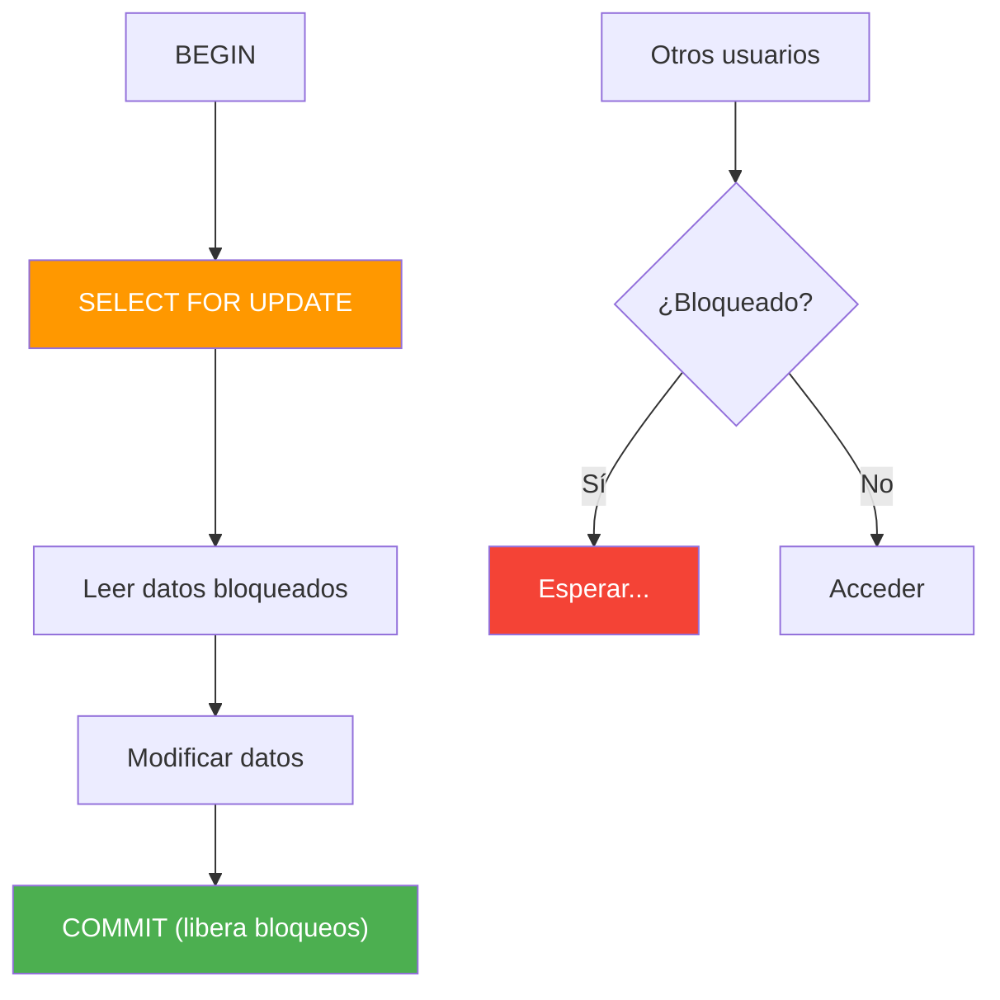

La espera en el tiempo se ve así: el segundo cliente no recibe error, recibe **silencio** hasta que el candado se suelta.

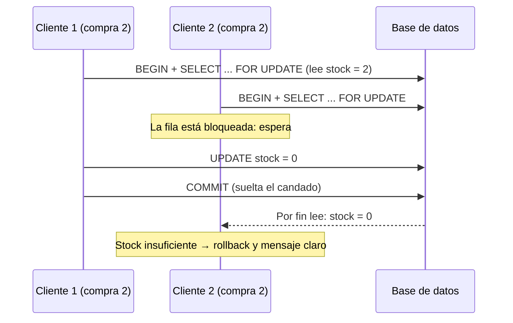

**Primero, el caso de un solo producto:** el mismo candado en su forma más simple, para ver las piezas sin ruido.

```csharp
await using var transaction = await context.Database.BeginTransactionAsync();
try
{
    // 1. Leer la fila YA bloqueada: hasta el COMMIT, nadie puede escribir en ella
    var producto = await context.Productos
        .FromSqlInterpolated($@"SELECT * FROM ""Productos"" WHERE ""Id"" = {id} FOR UPDATE")
        .SingleAsync();

    // 2. El candado no valida nada por sí solo: la regla de negocio la escribes tú
    if (producto.Stock < cantidad)
        throw new InvalidOperationException($"Stock insuficiente para {producto.Nombre}");

    // 3. Modificar la fila que ya tienes bloqueada
    producto.Stock -= cantidad;

    await context.SaveChangesAsync();
    await transaction.CommitAsync();   // 4. Al confirmar se suelta el candado
}
catch
{
    await transaction.RollbackAsync(); // Si algo falla, se suelta igualmente
    throw;
}
```

Recorrido del bloque: la transacción abre la frontera (línea 1); el `FOR UPDATE` mete el candado en el momento exacto de la lectura (líneas 5 y 6), y ese candado vive hasta el `Commit` o el `Rollback`. La comprobación de stock ocurre **después** de leer, ya con la fila protegida: dos clientes juntos no pueden pasar de la línea 8 con el mismo stock. Y si el `SaveChanges` falla, el `catch` suelta el candado: un candado abandonado deja la fila inutilizable para el resto del teatro.

**La versión real: varios productos con `IN`:**

```csharp
await using var transaction = await context.Database.BeginTransactionAsync();
try
{
    // ⚠️ FromSqlInterpolated convertiría {string.Join(",", ids)} en UN único
    // parámetro ("1,2,3"), inválido en un IN. Por eso aquí se construye
    // un parámetro por cada id con FromSqlRaw:
    var placeholders = string.Join(",", ids.Select((_, i) => $"@p{i}"));
    var parametros = ids.Select((id, i) => new NpgsqlParameter($"@p{i}", id)).ToArray();

    var productos = await context.Productos
        .FromSqlRaw($@"
            SELECT * FROM ""Productos""
            WHERE ""Id"" IN ({placeholders})
            FOR UPDATE", parametros)
        .ToListAsync();

    // El bloqueo no valida el stock: hay que comprobarlo con la fila ya bloqueada
    foreach (var item in productos)
    {
        if (item.Stock < cantidad)
            throw new InvalidOperationException($"Stock insuficiente para {item.Nombre}");

        item.Stock -= cantidad;
    }

    await context.SaveChangesAsync();
    await transaction.CommitAsync();
}
catch
{
    await transaction.RollbackAsync();
    throw;
}
```

**Por qué el `SELECT` va dentro de la transacción:**

El `FOR UPDATE` solo tiene sentido con una transacción abierta. Sin ella, PostgreSQL ejecuta el `SELECT`, bloquea las filas, te devuelve los datos y **libera el bloqueo al terminar la sentencia**: entre ese momento y tu `UPDATE` cabe otro cliente que modifica el stock. Por eso el ejemplo abre la transacción antes de leer y la cierra con el `Commit` al final. En PostgreSQL el `SELECT` sigue leyendo la versión anterior de la fila: el bloqueo impide escribir, no leer.

**Portabilidad del bloqueo:**

`FOR UPDATE` es sintaxis de PostgreSQL y del SQL estándar, pero no de todos los proveedores. Antes de copiar el ejemplo, mira dónde vas a ejecutarlo:

| Proveedor | Cómo se bloquea la fila |
|-----------|-------------------------|
| **PostgreSQL** | `SELECT ... FOR UPDATE` |
| **SQL Server** | `SELECT ... WITH (UPDLOCK, ROWLOCK)` |
| **SQLite** | No hay bloqueo por fila: `BEGIN IMMEDIATE` bloquea la base de datos entera y `FOR UPDATE` da error de sintaxis |

> ⚠️ **Advertencia:** si desarrollas con SQLite y el reto se ejecuta en PostgreSQL, el servicio pesimista no se puede probar en local sin cambiar de motor. Decide el proveedor antes de escribir este código, no después.

**Niveles de aislamiento:**

| Nivel | Dirty Read | Non-repeatable | Phantom | Bloqueo |
|-------|------------|----------------|---------|---------|
| **Read Uncommitted** | Permitido | Permitido | Permitido | Ninguno |
| **Read Committed** | Protegido | Permitido | Permitido | Filas |
| **Repeatable Read** | Protegido | Protegido | Permitido | Filas |
| **Serializable** | Protegido | Protegido | Protegido | Tabla completa |

> 📝 **Nota:** *Dirty read* es leer datos que otra transacción aún no ha confirmado; *non-repeatable read*, que la misma fila cambie entre dos lecturas de tu transacción; *phantom*, que aparezcan filas nuevas que cumplen tu filtro. En PostgreSQL el nivel por defecto es **Read Committed** y trabaja con MVCC: un lector no bloquea a un escritor, así que la columna de bloqueos describe el modelo clásico y no el de PostgreSQL. `Read Uncommitted` se trata allí como `Read Committed`. El nivel se fija con `BeginTransactionAsync(IsolationLevel.Serializable)`.

**Cuando dos transacciones se esperan (deadlock):**

El bloqueo tiene un precio: si dos transacciones toman las filas en distinto orden, pueden quedar esperando la una a la otra. Es el único escenario en el que dos operaciones escritas correctamente se bloquean para siempre:

| Momento | Transacción T1 (pedido A) | Transacción T2 (pedido B) |
|---------|---------------------------|---------------------------|
| 1 | Bloquea el producto 1 con `FOR UPDATE` | Bloquea el producto 2 con `FOR UPDATE` |
| 2 | Pide el producto 2 y se queda esperando | Pide el producto 1 y se queda esperando |

Ninguna puede continuar: cada una espera a la fila que la otra tiene bloqueada. PostgreSQL detecta el ciclo, aborta una de las dos con el error `deadlock detected` y el cliente recibe un error sin explicación útil.

**Cómo evitarlo:** bloquea siempre en el mismo orden. Si ordenas los ids antes de bloquear (`ids.OrderBy(i => i)`), las dos transacciones intentan tomar primero el producto 1, una espera a la otra y el ciclo nunca se forma. Como red de seguridad, pon un tiempo límite a la espera de comandos en la cadena de conexión (`Command Timeout=10`): si algo se atasca, la transacción falla antes de dejar filas bloqueadas.

**Cuándo usarlo:** cuando perder la carrera es inaceptable y el bloqueo es corto: últimas unidades, reserva de asientos, transferencias entre cuentas. El candado tiene un precio que se paga en cuanto la transacción se estira (llamadas a una API externa, cálculos pesados dentro): las filas quedan bloqueadas, las colas crecen y aparecen los deadlocks. La regla práctica: abre la transacción, bloquea lo mínimo, trabaja y sal cuanto antes.

### 15.3.3. Enfoque mixto

El **enfoque mixto** no es un tercer mecanismo de bloqueo, es una composición. Se lee sin bloquear para fallar rápido y dar un mensaje claro al usuario, y la garantía real la da un `UPDATE` condicional (`WHERE stock >= cantidad`): un compare-and-set que o actualiza, o afecta a 0 filas.

**El caso de la tienda:** es el carrito de 15.1 resuelto. Llega el pedido; la tienda lee el stock sin bloquear para poder decir "no hay stock suficiente" en vez de un error genérico, y después descuenta con el `UPDATE` condicional. Si entre la lectura y el descuento otro cliente se llevó las últimas unidades, el `WHERE` no coincide con ninguna fila y el pedido se rechaza: nadie vende dos veces el stock que solo había una vez.

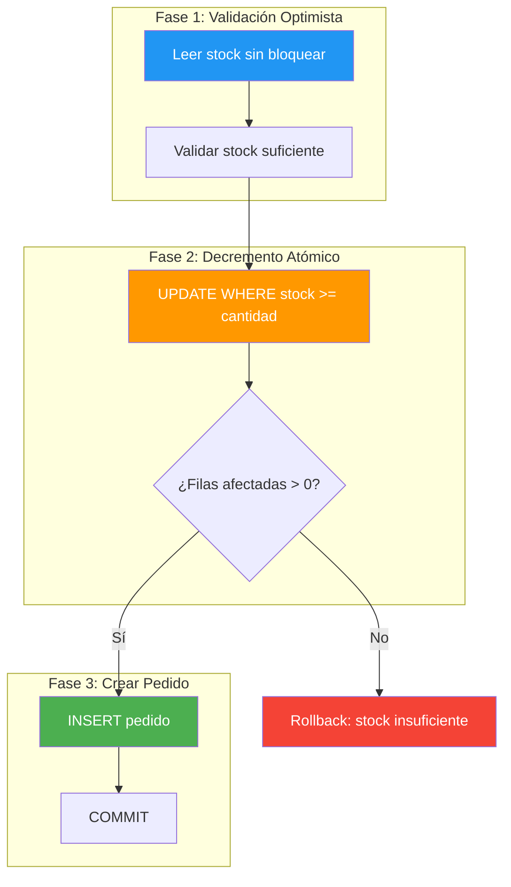

Y la misma compra de dos clientes en paralelo, para ver dónde se decide la carrera:

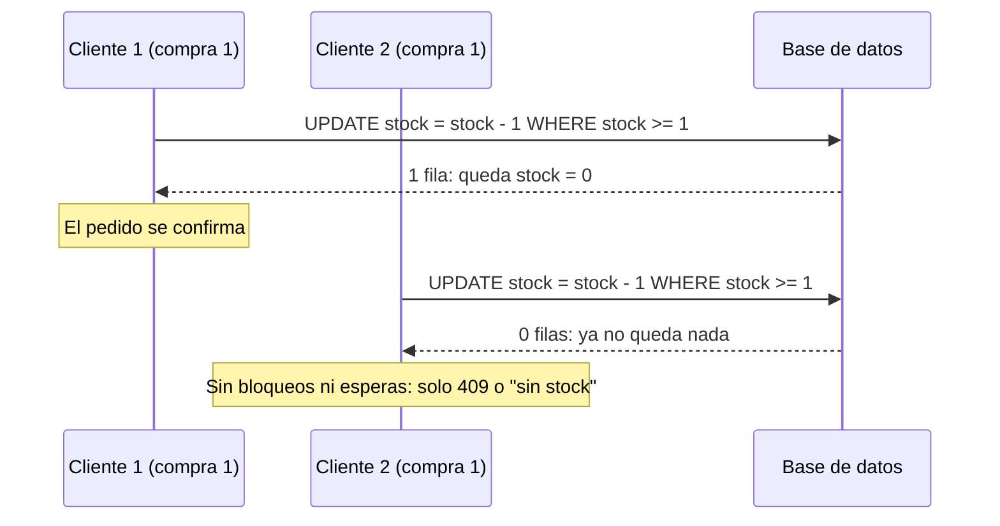

**Fase 1 — Validación optimista:**

La primera fase solo **lee** para poder dar un mensaje útil ("no hay stock"), pero la garantía no está aquí: la da el `UPDATE` condicional de la fase 2. Por eso las entidades se piden con `AsNoTracking()`: no hay intención de modificarlas con EF Core, la escritura la hace SQL crudo, y trackearlas solo ocuparía memoria y dejaría el estado del `DbContext` desincronizado con la base de datos.

```csharp
var ids = items.Select(i => i.Id).ToArray();

var productos = await context.Productos
    .AsNoTracking()
    .Where(p => ids.Contains(p.Id))
    .ToDictionaryAsync(p => p.Id);

foreach (var item in items)
    if (productos[item.Id].Stock < item.Cantidad)
        return Result.Failure(...);  // Stock insuficiente
```

**Fase 2 y 3 — descuento atómico y pedido:** las dos fases van dentro de la misma transacción; si el `INSERT` del pedido falla, el descuento se deshace. Este es el bloque completo, tal y como quedaría en el servicio:

```csharp
await using var transaction = await context.Database.BeginTransactionAsync();
try
{
    // ✅ ExecuteSqlInterpolatedAsync crea un parámetro por cada valor
    // interpolado, válido con cualquier proveedor (Npgsql, SqlServer...)
    var filas = await context.Database.ExecuteSqlInterpolatedAsync($@"
        UPDATE ""Productos""
        SET ""Stock"" = ""Stock"" - {cantidad}
        WHERE ""Id"" = {productoId} AND ""Stock"" >= {cantidad}");

    if (filas == 0)
    {
        // Entre la lectura y el UPDATE, otro cliente se llevó el stock:
        // el WHERE no ha coincidido con ninguna fila. Desechamos y avisamos.
        await transaction.RollbackAsync();
        return Result.Failure<ProductoDto, DomainError>(
            ProductoError.StockInsuficiente(productoId));
    }

    // Solo si el descuento salió, creamos el pedido
    context.Pedidos.Add(pedido);
    await context.SaveChangesAsync();
    await transaction.CommitAsync();   // Se confirma junto: descuento + pedido
    return Result.Success<ProductoDto, DomainError>(pedido.ToDto());
}
catch
{
    await transaction.RollbackAsync(); // Si el INSERT falla, el descuento se deshace
    throw;
}
```

Recorrido de las líneas críticas: el `SET "Stock" = "Stock" - {cantidad}` es una **actualización relativa**: la base de datos descuenta sobre el valor que tiene ahora, no sobre el que leíste en la fase 1, así que nunca pisa cambios ajenos. El `WHERE "Stock" >= {cantidad}` es el candado invisible: solo puede pasar el pedido si aún queda mercancía, y la comprobación y el descuento ocurren en la misma sentencia, sin hueco para nadie. `filas == 0` significa exactamente "otro cliente ganó la carrera entre tu lectura y tu escritura": no es un error técnico, es una respuesta de negocio (sin stock) que se devuelve con su código correspondiente. Y el `Rollback` del `catch` existe porque si el `INSERT` del pedido revienta a mitad, el descuento no puede quedarse huérfano: o van los dos o no va ninguno.

**Cuándo usarlo:** el candidato por defecto para compras e inventario en la web: sin candados de larga duración, con garantía atómica y con mensajes de negocio claros. Solo exige dos cosas de tu stack: soportar el `UPDATE` condicional en tu proveedor (cualquier base de datos relacional lo hace) y aceptar que la validación de la fase 1 es cortesía, no garantía.

### 15.3.4. Comprobar el conflicto con dos contextos

La concurrencia no se ve usando la aplicación: con un solo usuario nunca hay conflicto. La forma de reproducirla en un test es abrir dos `DbContext` sobre la misma base de datos, leer la misma fila con los dos y guardar en orden inverso. El primero gana, el segundo recibe la excepción.

```csharp
[Test]
public async Task SaveChanges_DosUsuariosEditanElMismoProducto_LanzaDbUpdateConcurrencyException()
{
    // Arrange: dos contextos contra la misma base de datos
    await using var contextA = CreateContext();
    await using var contextB = CreateContext();

    var productoA = await contextA.Productos.SingleAsync(p => p.Id == 1);
    var productoB = await contextB.Productos.SingleAsync(p => p.Id == 1);

    // Act: el usuario A guarda primero
    productoA.Stock = 5;
    productoA.Version++;
    await contextA.SaveChangesAsync();

    // El usuario B sigue con la versión que leyó al principio
    productoB.Stock = 3;
    productoB.Version++;

    // Assert
    Func<Task> guardarB = () => contextB.SaveChangesAsync();
    await guardarB.Should().ThrowAsync<DbUpdateConcurrencyException>();
}

// Dos contextos sobre el mismo fichero SQLite: así sí comparten la base de datos
private static AppDbContext CreateContext() =>
    new(new DbContextOptionsBuilder<AppDbContext>()
        .UseSqlite("Data Source=concurrencia.db")
        .Options);
```

Con `Version` de tipo `int` configurado como token en el `DbContext` (`modelBuilder.Entity<Producto>().Property(p => p.Version).IsConcurrencyToken();`), el test funciona igual en SQLite, PostgreSQL y SQL Server. `productoB` conserva el `Version` original, así que su `UPDATE` busca una versión que ya no existe y afecta a 0 filas. En producción ese `Version++` va en el servicio que actualiza; en el test se hace a mano para controlar el orden. El producto con `Id = 1` tiene que existir antes de ejecutar: créalo en el `SetUp` o confía en el seed data.

> ⚠️ **Advertencia:** el proveedor `InMemory` no comprueba tokens de concurrencia. Un test así contra `UseInMemoryDatabase` pasa siempre y no demuestra nada: usa SQLite en fichero o Testcontainers. Y usa un fichero distinto por test para no arrastrar datos entre ejecuciones.

### 15.3.5. Comparativa de enfoques

| Criterio | Optimista | Pesimista | Mixto |
|----------|-----------|-----------|-------|
| **Bloqueos** | Solo al escribir | Largo periodo | Breve (UPDATE atómico) |
| **Deadlocks** | Muy raros | Posibles | Raros |
| **Rendimiento** | Alto sin contención | Bajo con contención | Optimizado |
| **Consistencia** | Verificación al final | Garantizada | Garantizada |
| **Retry necesario** | Sí | No | Opcional |
| **Complejidad** | Moderada | Simple | Moderada |

> 📝 **Nota:** cuando `SaveChangesAsync` lanza `DbUpdateConcurrencyException`, la API no devuelve 400: los datos eran válidos y lo que cambió fue el estado. Responde **409 Conflict**, o **412 Precondition Failed** si el cliente envió `If-Match` con el ETag del recurso. Al segundo cliente se le pide recargar y reintentar, no se le dice que su petición estaba mal.

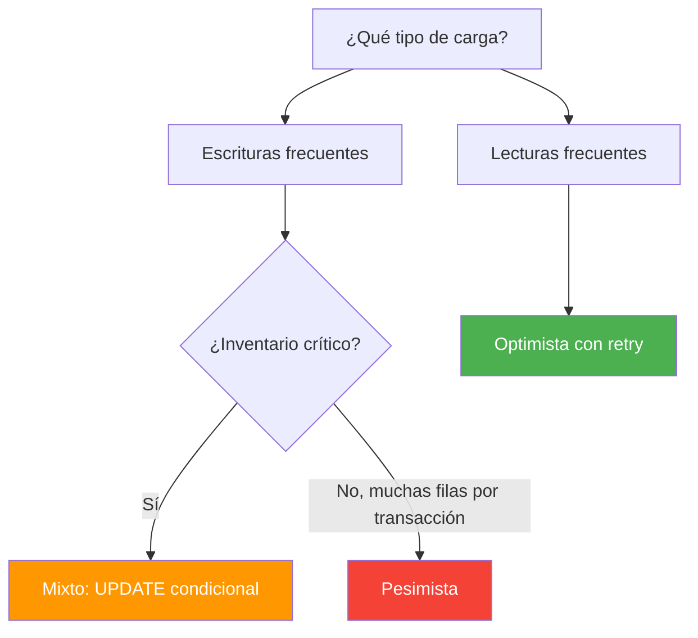

> 📝 **Nota:** El enfoque **mixto** es el más recomendado para la mayoría de aplicaciones web: la lectura sin bloqueo evita esperas y el `UPDATE` condicional garantiza el stock. La validación previa solo mejora el mensaje, no la seguridad.

## 15.4. Identificadores: claves primarias

Hasta aquí un identificador servía para encontrar una fila. En concurrencia hay un segundo identificador en juego: el token de versión, que no dice *qué* fila es, sino *en qué versión* está. Las dos ideas funcionan con el mismo mecanismo, comparar un valor leído antes con el valor que hay ahora, así que conviene entender bien cómo se elige una clave: de ella dependen el tamaño de los índices, el orden natural de la tabla y hasta la forma de detectar un conflicto.

### 15.4.1. Autoincrementales (INT/BIGINT)

El tipo más tradicional. La BD asigna automáticamente el siguiente valor: 1, 2, 3, ...

```csharp
// ❌ MALO: Usar INT para sistemas distribuidos (múltiples bases de datos)
// BD1 tiene Producto ID=42, BD2 también tiene Producto ID=42 → colisión
public class Producto
{
    public int Id { get; set; } // ¡Peligro en microservicios!
}

// ✅ BUENO: Usar INT solo en sistemas monolíticos con una única BD
public class Producto
{
    public int Id { get; set; }  // Aceptable en app con una sola BD
    public string Nombre { get; set; } = string.Empty;
}
```

> 📝 **Nota:** el tipo de la clave cambia de un apartado a otro a propósito, para poder comparar las alternativas: aquí es `int` y en el punto 15.3 era `long` (4 bytes frente a 8). En tu proyecto eliges uno y lo mantienes: cambiar el tipo de una clave primaria obliga a rehacer la tabla, todas sus claves foráneas y las URL que la incluyen.

> 💡 **Analogía:** Un INT autoincremental es como el número de tu DNI: es único **dentro de tu país**, pero si dos países emitieran los mismos números, habría colisiones. Un GUID es como tu huella dactilar: única en todo el mundo, sin importar cuántas personas haya.

| Ventaja | Desventaja |
|---------|------------|
| Simple, rápido, indexado | Secuencial: expone cuántos registros hay |
| Ocupa poco espacio (4-8 bytes) | No distribuible (colisiones en BD separadas) |
| Orden natural | Adivinable: `/api/productos/42` → probando `/api/productos/43` |

### 15.4.2. UUID/GUID

Un **GUID** (Globally Unique Identifier) es un identificador de 128 bits con 3.4 × 10^38 combinaciones posibles. Es prácticamente imposible que se repita.

```csharp
// ❌ MALO: Usar GUID sin contexto — no se sabe qué representa
public class Producto
{
    public Guid Id { get; set; } = Guid.NewGuid(); // ¿Por qué GUID aquí?
}

// ✅ BUENO: Usar GUID cuando necesitas distribuir entre sistemas
public class Producto
{
    public Guid Id { get; set; } = Guid.NewGuid(); // Sistemas distribuidos ✓
    public string Nombre { get; set; } = string.Empty;
}

// ✅ BUENO: Usar SHORT GUID para URLs más legibles (ej: invite links)
public class Invitacion
{
    public string Id { get; set; } = ShortGuid.NewGuid().ToString(); // "aB3xYz..."
    // Más corto que un GUID completo, ideal para URLs y códigos de invitación
}
```

```csharp
// ❌ MALO: Generar el GUID en el cliente y usarlo como clave con muchos datos
// El GUID sale al azar, así que cada INSERT cae en una zona distinta del índice
// y el B-Tree se fragmenta con facilidad
public class Producto
{
    public Guid Id { get; set; } = Guid.NewGuid();
}

// ✅ BUENO: Que la base de datos genere el GUID, o usar un GUID secuencial
// (SequentialGuidValueGenerator) que mantiene el orden de inserción
public class Producto
{
    public Guid Id { get; set; }
}
```

> 📝 **Nota:** `ShortGuid` no viene con .NET: es el paquete `ShortGuid` de NuGet y su tipo vive en el espacio de nombres `DEDrake.ShortGuid`. Sin el paquete y sin el `using` correspondiente, el compilador responde que no existe el tipo `ShortGuid`.

| Ventaja | Desventaja |
|---------|------------|
| Único globalmente | Ocupa más espacio (16 bytes) |
| Sin colisiones | Random = mal rendimiento en índices B-Tree |
| Seguro para URLs | No ordenable secuencialmente |
| Distribuible | Menos legible para humanos |

> 💡 **Consejo:** Usa `Guid.NewGuid()` para generar GUIDs. En PostgreSQL, puedes usar `gen_random_uuid()` como valor por defecto de la columna.

### 15.4.3. El ID de YouTube: base64 de 11 caracteres

El identificador de un video de YouTube es una cadena de **exactamente 11 caracteres** que se usa en la URL (por ejemplo, `dQw4w9WgXcQ` en `youtube.com/watch?v=dQw4w9WgXcQ`).

**Anatomía del ID:**

| Aspecto | Detalle |
|---------|---------|
| **Longitud** | Exactamente 11 caracteres |
| **Juego de caracteres** | Base64url: `a-z`, `A-Z`, `0-9`, `_`, `-` (64 caracteres) |
| **Combinaciones** | 64^11 ≈ 7.37 × 10^19 (73 quintillones) |
| **Probabilidad de colisión** | Prácticamente nula |

**Cómo se genera:**

El proceso tiene dos pasos, y ninguno de los dos es "un número al azar metido en la URL":

1. **Un número de 64 bits:** cada video tiene un identificador numérico interno, un contador del sistema de videos.

2. **Codificación en Base64url:** ese número se escribe con 11 caracteres usando el alfabeto Base64url (26 minúsculas, 26 mayúsculas, 10 dígitos, `_` y `-`). Cada carácter aporta 6 bits, así que 11 caracteres guardan 66 bits: sobran para los 64 del número.

De ahí sale todo: `dQw4w9WgXcQ` no dice en qué momento se publicó el video y los IDs vecinos no se parecen entre sí. Hay técnicas parecidas, como Hashids, que persiguen el mismo efecto con otro algoritmo.

> 📝 **Nota:** los IDs de YouTube siempre han tenido 11 caracteres, pero su contenido no es un contador legible: por eso no puedes deducir de un video cuándo se publicó otro ni recorrerlos en orden. Ese es justo el objetivo de la codificación.

> ⚠️ **Advertencia:** un ID aleatorio no garantiza unicidad, solo la hace muy probable. Con 64^11 combinaciones (unas 7,4 × 10^19), la probabilidad de que dos IDs choquen es de una entre 150 millones con un millón de filas, y de una entre 1,5 millones con diez millones. Cuando ocurre, la base de datos rechaza el `INSERT` con un error de clave duplicada: por eso los sistemas reales comprueban la unicidad antes de insertar (YouTube la verifica en Spanner) o reintentan con otro valor.

📌 Ejemplo real: El video más visto de YouTube ("Baby Shark") tiene el ID `XqZsoesa55w`. Si intentases adivinar videos vecinos (`XqZsoesa55v`, `XqZsoesa55x`), no encontrarías nada porque los IDs son pseudoaleatorios, no secuenciales.

### 15.4.4. Generador de IDs personalizado con atributo

Podemos crear nuestro propio generador de IDs estilo YouTube usando un **atributo personalizado** y un **ValueGenerator** en EF Core.

**Paso 1: Crear el atributo:**

```csharp
[AttributeUsage(AttributeTargets.Property)]
public class YouTubeIdAttribute : Attribute { }
```

**Paso 2: Crear el generador:**

```csharp
using Microsoft.EntityFrameworkCore.ChangeTracking;
using Microsoft.EntityFrameworkCore.ValueGeneration;

namespace ProductosApi.IdGenerators;

/// <summary>
/// Genera IDs de 11 caracteres estilo YouTube (Base64url).
/// </summary>
public class YouTubeIdValueGenerator : ValueGenerator<string>
{
    private const string Chars = "ABCDEFGHIJKLMNOPQRSTUVWXYZabcdefghijklmnopqrstuvwxyz0123456789-_";

    // Random.Shared es thread-safe y está disponible desde .NET 6
    public override string Next(EntityEntry entry) =>
        new string(Enumerable.Range(0, 11).Select(_ => Chars[Random.Shared.Next(64)]).ToArray());

    public override bool GeneratesTemporaryValues => false;
}
```

**Paso 3: Registrar en `OnModelCreating`:**

La clave de `Proveedor` es un `string`, así que la propiedad tiene que quedar marcada como generada en el momento de añadir la entidad. Sin esa indicación, EF Core no genera nada y falla al guardar porque la clave no tiene valor.

```csharp
protected override void OnModelCreating(ModelBuilder modelBuilder)
{
    modelBuilder.Entity<Proveedor>(e =>
    {
        e.HasKey(p => p.Codigo);
        e.Property(p => p.Codigo)
            .HasValueGenerator<YouTubeIdValueGenerator>()
            .ValueGeneratedOnAdd();
    });
}
```

> 📝 **Nota:** `ValueGeneratedOnAdd()` es obligatorio desde EF Core 3.0 para las claves `string`. Y si lo añades pero olvidas `HasValueGenerator`, lo que se genera es un GUID de 36 caracteres, no tus 11 caracteres.

**Paso 4: Usar en la entidad:**

```csharp
public class Proveedor
{
    [YouTubeId]  // Documentación visual del tipo de ID
    public string Codigo { get; set; } = null!; // Sin valor: lo genera EF Core

    public string Nombre { get; set; } = string.Empty;
}
```

**La trampa del valor por defecto:**

EF Core usa el valor por defecto del tipo como **centinela** para saber si una propiedad está asignada: para un `string` ese valor es `null`. Si la propiedad llega con un valor (`string.Empty` cuenta), EF Core la da por asignada, **no llama al generador** y guarda ese valor tal cual. Es un detalle de una línea que decide si tu identificador funciona o no.

| Cómo declaras `Codigo` | Configuración | Qué pasa |
|-------------------------|--------------|----------|
| `= string.Empty` | `HasValueGenerator<YouTubeIdValueGenerator>()` | El generador **no se ejecuta**. Las dos entidades entran con la clave `""` y EF Core se queja al hacer `Add()` |
| `= string.Empty` | `+ ValueGeneratedOnAdd()` | Igual: el centinela manda sobre la configuración |
| Sin inicializar (`null`) | `+ ValueGeneratedOnAdd()` | **Correcto**: EF Core genera el ID en el `Add()` |
| ID asignado en el constructor | `ValueGeneratedNever()` | **Correcto**: EF Core usa el valor que traía la entidad |

El error del primer caso no habla de generadores, y por eso cuesta encontrarlo:

```text
InvalidOperationException: The instance of entity type 'Proveedor' cannot be tracked
because another instance with the same key value for {'Codigo'} is already being tracked.
```

Léelo despacio: dice "otra instancia con la misma clave". La clave que se repite es la cadena vacía, porque los dos `Proveedor` entraron con `Codigo = ""` y el generador nunca llegó a ejecutarse.

**Las dos formas que sí funcionan:**

1. **El generador de EF Core**, la que acabas de ver: la propiedad sin valor, `ValueGeneratedOnAdd()` y `HasValueGenerator`. EF Core genera el ID al hacer `Add()` y tú no escribes ni una línea de generación.

2. **Generarlo tú antes de guardar**, asignando el ID en el constructor o en una factoría. En ese caso la propiedad ya trae valor y le dices a EF Core que no se meta:

```csharp
public static class IdYouTube
{
    private const string Chars = "ABCDEFGHIJKLMNOPQRSTUVWXYZabcdefghijklmnopqrstuvwxyz0123456789-_";

    public static string Next() =>
        new string(Enumerable.Range(0, 11).Select(_ => Chars[Random.Shared.Next(64)]).ToArray());
}

public class Proveedor
{
    public string Codigo { get; set; } = IdYouTube.Next(); // 11 caracteres, ya asignado
    public string Nombre { get; set; } = string.Empty;
}
```

Fíjate en la diferencia: la versión de EF Core hereda de `ValueGenerator` y su `Next` recibe la `EntityEntry` porque es EF quien la llama; la tuya es un método estático normal y se puede usar en cualquier sitio, incluso sin base de datos.

> ⚠️ **Advertencia: SaveChanges vs SaveChangesAsync**
>
> No pongas la generación del ID en un override de `SaveChanges` cuando la clave es un `string`. El problema no es la sincronía: es que ese camino llega tarde. Si la clave está a `null`, EF Core ni siquiera puede rastrear la entidad (`Unable to track an entity of type 'Proveedor' because its primary key property 'Codigo' is null`), y si la inicializas a `string.Empty` las dos entidades chocan ya en el `Add()`. El error salta **antes** de guardar, así que ningún override llega a ejecutarse. Si generas los IDs a mano, hazlo en el constructor o en una factoría, como en la segunda forma de arriba.
>
> Y si en algún momento necesitas generarlos en un override, sobrescribe **ambos** métodos:
>
> ```csharp
> // ❌ MALO: Solo override async
> public override async Task<int> SaveChangesAsync(CancellationToken ct = default)
> {
>     GenerateIds();
>     return await base.SaveChangesAsync(ct);
> }
>
> // ✅ BUENO: Override ambos
> private void GenerateIds()
> {
>     foreach (var entry in ChangeTracker.Entries<Proveedor>()
>         .Where(e => e.State == EntityState.Added))
>     {
>         if (string.IsNullOrEmpty(entry.Entity.Codigo))
>             entry.Entity.Codigo = new YouTubeIdValueGenerator().Next(entry);
>     }
> }
>
> public override int SaveChanges()
> {
>     GenerateIds();
>     return base.SaveChanges();
> }
>
> public override Task<int> SaveChangesAsync(CancellationToken ct = default)
> {
>     GenerateIds();
>     return base.SaveChangesAsync(ct);
> }
> ```
>
> También elimina `ValueGeneratedOnAdd()` del Fluent API si generas el ID manualmente en el override.

### 15.4.5. Comparativa de identificadores

| Tipo | Espacio | Único | Ordenable | Distribuible | Legible |
|------|---------|-------|-----------|--------------|---------|
| **INT autoincremental** | 4 bytes | Sí (en 1 BD) | Sí | No | Sí |
| **BIGINT autoincremental** | 8 bytes | Sí (en 1 BD) | Sí | No | Sí |
| **GUID** | 16 bytes | Sí (global) | No | Sí | No |
| **YouTube-style (11 chars)** | 11 bytes | Sí (prácticamente) | No | Sí | Sí |
| **ShortGuid** | ~22 chars | Sí (global) | No | Sí | Sí |

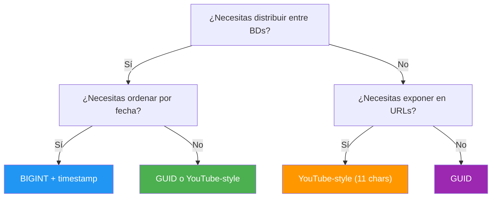

> 📝 **Nota:** En la práctica, el 90% de las aplicaciones usan BIGINT autoincremental o GUID. Los IDs estilo YouTube son útiles cuando necesitas IDs cortos y legibles en URLs (como YouTube, Bitly, o IDs de invite).

## 15.5. Buenas prácticas

Estas son las reglas que debes seguir al trabajar con transacciones. El primer ejemplo muestra un error común y el segundo la forma correcta:

```csharp
// ❌ MALO: Olvidar el rollback en catch — transacción abandonada bloquea recursos
await using var transaction = await context.Database.BeginTransactionAsync();
try
{
    context.Pedidos.Add(pedido);
    context.Productos.Update(producto);
    await context.SaveChangesAsync();
    await transaction.CommitAsync();
}
catch (Exception ex)
{
    // ¡Sin rollback! La transacción queda abierta → bloqueo indefinido
    throw;
}

// ✅ BUENO: SIEMPRE hacer rollback en catch, sin excepciones
await using var transaction = await context.Database.BeginTransactionAsync();
try
{
    context.Pedidos.Add(pedido);
    context.Productos.Update(producto);
    await context.SaveChangesAsync();
    await transaction.CommitAsync();
}
catch
{
    await transaction.RollbackAsync(); // Libera recursos siempre
    throw;
}
// Alternativa: usar 'await using' que hace dispose automático (pero explícito es mejor práctica)
```

```csharp
// ❌ MALO: Usar SELECT sin FOR UPDATE en pesimista — otros usuarios modifican mientras lees
var productos = await context.Productos.Where(p => ids.Contains(p.Id)).ToListAsync();
// Otro usuario puede decrementar el stock entre tu SELECT y tu UPDATE

// ✅ BUENO: SELECT FOR UPDATE garantiza bloqueo durante la transacción
// Un párrafo por id: FromSqlInterpolated con string.Join daría UN único
// parámetro "1,2,3", inválido en el IN (mismo bug que en 15.2)
var placeholders = string.Join(",", ids.Select((_, i) => $"@p{i}"));
var parametros = ids.Select((id, i) => new NpgsqlParameter($"@p{i}", id)).ToArray();

var productos = await context.Productos
    .FromSqlRaw($@"
        SELECT * FROM ""Productos""
        WHERE ""Id"" IN ({placeholders})
        FOR UPDATE", parametros)
    .ToListAsync();
// Bloqueo hasta COMMIT → ningún otro usuario puede modificar estas filas
```

| Práctica | Descripción |
|----------|-------------|
| **Usar transacciones explícitas** | Para operaciones que involucran múltiples entidades |
| **Rollback en catch** | Siempre hacer rollback en caso de excepción |
| **Niveles de aislamiento apropiados** | Elegir el nivel correcto según el caso de uso |
| **Evitar transacciones largas** | Minimizar el tiempo de bloqueo |
| **UPDATE atómico** | Usar `WHERE stock >= cantidad` en lugar de decremento simple |
| **Retry para optimista** | Usar Polly para reintentos automáticos |
| **GUID para distribuido** | Cuando necesitas IDs únicos entre múltiples BDs |
| **BIGINT para simple** | Cuando solo tienes una BD y necesitas orden |

> ⚠️ **Advertencia:** El enfoque pesimista puede causar **deadlocks** (bloqueos mutuos), como explicaste en 15.3.2. Recuerda las dos reglas: bloquea siempre las filas en el mismo orden y pon un tiempo límite de espera para que la transacción falle antes de dejar datos bloqueados.

## 15.6. Reto: concurrencia e identificadores para FunkoApp

### 15.6.1. Contexto

FunkoApp ya tiene su CRUD con EF Core y PostgreSQL: claves autoincrementales, borrado lógico y paginación. Pero el día en que dos administradores editan la misma ficha a la vez, o en que dos clientes reservan el último ejemplar al mismo tiempo, el sistema empieza a perder datos sin avisar. Este reto añade las dos defensas que faltan: políticas de concurrencia y tipos de clave primaria.

**Paso 0:** parte del CRUD con base de datos real que ya construiste en el punto 12 (Funko y Categoria con EF Core, migraciones, seed data, filtro de borrado lógico y tests con TestContainers). No hay que rehacerlo: aquí solo tocas las claves, el token de versión y un servicio de pedidos nuevo.

### 15.6.2. Modelo de datos

**Lo que ya tienes (punto 12):**

| Entidad | Clave | Columnas |
|---------|-------|----------|
| **Funko** | `id` int autogenerado | nombre, precio, stock, `categoriaId` int, `isDeleted`, `createdAt`, `updatedAt` |
| **Categoria** | `id` int autogenerado | nombre, descripcion |

**Lo que cambia o se añade en este reto:**

| Entidad | Clave | Cambio |
|---------|-------|--------|
| **Funko** | `id` BIGINT autogenerado | Migras la clave de `int` a `BIGINT` y añades el token de versión |
| **Categoria** | `id` GUID | Cambias la clave, y con ella la FK `categoriaId` de Funko |
| **Proveedor** | `codigo` string de 11 caracteres | Entidad nueva con ID estilo YouTube y su generador propio |
| **Pedido** | `id` BIGINT autogenerado | Entidad nueva: cabecera del pedido, con su cliente y su fecha |
| **PedidoLinea** | `id` BIGINT autogenerado | Entidad nueva: producto, cantidad y precio, con la FK a Funko |

Dos avisos antes de empezar:

- **El token de versión** se configura en la entidad, pero lo que cambia de verdad es la base de datos: en PostgreSQL usas `xmin` (una columna del sistema que no aparece en tu modelo) y en SQLite añades una columna `version int` que incrementas tú en cada escritura.
- **Cambiar la clave de `Categoria` es la parte incómoda del reto**: la FK `Funko.categoriaId` pasa de `int` a `Guid`, así que la migración rehace la tabla, el seed data se regenera y las URLs que usaban el id numérico dejan de ser válidas. Hazlo con una migración nueva y comprueba que el seed sigue creando los mismos datos.

### 15.6.3. Retos

1. **Funko con clave BIGINT**: migra la clave de `int` a `BIGINT` con una migración nueva y comprueba que la API sigue respondiendo igual.
2. **Categoria con GUID**: cambia la clave de `Categoria` a `Guid` y adapta la FK de `Funko`. Deja en el README del proyecto una nota explicando qué tipo de clave le conviene a cada entidad y por qué.
3. **Proveedor con ID estilo YouTube**: entidad nueva con clave `string` de 11 caracteres, generador propio con `[YouTubeId]` y la configuración correcta, sin inicializar la propiedad para que la genere EF Core.
4. **Política optimista en Funko**: token que el proveedor actualice de verdad (`xmin` en PostgreSQL, `Version int` en SQLite) y manejo de `DbUpdateConcurrencyException` devolviendo **409** en la API.
5. **Política pesimista en el servicio de pedidos**: `SELECT ... FOR UPDATE` dentro de una transacción explícita, bloqueando siempre los ids en el mismo orden para no provocar deadlocks.
6. **Política mixta**: validación optimista previa y `UPDATE ... WHERE stock >= cantidad`, devolviendo error si el `UPDATE` no afecta a ninguna fila.
7. **Tests de concurrencia**: simula dos administradores editando el mismo Funko y dos clientes reservando el último ejemplar.

### 15.6.4. Ampliaciones (puntos extra)

- Reintentos automáticos con Polly en el enfoque optimista
- Endpoint que muestra el SQL generado con `ToQueryString()`
- Comprobación de unicidad del ID de `Proveedor` antes de insertar, con reintento si colisiona
- Generador personalizado de IDs para una tercera entidad

---

**Resumen del punto:**

| Concepto | Descripción |
|----------|-------------|
| **Transacción** | Conjunto de operaciones atómicas (todo o nada) |
| **ACID** | Atomicidad, Consistencia, Aislamiento, Durabilidad |
| **Optimista** | Sin bloqueos: compara un token de versión y falla si ya no coincide |
| **Token de versión** | `rowversion` (SQL Server), `xmin` (PostgreSQL) o `Version int` (SQLite) |
| **Pesimista** | Bloquea filas con `SELECT FOR UPDATE` dentro de una transacción |
| **Mixto** | Validación optimista + `UPDATE` condicional atómico |
| **Deadlock** | Dos transacciones que esperan una a la otra; se evita bloqueando en el mismo orden |
| **BIGINT** | Autoincremental, simple, no distribuible |
| **GUID** | 128 bits, único globalmente, distribuible |
| **YouTube-style** | 11 chars Base64url, corto, legible, único |
| **ValueGenerator** | Generador de IDs que EF Core ejecuta al añadir la entidad |
| **Centinela** | Valor por defecto del tipo que le dice a EF Core que una propiedad está sin asignar |

**¿Qué viene después?**

En el siguiente punto veremos **Autenticación y Seguridad**: cómo identificar al usuario que hace cada petición, JWT, OAuth2, y las mejores prácticas para proteger APIs REST.

