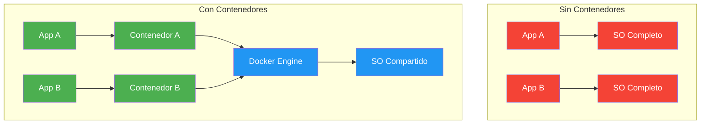
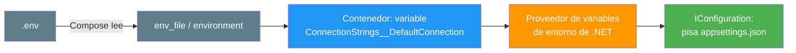

- [29. Docker y despliegue](#29-docker-y-despliegue)
  - [29.1. Conceptos fundamentales](#291-conceptos-fundamentales)
    - [29.1.1. Qué es un contenedor](#2911-qué-es-un-contenedor)
    - [29.1.2. Ventajas de los contenedores](#2912-ventajas-de-los-contenedores)
  - [29.2. Dockerfile](#292-dockerfile)
    - [29.2.1. Estructura del proyecto](#2921-estructura-del-proyecto)
    - [29.2.2. Dockerfile básico](#2922-dockerfile-básico)
    - [29.2.3. Explicación de instrucciones](#2923-explicación-de-instrucciones)
  - [29.3. Multi-Stage build](#293-multi-stage-build)
  - [29.4. Docker compose](#294-docker-compose)
    - [29.4.1. Docker-compose.yml completo](#2941-docker-composeyml-completo)
    - [29.4.2. Patrón de dos archivos](#2942-patrón-de-dos-archivos)
  - [29.5. Variables de entorno](#295-variables-de-entorno)
    - [29.5.1. El fichero .env](#2951-el-fichero-env)
    - [29.5.2. Las dos vías del docker-compose](#2952-las-dos-vías-del-docker-compose)
    - [29.5.3. El viaje hasta la aplicación](#2953-el-viaje-hasta-la-aplicación)
  - [29.6. Health Checks](#296-health-checks)
  - [29.7. Optimización de imágenes](#297-optimización-de-imágenes)
    - [29.7.1. Usar alpine Linux](#2971-usar-alpine-linux)
    - [29.7.2. .dockerignore](#2972-dockerignore)
    - [29.7.3. Excluir proyectos de test del build](#2973-excluir-proyectos-de-test-del-build)
  - [29.8. CI/CD con GitHub Actions](#298-cicd-con-github-actions)
  - [29.9. Buenas prácticas](#299-buenas-prácticas)
  - [29.10. Reto: despliega FunkoApp con Docker](#2910-reto-despliega-funkoapp-con-docker)


# 29. Docker y despliegue

> 💡 **Punto de partida:** ¿Recuerdas cuando instalabas un programa y decía "funciona en mi ordenador"? Docker resuelve ese problema: empaqueta tu aplicación con todo lo que necesita (runtime, librerías, configuración) y funciona igual en cualquier lugar. Es como un contenedor de carga pero para código.

En este punto aprenderás a crear Dockerfiles optimizados, usar Docker Compose para orquestar múltiples contenedores, implementar multi-stage builds y configurar CI/CD con GitHub Actions.

**Objetivos de aprendizaje:**
- Comprender que son los contenedores y por qué se usan
- Crear Dockerfiles para aplicaciones ASP.NET Core
- Implementar multi-stage builds para reducir tamaño de imágenes
- Usar Docker Compose para orquestar múltiples servicios
- Configurar variables de entorno y health checks
- Implementar CI/CD con GitHub Actions

## 29.1. Conceptos fundamentales

### 29.1.1. Qué es un contenedor

Un **contenedor** es una unidad de software que incluye todo lo necesario para ejecutar una aplicación: código, runtime, herramientas del sistema, librerías y configuraciones. A diferencia de las máquinas virtuales, los contenedores comparten el kernel del sistema operativo y son más ligeros.



📌 **Ejemplo real:** Spotify usa contenedores Docker para desplegar miles de microservicios. Cada servicio está empaquetado en su propio contenedor, lo que permite escalar solo los que necesitan más recursos.

### 29.1.2. Ventajas de los contenedores

| Aspecto | Beneficio |
|---------|-----------|
| **Consistencia** | Mismo entorno en desarrollo, testing y producción |
| **Portabilidad** | Funciona en cualquier sistema con Docker |
| **Aislamiento** | Cada aplicación tiene su propio contenedor |
| **Escalabilidad** | Fácil de escalar horizontalmente |
| **Velocidad** | Arrancan en segundos, no en minutos |
| **Eficiencia** | Usan menos recursos que máquinas virtuales |

## 29.2. Dockerfile

El **Dockerfile** es un archivo de texto que contiene instrucciones para construir una imagen Docker.

### 29.2.1. Estructura del proyecto

La estructura de un proyecto Docker incluye el `Dockerfile`, el `.dockerignore` y el `docker-compose.yml` para las dependencias externas.

```
ProductosApp/
├── src/
│   └── ProductosApp/
│       ├── Program.cs
│       └── ProductosApp.csproj
├── Dockerfile
├── .dockerignore
└── docker-compose.yml
```

### 29.2.2. Dockerfile básico

> 📝 **Nota:** Antes de construir la imagen, genera la carpeta `publish` con la aplicación compilada: `dotnet publish src/ProductosApp/ProductosApp.csproj -c Release -o publish`.

```dockerfile
FROM mcr.microsoft.com/dotnet/aspnet:10.0
WORKDIR /app
COPY ./publish .
EXPOSE 8080
ENV ASPNETCORE_URLS=http://+:8080
ENTRYPOINT ["dotnet", "ProductosApp.dll"]
```

> 📝 **Nota:** este ejemplo compila fuera (con `dotnet publish`) y solo copia el resultado. Si la compilación ocurre dentro de la imagen y el proyecto centraliza versiones con CPM (`Directory.Packages.props`, tema 26), la fase de build debe copiar ese fichero **antes** del `dotnet restore`; si falta, el restore revienta con **NU1015**, porque los `.csproj` no llevan `Version=` y el catálogo de versiones no está dentro de la imagen.

### 29.2.3. Explicación de instrucciones

| Instrucción | Propósito |
|-------------|-----------|
| `FROM` | Imagen base sobre la que construimos |
| `WORKDIR` | Directorio de trabajo dentro del contenedor |
| `COPY` | Copiar archivos del host al contenedor |
| `RUN` | Ejecutar comandos durante la construcción |
| `ENV` | Variables de entorno |
| `EXPOSE` | Puertos que expone el contenedor |
| `USER` | Usuario que ejecuta la aplicación |
| `ENTRYPOINT` | Comando que se ejecuta al iniciar |
| `HEALTHCHECK` | Verificación de salud del contenedor |

## 29.3. Multi-Stage build

El **multi-stage build** permite construir la aplicación en una etapa y copiar solo los archivos necesarios a una imagen final más pequeña.

```dockerfile
# ==================================================
# ETAPA 1: BUILD - Compilar la aplicacion
# ==================================================
FROM mcr.microsoft.com/dotnet/sdk:10.0 AS build
WORKDIR /src

# Restaurar dependencias
COPY ["ProductosApp/ProductosApp.csproj", "ProductosApp/"]
RUN dotnet restore "ProductosApp/ProductosApp.csproj"

# Copiar codigo fuente
COPY . .
WORKDIR "/src/ProductosApp"

# Construir
RUN dotnet build "ProductosApp.csproj" -c Release -o /app/build

# ==================================================
# ETAPA 2: PUBLISH
# ==================================================
FROM build AS publish
RUN dotnet publish "ProductosApp.csproj" -c Release -o /app/publish

# ==================================================
# ETAPA 3: RUNTIME - Imagen final
# ==================================================
FROM mcr.microsoft.com/dotnet/aspnet:10.0 AS final
WORKDIR /app

# Instalar curl para el healthcheck (las imágenes aspnet no lo incluyen)
RUN apt-get update \
    && apt-get install -y --no-install-recommends curl \
    && rm -rf /var/lib/apt/lists/*

# Usuario no-root para seguridad: la imagen aspnet:10.0 YA trae el usuario
# "app" (UID 1654). Ver advertencia debajo: no existe adduser/addgroup aquí.
COPY --from=publish --chown=app:app /app/publish .

USER app

EXPOSE 8080

ENV ASPNETCORE_URLS=http://+:8080
ENV ASPNETCORE_ENVIRONMENT=Production

HEALTHCHECK --interval=30s --timeout=3s --start-period=5s --retries=3 \
    CMD curl --fail http://localhost:8080/health || exit 1

ENTRYPOINT ["dotnet", "ProductosApp.dll"]
```

> ⚠️ **Advertencia — No uses `adduser`/`addgroup` en `aspnet:10.0`:** La imagen `mcr.microsoft.com/dotnet/aspnet:10.0` **no incluye** las utilidades `adduser` ni `addgroup` (si incluye `useradd`/`groupadd`, del paquete `passwd`), así que un `RUN adduser ...` **rompe el build**. Además ya trae de fábrica el usuario no-root **`app` con UID 1654** (`app:x:1654:1654::/home/app:/bin/sh`), por lo que basta con `USER app` y, si quieres los ficheros en propiedad del usuario, `COPY --chown=app:app` (evita además una capa extra de `RUN chown`).

📌 **Ejemplo real:** La imagen de Netflix Backend usa multi-stage builds. La etapa de build tiene el SDK completo (~800MB), pero la imagen final solo tiene el runtime (~200MB). Esto reduce el tiempo de despliegue y el ataque superficial de seguridad.

### Comparación de tamaños

| Tipo de Build | Tamaño Aproximado |
|---------------|-------------------|
| Single-stage con SDK | ~800 MB |
| Multi-stage con aspnet | ~200 MB |
| Multi-stage con alpine | ~150 MB |

> ⚠️ **Advertencia:** Usa siempre multi-stage builds en producción. Una imagen con el SDK incluido expone herramientas de desarrollo que no deberían estar en producción.

## 29.4. Docker compose

**Docker Compose** es una herramienta para definir y ejecutar aplicaciones Docker multi-contenedor usando un archivo YAML.

### 29.4.1. Docker-compose.yml completo

El `docker-compose.yml` levanta la aplicación con todas sus dependencias: base de datos, caché Redis y el servicio de la API en un solo comando.

```yaml
services:
  api:
    build:
      context: .
      dockerfile: Dockerfile
    container_name: productosapp
    ports:
      - "8080:8080"
    environment:
      - ASPNETCORE_ENVIRONMENT=Production
      - ConnectionStrings__DefaultConnection=Host=db;Port=5432;Database=productosdb;Username=postgres;Password=${DB_PASSWORD}
      - Jwt__Secret=${JWT_SECRET}
    depends_on:
      db:
        condition: service_healthy
    restart: unless-stopped
    networks:
      - productosapp-network
    healthcheck:
      test: ["CMD", "curl", "-f", "http://localhost:8080/health"]
      interval: 30s
      timeout: 3s
      retries: 3

  db:
    image: postgres:17-alpine
    container_name: productosapp-postgres
    environment:
      POSTGRES_DB: productosdb
      POSTGRES_USER: postgres
      POSTGRES_PASSWORD: ${DB_PASSWORD}
    ports:
      - "5432:5432"
    volumes:
      - postgres_data:/var/lib/postgresql/data
    healthcheck:
      test: ["CMD-SHELL", "pg_isready -U postgres"]
      interval: 10s
      timeout: 5s
      retries: 5
    restart: unless-stopped
    networks:
      - productosapp-network

volumes:
  postgres_data:

networks:
  productosapp-network:
    driver: bridge
```

### Comandos de Docker compose

| Comando | Descripción |
|---------|-------------|
| `docker compose up -d` | Iniciar todos los servicios en background |
| `docker compose down` | Detener todos los servicios |
| `docker compose logs -f api` | Ver logs de la API |
| `docker compose build api` | Reconstruir imagen de la API |
| `docker compose ps` | Ver estado de los servicios |

### 29.4.2. Patrón de dos archivos

En desarrollo es común separar la infraestructura de la API en dos archivos:

```yaml
# docker-compose.yml — Solo base de datos (para desarrollo local)
services:
  db:
    image: postgres:17-alpine
    ports:
      - "5432:5432"
    environment:
      POSTGRES_USER: admin
      POSTGRES_PASSWORD: admin123
      POSTGRES_DB: productosdb
```

```yaml
# docker-compose.api.yml — API + base de datos (para despliegue)
services:
  api:
    build: .
    ports:
      - "5000:8080"
    environment:
      - ConnectionStrings__DefaultConnection=Host=db;Port=5432;Database=productosdb;Username=postgres;Password=${DB_PASSWORD}
    depends_on:
      db:
        condition: service_healthy
  db:
    image: postgres:17-alpine
    ports:
      - "5433:5432"
    healthcheck:
      test: ["CMD-SHELL", "pg_isready -U postgres"]
      interval: 10s
      timeout: 5s
      retries: 5
```

```bash
# Desarrollo: solo BD
docker compose up -d

# Despliegue: API + BD
docker compose -f docker-compose.api.yml up -d
```

> 💡 **Consejo:** Mantén las versiones de imágenes consistentes en todos los compose. Ejemplo: `postgres:17-alpine`, `redis:7-alpine`.

## 29.5. Variables de entorno

Las variables de entorno permiten configurar la aplicación sin modificar el código: la misma imagen sirve para desarrollo, pruebas y producción, y lo único que cambia es lo que haya fuera. En Docker ese "fuera" se organiza en un fichero `.env`.

### 29.5.1. El fichero .env

El `.env` es un fichero de texto plano con una variable por línea, en formato `CLAVE=valor`, sin `export` y sin comillas. Vive en la raíz del proyecto, junto al `docker-compose.yml`.

```bash
# .env
DB_PASSWORD=Postgres123!
JWT_SECRET=mi-clave-secreta-produccion-muy-larga-y-segura-de-al-menos-32-caracteres
```

Nunca se sube al repositorio: el `.env` con las contraseñas va en el `.gitignore` desde el primer commit.

```gitignore
.env
.env.local
.env.*.local
secrets.json
```

> ⚠️ **Advertencia:** Si el `.env` llega a GitHub, borrarlo después no borra el historial: hay que sacarlo de todos los commits. Comparte los secretos por canales seguros, no por el repositorio.

> 📝 **Nota:** Este mismo `.env` se usa sin Docker: se carga a mano antes de `dotnet run` y la aplicación ni se entera. Ese circuito, con el comando para PowerShell y para bash, está en 9.1.4.

### 29.5.2. Las dos vías del docker-compose

Hay dos formas de que el `.env` entre en el compose, y las dos hacen cosas distintas. Es la confusión más habitual de esta parte:

| Vía | Dónde actúa | Para qué sirve |
|-----|-------------|----------------|
| `env_file` | Dentro del contenedor | Pasa las variables a la aplicación para que las lea en ejecución |
| `environment` con `${...}` | En el propio YAML del compose | Sustituir valores antes de arrancar nada: contraseñas dentro de cadenas, rutas, puertos |

```yaml
services:
  api:
    build: .
    env_file:
      - .env   # inyecta DB_PASSWORD y JWT_SECRET dentro del contenedor
    environment:
      - ASPNETCORE_ENVIRONMENT=Production
      - ConnectionStrings__DefaultConnection=Host=db;Database=productosdb;Password=${DB_PASSWORD}
```

Dos detalles que conviene tener claros antes de copiar el bloque:

- Si una clave aparece en las dos vías, gana `environment`.
- `${DB_PASSWORD}` lo resuelve **Compose**, no la aplicación: si la variable no está en el `.env`, la cadena queda con el hueco vacío y el error aparece mucho después, cuando la app intenta conectar.

La comprobación es de dos segundos:

```bash
# Lo que Compose ya ha resuelto: aquí se ve la cadena con la contraseña dentro
docker compose config

# Lo que el contenedor tiene realmente al otro lado
docker compose exec api printenv ConnectionStrings__DefaultConnection
```

### 29.5.3. El viaje hasta la aplicación

Dentro del contenedor no hay nada especial: una variable de entorno más, igual que la que definiste en la terminal de tu máquina. Desde ahí el viaje hasta el código es el mismo que en 9.1.4, con una sola diferencia: quien define la variable es Compose.



Y con eso el `.env` deja de ser un truco de Compose: es la última capa de configuración de la aplicación, la que manda sobre `appsettings.json` y sobre `appsettings.{Environment}.json`.

> 💡 **Consejo:** La jerarquía de la 9.1.2 no cambia: `appsettings.json` abajo, `appsettings.{Entorno}.json` encima y la variable de entorno arriba del todo. El `.env` no mueve nada de esa pila, solo es el sitio donde guardas lo que va en el piso superior.

## 29.6. Health Checks

Los health checks monitorizan la salud de la aplicación y permiten al orquestador tomar decisiones.

### Endpoint de salud en ASP.NET Core

```bash
# Paquete necesario para AddDbContextCheck
dotnet add package AspNetCore.HealthChecks.EntityFrameworkCore
```

```csharp
builder.Services.AddHealthChecks()
    .AddDbContextCheck<ProductosDbContext>("database")
    .AddRedis(
        builder.Configuration.GetConnectionString("Redis")!,
        "redis"
    );

app.MapHealthChecks("/health");
app.MapHealthChecks("/health/ready", new HealthCheckOptions
{
    Predicate = check => check.Tags.Contains("ready")
});
```

### Healthcheck en Dockerfile

```dockerfile
# Requiere curl instalado en la imagen (ver multi-stage build):
# RUN apt-get update && apt-get install -y --no-install-recommends curl && rm -rf /var/lib/apt/lists/*
HEALTHCHECK --interval=30s --timeout=3s --start-period=10s --retries=3 \
    CMD curl --fail http://localhost:8080/health || exit 1
```

> 💡 **Truco:** En imágenes **Alpine** no hay `curl` (ni `apt-get`). Alpine trae `wget` de BusyBox: `CMD wget --spider -q http://localhost:8080/health || exit 1`.

### Healthcheck en docker-compose.yml

```yaml
services:
  api:
    healthcheck:
      test: ["CMD", "curl", "-f", "http://localhost:8080/health"]
      interval: 30s
      timeout: 3s
      retries: 3
      start_period: 10s
```

## 29.7. Optimización de imágenes

### 29.7.1. Usar alpine Linux

Las imágenes Alpine son mucho más ligeras que las estándar de Debian, lo que reduce el tamaño final de la imagen y el tiempo de descarga.

```dockerfile
# Imagenes Alpine son mas ligeras
FROM mcr.microsoft.com/dotnet/sdk:10.0-alpine AS build
FROM mcr.microsoft.com/dotnet/aspnet:10.0-alpine AS final
```

> ⚠️ **Advertencia:** Las imágenes Alpine **no incluyen `curl`**. Usa `wget` (de BusyBox) en el healthcheck:

```dockerfile
HEALTHCHECK --interval=30s --timeout=3s --start-period=10s --retries=3 \
    CMD wget --spider -q http://localhost:8080/health || exit 1
```

### 29.7.2. .dockerignore

El `.dockerignore` excluye ficheros del contexto de construcción (carpetas `bin`, `obj`, `.git`) para que la imagen no los lleve dentro.

```
.git
.gitignore
.vs
.vscode
*.suo
*.user
bin/
obj/
out/
**/*.md
**/Dockerfile*
**/docker-compose*
.env
.secrets
```

> 💡 **Consejo:** El `.dockerignore` es como el `.gitignore` pero para Docker. Excluye archivos innecesarios para reducir el tamaño de la imagen y mejorar la seguridad.

### 29.7.3. Excluir proyectos de test del build

Un repositorio completo tiene proyectos de test (`*.Tests.csproj`, `*.Test.csproj`). El Dockerfile de producción **no debería compilarlos**: solo necesitas la app, no las pruebas.

📌 **Ejemplo real:** Una tienda tiene la API, los tests unitarios y los tests E2E en el mismo repositorio. Si el Dockerfile copia todo y ejecuta `dotnet build`, el contenedor tarda el doble y pesa el doble. Con la exclusión correcta, el build solo compila lo que se despliega.

**Cómo excluirlos:**

```dockerfile
# Copiar solo los .csproj de PRODUCCIÓN
COPY ["MiApi/MiApi.csproj", "MiApi/"]
COPY ["MiApi.Shared/MiApi.Shared.csproj", "MiApi.Shared/"]
# ❌ NO copiar MiApi.Tests/MiApi.Tests.csproj

RUN dotnet restore "MiApi/MiApi.csproj"
```

**O usar un patrón amplio:**

```dockerfile
# Copiar todos los .csproj EXCEPTO los de test
COPY ["MiApi*/MiApi*.csproj", "MiApi/"]
# O mejor: listar uno a uno los que sí necesitas
```

**Y en `.dockerignore`:**

```
# Excluir carpetas de test del contexto de Docker
**/bin/
**/obj/
**/*Tests*/
**/*Test/
```

> ⚠️ **Advertencia:** No excluir los tests del build de producción es una mala práctica: la imagen de contenedor no necesita los binarios de pruebas, y copiarlos alarga el build sin aportar nada.

> 📝 **Nota:** Si usas CPM, recuerda copiar `Directory.Packages.props` antes de los `.csproj` (ver punto 20.5 de UD03).
## 29.8. CI/CD con GitHub Actions

CI/CD (Continuous Integration / Continuous Deployment) automatiza el build, test y deploy de tu aplicación.

### Workflow completo

```yaml
name: CI/CD Pipeline

on:
  push:
    branches: [main, develop]
  pull_request:
    branches: [main]

env:
  REGISTRY: ghcr.io
  IMAGE_NAME: ${{ github.repository }}
  DOTNET_VERSION: '10.0.x'

jobs:
  build:
    name: Build
    runs-on: ubuntu-latest

    steps:
      - name: Checkout code
        uses: actions/checkout@v4

      - name: Setup .NET
        uses: actions/setup-dotnet@v4
        with:
          dotnet-version: ${{ env.DOTNET_VERSION }}

      - name: Restore dependencies
        run: dotnet restore

      - name: Build
        run: dotnet build --configuration Release --no-restore

  test:
    name: Test
    needs: build
    runs-on: ubuntu-latest

    services:
      postgres:
        image: postgres:17-alpine
        env:
          POSTGRES_USER: postgres
          POSTGRES_PASSWORD: postgres
          POSTGRES_DB: productosdb
        ports:
          - 5432:5432

    steps:
      - name: Checkout code
        uses: actions/checkout@v4

      - name: Setup .NET
        uses: actions/setup-dotnet@v4
        with:
          dotnet-version: ${{ env.DOTNET_VERSION }}

      - name: Run tests
        run: |
          dotnet test \
            --configuration Release \
            --collect:"XPlat Code Coverage"

  push:
    name: Build and push Docker image
    needs: test
    if: github.event_name == 'push'
    runs-on: ubuntu-latest

    steps:
      - name: Checkout code
        uses: actions/checkout@v4

      - name: Set up Docker Buildx
        uses: docker/setup-buildx-action@v3

      - name: Log in to Container Registry
        uses: docker/login-action@v3
        with:
          registry: ${{ env.REGISTRY }}
          username: ${{ github.actor }}
          password: ${{ secrets.GITHUB_TOKEN }}

      - name: Build and push Docker image
        uses: docker/build-push-action@v5
        with:
          context: .
          push: true
          tags: |
            type=raw,value=latest,enable={{is_default_branch}}
            type=ref,event=branch
```

📌 **Ejemplo real:** Spotify ejecuta más de 50,000 tests en cada pull request usando pipelines CI/CD similares. Si algún test falla, el PR no se puede merge.

## 29.9. Buenas prácticas

| Práctica | Descripción |
|----------|-------------|
| **Multi-stage builds** | Reducir tamaño de imagen final |
| **Usuario no-root** | Seguridad en el contenedor |
| **Variables de entorno** | Para secretos, nunca hardcodear |
| **Health checks** | Para monitorización y orquestación |
| **.dockerignore** | Excluir archivos innecesarios |
| **Cache de layers** | En CI/CD para acelerar builds |
| **Imágenes Alpine** | Para reducir tamaño |
| **Persistencia de datos** | Usar volumes para bases de datos |
| **Redes aisladas** | Para seguridad entre contenedores |
| **CI/CD automatizado** | Para builds y deploys consistentes |

> ⚠️ **Advertencia:** Nunca guardes secretos en el Dockerfile o en el código fuente. Usa variables de entorno o archivos .env que nunca se suban al repositorio.

## 29.10. Reto: despliega FunkoApp con Docker

> Antes de irte, despliega tu API de Funkos completamente con Docker.

### Contexto

Tu API de Funkos necesita ser desplegable en cualquier entorno usando contenedores Docker.

### Ejercicio

1. Crea un `Dockerfile` optimizado con multi-stage build
2. Crea un `docker-compose.yml` con API + PostgreSQL
3. Configura variables de entorno para secretos
4. Implementa health checks en el contenedor
5. Configura persistencia de datos con volumes
6. Crea un workflow básico de CI/CD con GitHub Actions

### Archivos esperados

```
FunkoApp/
├── Dockerfile
├── docker-compose.yml
├── .env
├── .dockerignore
└── .github/workflows/
    └── ci-cd.yml
```

> 💡 **Consejo:** Prueba primero con `docker compose up -d` para verificar que todo funciona. Luego configura el CI/CD para automatizar el proceso.

---

**Resumen del punto:**

| Concepto | Descripción |
|----------|-------------|
| **Contenedor** | Unidad de software portable con todas las dependencias |
| **Imagen Docker** | Plantilla de solo lectura para crear contenedores |
| **Dockerfile** | Instrucciones para construir una imagen |
| **Multi-stage** | Construir en etapas para reducir tamaño final |
| **Docker Compose** | Orquestar múltiples contenedores |
| **Variables de entorno** | Configurar la aplicación sin modificar el código |
| **Health Check** | Verificación de salud del contenedor |
| **CI/CD** | Automatización de build, test y deploy |
| **GitHub Actions** | Plataforma de CI/CD integrada en GitHub |
| **Alpine Linux** | Imágenes más ligeras para producción |

**¿Qué viene después?**

En la siguiente unidad veremos **Clean Architecture**: cómo organizar una aplicación ASP.NET Core en capas (Domain, Application, Infrastructure, Presentation) siguiendo principios SOLID y patrones de diseño.
