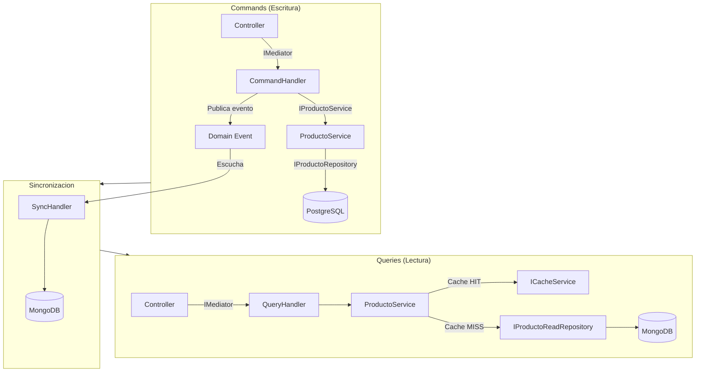

# 23 - Productos CQRS (MediatR + PostgreSQL + MongoDB)

API REST con **CQRS** usando MediatR: PostgreSQL para escrituras y MongoDB para lecturas, sincronizados con **Domain Events**.

## Descripción

- Commands → PostgreSQL (escritura normalizada)
- Queries → MongoDB (lectura denormalizada) + caché
- Sync → Domain Events (`SyncProductoHandler`) PostgreSQL → MongoDB
- Dev: `MemoryCache`; admin `admin@admin.com` / `Admin123!`
- Infra: PostgreSQL (`productos_cqrs`) + MongoDB + Redis

> ⚠️ **Advertencia:** Puertos host de postgres/mongo/redis publicados en `docker-compose.yml`; `appsettings.Development.json` apunta a `productos_cqrs`.

## Arquitectura CQRS



| Problema | Solución CQRS |
|----------|---------------|
| Lecturas y escrituras con necesidades distintas | Modelos separados |
| JOINs costosos en lectura | MongoDB denormalizado |
| Caché obsoleto tras escritura | Invalidación en el servicio |
| Mismo ORM para todo | EF Core (escritura) + MongoDB.Driver (lectura) |

## Ejecución manual

```bash
# 1. Infra (PostgreSQL + MongoDB + Redis)
docker compose up -d

# 2. API
dotnet run --project ProductosTest
```

Escucha en `http://localhost:5110`.

## Pruebas automatizadas (runner)

```bash
node automation/test-runner.mjs
```

Node.js nativo: infra → restore/build/run → polling (`/swagger`, `/`, `/api/Productos`) ≤20 s → **13 tests** → limpieza.

- `exit 0` → todos OK · `exit 1` → detalle del fallo

### Verificación CQRS en el runner

El ciclo completo de sincronización se comprueba en los tests:

| Flujo | Test | Qué verifica |
|-------|------|--------------|
| **Create** | `POST → 200` + `GET tras POST → 200` | El evento `ProductoCreado` sincronizó a MongoDB y el `GET` (lectura) lo ve |
| **Update** | `PUT → 200` + `GET tras PUT → 200 con datos actualizados` | El evento `ProductoActualizado` propagó nombre/precio nuevos al read model |
| **Delete** | `DELETE → 204` + `GET tras DELETE → 404` | El evento `ProductoEliminado` borró el documento de MongoDB (ya no se ve) |

## Tests unitarios

```bash
dotnet test
```

## Endpoints

### Auth — `/api/Auth`

| Método | Ruta | Auth | Cuerpo | Éxito | Errores |
|--------|------|------|--------|-------|---------|
| POST | `/api/Auth/login` | no | `{ email, password }` | `200` `{ token }` | `401` |
| POST | `/api/Auth/signup` | no | `{ email, password, nombre, apellidos }` | `200` `{ token }` | `400`/`409` |
| GET | `/api/Auth/me` | **Bearer** | — | `200` | `401` |

### Productos — `/api/Productos`

| Método | Ruta | Auth | BD | Cuerpo | Éxito | Errores |
|--------|------|------|----|--------|-------|---------|
| GET | `/api/Productos` | público | MongoDB | ( | `200` | ) |
| GET | `/api/Productos/{id}` | público | MongoDB | — | `200` | `404` |
| POST | `/api/Productos` | **ADMIN** | PostgreSQL | `{ nombre, precio, categoriaId }` | `200` (NO 201) | `401`, `400` |
| PUT | `/api/Productos/{id}` | **ADMIN, USER** | PostgreSQL | `UpdateProductoDto` | `200` | `401`, `404` |
| DELETE | `/api/Productos/{id}` | **ADMIN** | PostgreSQL | — | `204` | `401`, `404` |
| POST | `/api/Productos/imagen` | **ADMIN** | PostgreSQL | `multipart/form-data` | `200` | `401`, `400` |
| PATCH | `/api/Productos/{id}/imagen` | **ADMIN** | PostgreSQL | `multipart/form-data` | `200` | `401`, `404` |

📌 Ejemplo real: `POST /api/Productos` crea en PostgreSQL y, vía Domain Event, sincroniza **síncrono** a MongoDB; el `GET` posterior lee de MongoDB (o caché).

> 📝 **Nota:** No existe `GET /api/Productos/search` en CQRS → `404`.

## Tecnologías

| Capa | Tecnología |
|------|------------|
| API | .NET 10, C# 14, ASP.NET Core |
| CQRS | MediatR (Commands + Queries + Domain Events) |
| Escritura | EF Core + PostgreSQL |
| Lectura | MongoDB.Driver + MongoDB.EntityFrameworkCore |
| Cache | MemoryCache (dev) / Redis (prod) |
| Auth | Identity + JWT (ADMIN/USER) |
| Storage | FileSystemStorageService |
| Funcional | CSharpFunctionalExtensions (Result pattern) |

## Docker

```bash
docker compose up -d
docker compose -f docker-compose.api.yml up -d --build
docker compose down -v
```

## Estructura

```
23-ProductosCQRS/
├── ProductosEFCore.slnx
├── docker-compose.yml / docker-compose.api.yml / Dockerfile
├── ProductosTest/
│   ├── Features/Productos/{Commands,Queries,Sync}/
│   ├── Controllers/ (Auth, Productos)
│   ├── Repositories/ (PostgreSQL + MongoDB)
│   ├── Cache/ Storage/ wwwroot/
│   └── Program.cs
├── ProductosTest.Test/
├── automation/test-runner.mjs
└── README.md
```

## Paquetes NuGet

- MediatR, MongoDB.EntityFrameworkCore, EF Core + PostgreSQL
- Identity/JWT, Serilog, Swashbuckle, CSharpFunctionalExtensions
