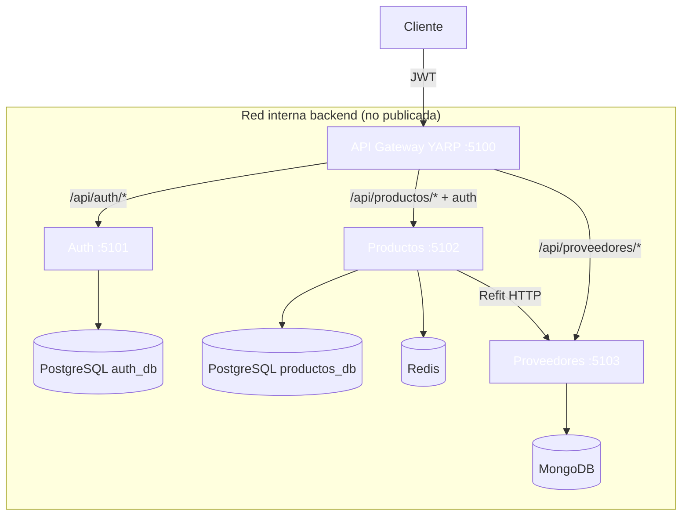

# 24 - API Gateway (YARP + Microservicios)

API Gateway con **YARP** y 3 microservicios: **Auth**, **Productos** y **Proveedores**.

## Descripción

Punto único de entrada en `http://localhost:5100`:

| Servicio | Puerto | BD | Publicado fuera de Docker |
|----------|--------|-----|---------------------------|
| ApiGateway (YARP) | 5100 | — | ✅ **Sí** (`5100:5100`) |
| AuthMicroService | 5101 | PostgreSQL `auth_db` | ❌ No (solo red interna) |
| ProductosMicroService | 5102 | PostgreSQL `productos_db` + Redis | ❌ No (solo red interna) |
| ProveedoresMicroService | 5103 | MongoDB `proveedores_db` | ❌ No (solo red interna) |

- Gateway valida JWT en `/api/productos/*` (política `authenticated`)
- Productos exige rol **ADMIN** en escrituras (misma clave JWT que Auth)
- Seed: admin `admin@admin.com` / `Admin123!`, 3 categorías, 4 proveedores

> 💡 **Aislamiento de microservicios:** en `docker-compose.yml` los micros **no declaran `ports`**, solo el gateway publica `5100`. Los microservicios se hablan entre sí (y con el gateway) por la red bridge `backend` usando los DNS de Docker (`auth-microservice:5101`, etc.). Así un atacante solo ve el gateway; los puertos 5101–5103 no existen fuera del contenedor.
> En el **modo runner/CLI** los 4 procesos corren en el host con `localhost:5101-5103` (necesario para que YARP local los alcance), por lo que ahí sí son accesibles en local — el aislamiento aplica al despliegue Docker.

## Arquitectura



📌 Ejemplo real: Netflix/Glovo usan un gateway similar para centralizar auth, rate limit y enrutado sin que el cliente conozca los microservicios internos.

## Ejecución manual

```bash
# 1. Solo infra (BDs)
docker compose up -d postgres mongo redis

# 2. Cuatro terminales (o el runner)
dotnet run --project AuthMicroService --no-launch-profile
dotnet run --project ProductosMicroService --no-launch-profile
dotnet run --project ProveedoresMicroService --no-launch-profile
dotnet run --project ApiGateway --no-launch-profile
```

> ⚠️ **Advertencia:** `--no-launch-profile` para respetar los puertos 5100–5103 (`ASPNETCORE_URLS`).  
> ⚠️ **Advertencia:** Crear `productos_db` si no existe: `docker compose exec postgres psql -U admin -d postgres -c "CREATE DATABASE productos_db;"`

## Pruebas automatizadas (runner)

```bash
node automation/test-runner.mjs
```

Node.js nativo: infra → `CREATE productos_db` → restore/build → **4 procesos** (Auth, Productos, Proveedores, Gateway) → polling gateway ≤30 s → **13 tests** → limpieza.

- Overrides YARP a `localhost:5101-5103` vía env (`ReverseProxy__Clusters__…`)
- `exit 0` → todos OK · `exit 1` → detalle del fallo

## Tests unitarios

```bash
dotnet test
```

## Endpoints (vía gateway `:5100`)

### Auth — `/api/Auth`

| Método | Ruta | Auth | Cuerpo | Éxito | Errores |
|--------|------|------|--------|-------|---------|
| POST | `/api/Auth/register` | no | `{ email, password, nombre, apellidos }` | `200` `{ token, rol }` | `400` (duplicado) |
| POST | `/api/Auth/login` | no | `{ email, password }` | `200` `{ token, rol }` | `401` |

### Productos — `/api/Productos` (JWT en gateway)

| Método | Ruta | Auth | Cuerpo | Éxito | Errores |
|--------|------|------|--------|-------|---------|
| GET | `/api/Productos` | **Bearer** (Gateway) | — | `200` array | `401` |
| GET | `/api/Productos/{id}` | Bearer | — | `200` | `404` |
| POST | `/api/Productos` | **ADMIN** | `{ nombre, precio, categoriaId, proveedorId }` | `201` + `Location` | `401`, `403`, `400` |
| PUT | `/api/Productos/{id}` | **ADMIN** | `UpdateProductoDto` | `200` | `401`, `403`, `404` |
| DELETE | `/api/Productos/{id}` | **ADMIN** | — | `204` | `401`, `403`, `404` |

> 📝 **Nota:** `proveedorId` es **string** (ObjectId de Mongo). La validación remota usa Refit → Proveedores.

### Proveedores — `/api/proveedores` (solo lectura)

| Método | Ruta | Auth | Éxito | Errores |
|--------|------|------|-------|---------|
| GET | `/api/proveedores` | no | `200` array (semilla 4) | — |
| GET | `/api/proveedores/{id}` | no | `200` | `404` |

## Comunicación entre microservicios

- **Refit** (`IProveedorApi`): Productos valida/exhibe proveedor vía HTTP a `:5103` (en Docker: `proveedores-microservice:5103`, red interna)
- **JWT compartido**: misma Key/Issuer/Audience en Auth, Productos y Gateway
- **Redis**: caché de listas/productos/proveedores con invalidación en escrituras

## Docker

```bash
docker compose up -d                 # BDs + 4 servicios (solo gateway publica :5100)
docker compose down -v
```

Solo el gateway es accesible desde el host (`http://localhost:5100`); los micros viven en la red interna `backend`.

## Estructura

```
24-ApiGateway/
├── ApiGateway.slnx
├── docker-compose.yml
├── ApiGateway/           # YARP + JWT + Swagger (:5100, único publicado)
├── AuthMicroService/     # Identity + JWT + PostgreSQL (interno :5101)
├── ProductosMicroService/# EF + Redis + Refit + JWT roles (interno :5102)
├── ProveedoresMicroService/ # MongoDB + seed (interno :5103)
├── automation/test-runner.mjs
└── README.md
```

## Patrones

- **ROP**: `Result<T, DomainError>` en Auth y Productos
- **Infrastructure Config**: `AddDatabase` / `AddRepositories` / `AddServices`
- **YARP**: routes + clusters en `appsettings.json`
- **Primary constructors** en servicios y repositorios

## Paquetes NuGet

- YARP, JwtBearer, Identity.EntityFrameworkCore
- EF Core + Npgsql, MongoDB.EntityFrameworkCore
- Refit + Refit.Reflection, StackExchange.Redis
- CSharpFunctionalExtensions, Serilog, Swashbuckle
