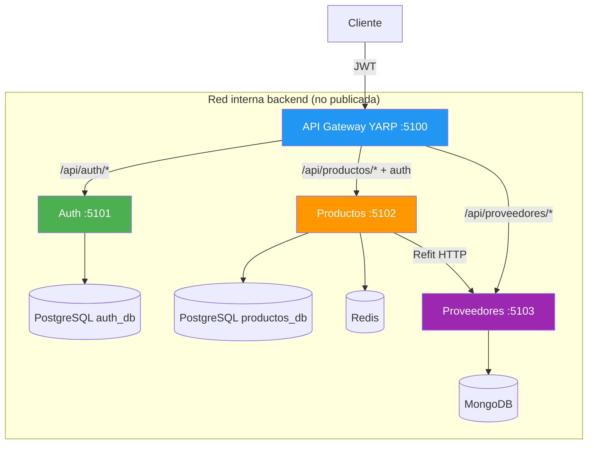

# 24 - API Gateway (YARP + Microservicios)

API Gateway con **YARP** y 3 microservicios: **Auth**, **Productos** y **Proveedores**.

## Puesta en marcha en 3 pasos

1. **Infraestructura** (solo la primera vez): `docker compose up -d postgres mongo redis`
2. **Arranca los cuatro proyectos** en Rider con el perfil `http` (o en terminal con `dotnet run --project <proyecto>`), en este orden: Proveedores (5103) → Auth (5101) → Productos (5102) → ApiGateway (5100)
3. **Comprueba** en `http://localhost:5100/api/proveedores`: tienes que ver los 4 proveedores de ejemplo. Para `/api/productos` hace falta token: `POST /api/Auth/login` con `admin@admin.com` / `Admin123!`

Eso es todo. No hay que crear bases a mano, ni tocar puertos, ni exportar variables de entorno: los `launchSettings.json` ya traen los puertos 5100–5103, `productos_db` la crea PostgreSQL sola al arrancar y las semillas (admin, 3 categorías, 6 productos, 4 proveedores) se crean en el primer arranque.

Para ver el sistema entero respondiendo de golpe:

```bash
node automation/test-runner.mjs
```

Termina con `Total: 13 · OK: 13 · KO: 0` y, debajo de cada test, el status y el cuerpo que la API ha devuelto.

> ⚠️ **Advertencia:** los cuatro proyectos usan puertos fijos (5100–5103). Si alguno no arranca, es que quedó un proceso de la sesión anterior ocupándolo; ciérralo antes de volver a darle a Play.

## Descripción

Punto único de entrada en `http://localhost:5100`:

| Servicio | Puerto | BD | Publicado fuera de Docker |
|----------|--------|-----|---------------------------|
| ApiGateway (YARP) | 5100 | — | ✅ **Sí** (`5100:5100`) |
| AuthMicroService | 5101 | PostgreSQL `auth_db` | ❌ No (solo red interna) |
| ProductosMicroService | 5102 | PostgreSQL `productos_db` + Redis | ❌ No (solo red interna) |
| ProveedoresMicroService | 5103 | MongoDB `proveedores_db` | ❌ No (solo red interna) |

- Gateway valida JWT en `/api/productos/*` (política `authenticated`)
- Productos exige rol **ADMIN** en escrituras (misma clave JWT que Auth)
- Semillas automáticas: admin `admin@admin.com` / `Admin123!`, 3 categorías, **6 productos de ejemplo**, 4 proveedores

| Base de datos | Contenedor | Puerto en el host |
|---------------|------------|-------------------|
| PostgreSQL 17 | `postgres` | **5440** (5432 dentro) |
| MongoDB 7 | `mongo` | **27020** (27017 dentro) |
| Redis 7 | `redis` | **6390** (6379 dentro) |

Las conexiones de los micros ya traen ese puerto en `appsettings.json` (`Port=5440`), así que no hay que tocar nada para arrancar en local.

> 💡 **Aislamiento de microservicios:** en `docker-compose.yml` los micros **no declaran `ports`**, solo el gateway publica `5100`. Los microservicios se hablan entre sí (y con el gateway) por la red bridge `backend` usando los DNS de Docker (`auth-microservice:5101`, etc.). Así un atacante solo ve el gateway; los puertos 5101–5103 no existen fuera del contenedor.
> En el **modo runner/CLI** los 4 procesos corren en el host con `localhost:5101-5103` (necesario para que YARP local los alcance), por lo que ahí sí son accesibles en local — el aislamiento aplica al despliegue Docker.

## Arquitectura



📌 Ejemplo real: Netflix/Glovo usan un gateway similar para centralizar auth, rate limit y enrutado sin que el cliente conozca los microservicios internos.

## Ejecución manual (Rider o terminal)

```bash
# 1. Infraestructura (PostgreSQL, MongoDB, Redis)
docker compose up -d postgres mongo redis

# 2. Los cuatro servicios, en este orden, cada uno en su terminal
dotnet run --project ProveedoresMicroService   # :5103
dotnet run --project AuthMicroService          # :5101
dotnet run --project ProductosMicroService     # :5102
dotnet run --project ApiGateway                # :5100
```

En **Rider** basta con elegir el perfil `http` en cada uno de los cuatro proyectos (los `launchSettings.json` ya fijan los puertos 5100–5103 y `Development`) y pulsar Play en ese mismo orden.

> 💡 **Consejo:** el orden no es caprichoso. Al arrancar, Productos pide un proveedor real a Proveedores para sembrar sus 6 productos de ejemplo; si Proveedores todavía no está listo, reintenta 10 veces (1 s cada una) y, si sigue sin responder, usa un ObjectId fijo para no bloquear el arranque.

> 📝 **Nota:** no hay que crear ninguna base a mano. `productos_db` la crea `postgres-init.sql` la primera vez que levanta el volumen; si el volumen es de antes, la crea el runner al detectar que falta.

### Probar desde Bruno (o cualquier cliente)

Todo pasa por el gateway, nunca por los micros:

- Base URL: `http://localhost:5100`
- `POST /api/Auth/login` con `{"email":"admin@admin.com","password":"Admin123!"}` → copia el `token` del JSON
- Cabecera `Authorization: Bearer <token>` para todo lo que sea `/api/productos`
- `GET /api/proveedores` no necesita token

> ⚠️ **Advertencia:** la cabecera `Location` que devuelve `POST /api/productos` apunta al microservicio (`:5102`), no al gateway. Para seguir el recorrido en Bruno, usa siempre `http://localhost:5100/api/productos/{id}`.

## Pruebas automatizadas (runner)

```bash
node automation/test-runner.mjs
```

Node.js nativo, sin dependencias. Lo que hace, en orden:

1. `docker compose up -d postgres mongo redis` y espera a que Postgres acepte conexiones de verdad (`pg_isready`), no con esperas fijas
2. Crea `productos_db` solo si falta (idempotente; en volúmenes nuevos ya la crea `postgres-init.sql`)
3. `dotnet restore` + `dotnet build` sobre `ApiGateway.slnx`
4. Arranca los 4 procesos con `ASPNETCORE_URLS` a 5100–5103 y los overrides YARP a `localhost`
5. Espera a que respondan **los cuatro** (gateway + Auth + Productos + Proveedores); si alguno ha muerto, no lanza la suite en falso
6. **13 tests** HTTP contra `http://localhost:5100`, y debajo de cada uno imprime el status y el cuerpo real que la API ha devuelto
7. Para los 4 procesos y **deja la infraestructura levantada**, para que sigas en modo desarrollo después

- `exit 0` → `Total: 13 · OK: 13 · KO: 0`
- `exit 1` → en el detalle del test fallido ves el cuerpo de la respuesta, no solo el status
- Reiniciar la BD de cero: `docker compose down -v`

## Tests unitarios

```bash
dotnet test
```

## Endpoints (vía gateway `:5100`)

### Auth — `/api/Auth`

| Método | Ruta | Auth | Cuerpo | Éxito | Errores |
|--------|------|------|--------|-------|---------|
| POST | `/api/Auth/register` | no | `{ email, password, nombre, apellidos }` | `200` `{ token, rol }` | `400` (duplicado) |
| POST | `/api/Auth/login` | no | `{ email, password }` | `200` `{ token, rol }` | `401` |

### Productos — `/api/Productos` (JWT en gateway)

| Método | Ruta | Auth | Cuerpo | Éxito | Errores |
|--------|------|------|--------|-------|---------|
| GET | `/api/Productos` | **Bearer** (Gateway) | — | `200` array | `401` |
| GET | `/api/Productos/{id}` | Bearer | — | `200` | `404` |
| POST | `/api/Productos` | **ADMIN** | `{ nombre, precio, categoriaId, proveedorId }` | `201` + `Location` | `401`, `403`, `400` |
| PUT | `/api/Productos/{id}` | **ADMIN** | `UpdateProductoDto` | `200` | `401`, `403`, `404` |
| DELETE | `/api/Productos/{id}` | **ADMIN** | — | `204` | `401`, `403`, `404` |

> 📝 **Nota:** `proveedorId` es **string** (ObjectId de Mongo). La validación remota usa Refit → Proveedores.

### Proveedores — `/api/proveedores` (solo lectura)

| Método | Ruta | Auth | Éxito | Errores |
|--------|------|------|-------|---------|
| GET | `/api/proveedores` | no | `200` array (semilla 4) | — |
| GET | `/api/proveedores/{id}` | no | `200` | `404` |

## Comunicación entre microservicios

- **Refit** (`IProveedorApi`): Productos valida/exhibe proveedor vía HTTP a `:5103` (en Docker: `proveedores-microservice:5103`, red interna)
- **JWT compartido**: misma Key/Issuer/Audience en Auth, Productos y Gateway
- **Redis**: caché de listas/productos/proveedores con invalidación en escrituras

## Docker

```bash
docker compose up -d                 # BDs + 4 servicios (solo gateway publica :5100)
docker compose down -v               # parar y borrar datos (reinicio total)
```

Solo el gateway es accesible desde el host (`http://localhost:5100`); los micros viven en la red interna `backend`. En Docker, los puertos de las bases son los del mapa de arriba (5440 / 27020 / 6390) y los micros se reconfiguran por variables de entorno del propio compose.

## Estructura

```
24-ApiGateway/
├── ApiGateway.slnx
├── docker-compose.yml
├── postgres-init.sql     # crea productos_db en el primer arranque
├── ApiGateway/           # YARP + JWT + Swagger (:5100, único publicado)
├── AuthMicroService/     # Identity + JWT + PostgreSQL (interno :5101)
├── ProductosMicroService/# EF + Redis + Refit + JWT roles (interno :5102)
├── ProveedoresMicroService/ # MongoDB + seed (interno :5103)
├── automation/test-runner.mjs
└── README.md
```

## Patrones

- **ROP**: `Result<T, DomainError>` en Auth y Productos
- **Infrastructure Config**: `AddDatabase` / `AddRepositories` / `AddServices`
- **YARP**: routes + clusters en `appsettings.json`
- **Primary constructors** en servicios y repositorios

## Paquetes NuGet

- YARP, JwtBearer, Identity.EntityFrameworkCore
- EF Core + Npgsql, MongoDB.EntityFrameworkCore
- Refit + Refit.Reflection, StackExchange.Redis
- CSharpFunctionalExtensions, Serilog, Swashbuckle
